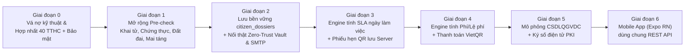
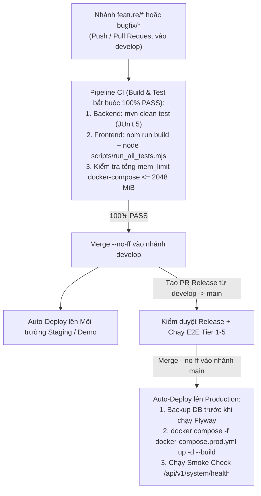

# ĐẶC TẢ HIỆN TRẠNG HỆ THỐNG & LỘ TRÌNH PHÁT TRIỂN TRIỂN KHAI PRODUCTION (SMARTWARD AI)

> **Tài liệu kỹ thuật phục vụ Chương "Đánh giá hiện trạng & Hướng phát triển" — Báo cáo Học kỳ Doanh nghiệp**
> - **Dự án:** Hệ thống Hành chính công & Đô thị thông minh cấp Xã/Phường ứng dụng Trí tuệ Nhân tạo (`SmartWard AI` — Tỉnh An Giang, 96 đơn vị hành chính cấp xã/phường/đặc khu)
> - **Phương pháp rà soát:** Kiểm toán mã nguồn tĩnh (Static Code Audit) trực tiếp trên toàn bộ repository tại `e:\SmartWardAI` (`backend/` Spring Boot 3.3.5 Java 21, `frontend/` React 18 + TypeScript + Vite, `ml/sidecar/` FastAPI + PhoBERT ONNX INT8, `docker-compose.yml`, và 4 bản Flyway Migration `V1`–`V4`). Mọi nhận định và số liệu dưới đây đều trích dẫn trực tiếp tên file và số dòng thực tế trong mã nguồn.

---

## PHẦN 1 — ĐẶC TẢ HIỆN TRẠNG HỆ THỐNG (SYSTEM SPEC AS-IS)

### 1.1. Kiến trúc Container Docker & Phân bổ Ngân sách Bộ nhớ (`docker-compose.yml`)

Toàn bộ hệ thống được đóng gói trong **6 container Docker** kết nối qua mạng nội bộ bridge `smartward-net` (`docker-compose.yml`, dòng 173–177) với tổng giới hạn bộ nhớ cứng (**Hard Memory Limit**) đúng bằng **`2048 MiB`** (tuân thủ quy chuẩn tại `AGENTS.md` mục 2):

| STT | Tên Service (`container_name`) | Image / Nguồn Build | Cổng (Host:Container) | Giới hạn RAM (`mem_limit`) | Vai trò thực tế & Cơ chế Healthcheck (`docker-compose.yml`) |
| :-: | :--- | :--- | :---: | :---: | :--- |
| 1 | **`postgres`** (`smartward-postgres`) | `pgvector/pgvector:pg16` (dòng 20) | `5432:5432` | **`448m`** (dòng 23) | Lưu trữ 7 bảng CSDL quan hệ + tìm kiếm tương đồng vector HNSW 768 chiều (`pgvector`). Healthcheck bằng `pg_isready` mỗi `10s` (dòng 32–36). |
| 2 | **`redis`** (`smartward-redis`) | `redis:7-alpine` (dòng 43) | `6379:6379` | **`128m`** (dòng 45) | Cấu hình `--maxmemory 100mb --maxmemory-policy volatile-lru` (dòng 46). Phục vụ 4 tác vụ: Semantic Query Cache (`QueryCacheService`), Spatial Index `GEOADD/GEOSEARCH` bán kính `R = 25m` (`TwoStageTriageService`), One-Time Token `GETDEL` cho Zero-Trust Vault (`ZeroTrustVaultService`), và dữ liệu tạm. |
| 3 | **`minio`** (`smartward-minio`) | `minio/minio:latest` (dòng 63) | `9000:9000` `9001:9001` | **`256m`** (dòng 65) | Lưu trữ đối tượng (Object Storage) tương thích chuẩn S3 cho bucket `smartward-vault`, chứa các bản chụp giấy tờ công dân đã đóng dấu mờ động (Dynamic Watermark) và mã hóa `AES-256-GCM`. |
| 4 | **`ai-sidecar`** (`smartward-ai-sidecar`) | `./ml/sidecar/Dockerfile` (dòng 87–89) | `8000:8000` | **`384m`** (dòng 90) | Microservice Python FastAPI chạy mô hình ngôn ngữ tiếng Việt `vinai/phobert-base-v2` lượng tử hóa `ONNX INT8` (`OMP_NUM_THREADS=2`, dòng 94) để sinh vector nhúng 768 chiều và phân tích độ nét ảnh (Laplacian Variance). |
| 5 | **`backend`** (`smartward-backend`) | `./backend/Dockerfile` (dòng 106–108) | `8080:8080` | **`768m`** (dòng 109) | Ứng dụng lõi Spring Boot 3.3.5 (Java 21), cấu hình JVM `-XX:+UseSerialGC -XX:MaxRAMPercentage=70.0 -Xss512k` (dòng 137) để chống tràn bộ nhớ (OOM) trong ngưỡng `768 MiB`. |
| 6 | **`frontend`** (`smartward-frontend`) | `./frontend/Dockerfile` (dòng 155–157) | `3000:80` | **`64m`** (dòng 158) | Ứng dụng SPA React 18 + TypeScript + TailwindCSS đóng gói tĩnh qua Nginx Alpine và reverse-proxy `/api/` sang `backend:8080`. |
| **Tổng** | **6 Containers** | — | — | **`2048 MiB`** | `448 + 128 + 256 + 384 + 768 + 64 = 2048 MiB` (Đạt 100% cam kết ngân sách RAM). |

---

### 1.2. Hiện trạng Cơ sở dữ liệu PostgreSQL (7 Bảng vật lý qua 4 Flyway Migrations)

Kiểm tra thư mục `backend/src/main/resources/db/migration/` ghi nhận **4 tệp kịch bản Flyway** tạo ra **7 bảng vật lý** trong PostgreSQL:

| STT | Tên bảng PostgreSQL | File Migration & Vị trí dòng | Khóa chính & Chỉ mục (Index) quan trọng | Mục đích lưu trữ & Hiện trạng sử dụng thực tế |
| :-: | :--- | :--- | :--- | :--- |
| 1 | **`admin_procedures`** | `V1__init_schema.sql` (dòng 12–30) | `id SERIAL PK`, `procedure_code VARCHAR(32) UNIQUE`, `idx_admin_procedures_category` | Lưu danh mục **40 Thủ tục hành chính (TTHC)** cấp xã/phường cùng `required_docs JSONB` và `form_schema JSONB`. Được `ProcedureDataSeeder.java` (dòng 22–167) nạp tự động từ 40 file JSON khi khởi động. |
| 2 | **`legal_chunks`** | `V1__init_schema.sql` (dòng 35–56), `V2__seed_legal_chunks.sql`, `V3__add_embedding_model_isolation.sql` (dòng 7–11) | `id SERIAL PK`, `chunk_code VARCHAR(64) UNIQUE`, `idx_legal_chunks_embedding_hnsw USING hnsw (embedding vector_cosine_ops) WITH (m = 16, ef_construction = 64)` | Lưu các phân đoạn căn cứ pháp lý và vector nhúng `vector(768)`. Bản `V3` bổ sung cột `embedding_model VARCHAR(64)` để cô lập vector sinh bởi `phobert-base-v2-int8` với vector fallback `deterministic-hash-v1`. |
| 3 | **`issue_clusters`** | `V1__init_schema.sql` (dòng 61–82), `V3__add_embedding_model_isolation.sql` (dòng 13–17) | `id SERIAL PK`, `cluster_code VARCHAR(32) UNIQUE`, `idx_issue_clusters_embedding_hnsw`, `idx_issue_clusters_geo`, `@Version version` | Lưu các cụm sự cố đô thị đã gom nhóm theo 2 tầng (bán kính không gian $R = 25\text{m}$ và độ tương đồng ngữ nghĩa $\tau = 0.82$), kèm mức độ khẩn cấp `urgency_score` và khóa lạc quan `version` chống race-condition. |
| 4 | **`civic_reports`** | `V1__init_schema.sql` (dòng 87–101) | `id SERIAL PK`, `report_code VARCHAR(32) UNIQUE`, `cluster_id INTEGER FK` | Lưu từng phản ánh hiện trường riêng lẻ của người dân (tọa độ GPS `latitude`, `longitude`, `ward_code`, `category`, `content`) liên kết khóa ngoại tới `issue_clusters(id)`. |
| 5 | **`form_submissions`** | `V1__init_schema.sql` (dòng 106–119) | `id SERIAL PK`, `submission_code VARCHAR(32) UNIQUE` | Lưu lịch sử các lần người dân chạy công cụ sơ duyệt biểu mẫu (`form_type`, `citizen_id_masked`, `ocr_raw_result JSONB`, `validation_report JSONB`, `is_valid`, `confidence`). |
| 6 | **`vault_documents`** | `V1__init_schema.sql` (dòng 124–137) | `id SERIAL PK`, `doc_uuid UUID UNIQUE`, `one_time_token VARCHAR(128) UNIQUE`, `idx_vault_token` | Lưu siêu dữ liệu (metadata) của tài liệu nhạy cảm đã mã hóa `AES-256-GCM` trên MinIO: `minio_bucket`, `minio_object_key`, vector khởi tạo `encryption_iv BYTEA`, `watermark_text`, `is_consumed`, `expires_at`. |
| 7 | **`citizen_dossiers`** | `V4__create_citizen_dossiers.sql` (dòng 6–27) | `id BIGSERIAL PK`, `dossier_code VARCHAR(32) UNIQUE`, `idx_citizen_dossiers_ward_status`, `idx_citizen_dossiers_cccd`, `idx_citizen_dossiers_appointment` | Bảng lưu trữ bền vững hồ sơ trực tuyến của công dân (`procedure_code`, `ward_code`, `citizen_name`, `citizen_cccd`, `citizen_phone`, `citizen_email`, `form_data JSONB`, `precheck_report JSONB`, `vault_doc_ids JSONB`, `status`, `sla_deadline`, `officer_feedback`, `reviewed_by`, `appointment_code`, `version`). |

---

### 1.3. Phân loại Toàn bộ REST API theo 3 Mức độ Hoàn thiện Thực tế

Dựa trên kiểm tra trực tiếp tầng Controller (`backend/src/main/java/vn/edu/uth/smartward/*/controller/`), tầng Service và tầng kiểm thử JUnit (`backend/src/test/java/`), hệ thống hiện có **9 REST Controller** với **31 HTTP Endpoint**, được phân định rõ thành 3 mức độ:

#### Mức (a) — Đã chạy thật, kết nối trực tiếp PostgreSQL / Redis / MinIO và có Test tự động

| Phân hệ | HTTP Endpoint | Controller & Số dòng | Service xử lý & Số dòng | Kết nối Hạ tầng thật | File Test kiểm chứng |
| :--- | :--- | :--- | :--- | :--- | :--- |
| **Danh mục TTHC** | `GET /api/v1/procedures`<br>`GET /api/v1/procedures/{code}` | `ProcedureController.java` (dòng 26–43) | `ProcedureService.java` (dòng 25–96)<br>`ProcedureDataSeeder.java` (dòng 22–167) | Đọc trực tiếp bảng `admin_procedures` và `legal_chunks` trong PostgreSQL. | `ProcedureServiceTest.java`<br>`test_f01_f03_procedures.mjs` |
| **Trợ lý Pháp lý RAG** | `POST /api/v1/rag/ask`<br>`GET /api/v1/rag/procedures` | `RagController.java` (dòng 37–69) | `RagQueryService.java` (dòng 75–315)<br>`QueryCacheService.java`<br>`EmbeddingClient.java` | Truy vấn `pgvector` HNSW trên `legal_chunks` ($\theta = 0.78$, $\theta_{\text{lower}} = 0.42$), Redis Cache TTL `1h`, Rate-Limit `5 req/phút/IP`. | `RagQueryServiceTest.java`<br>`RagEndToEndBenchmarkTest.java` |
| **Sơ duyệt Biểu mẫu & OCR** | `POST /api/v1/forms/precheck` (Multipart & JSON)<br>`POST /api/v1/forms/verify-bundle`<br>`GET /api/v1/forms/submissions` | `FormCheckController.java` (dòng 35–108) | `FormPrecheckService.java` (dòng 59–410) | Chạy bộ quy tắc tiền kiểm xác định (Deterministic Pre-check) và ghi bản ghi kiểm toán vào bảng `form_submissions` trên PostgreSQL. | `FormPrecheckServiceTest.java`<br>`FormPrecheckVerificationBundleTest.java` |
| **Zero-Trust Vault** | `POST /api/v1/vault/upload`<br>`GET /api/v1/vault/view/{token}` | `VaultController.java` (dòng 31–80) | `ZeroTrustVaultService.java` (dòng 48–245)<br>`MinioStorageService.java` | Đóng watermark động bằng `Java2D`, mã hóa `AES-256-GCM` (IV 12-byte ngẫu nhiên), lưu ciphertext lên MinIO bucket `smartward-vault`, lưu metadata vào `vault_documents` và dùng lệnh nguyên tử `GETDEL` trên Redis cho token xem 1 lần. | `ZeroTrustVaultServiceTest.java`<br>`test_f07_f09_verification_vault.mjs` |
| **Phân loại Sự cố 2 tầng** | `POST /api/v1/issues/report`<br>`GET /api/v1/issues/clusters`<br>`PATCH /api/v1/issues/clusters/{code}/status`<br>`POST /api/v1/issues/clusters/rebuild-index` | `TriageController.java` (dòng 31–94) | `TwoStageTriageService.java` (dòng 45–310) | Tầng 1 lọc bán kính `R = 25m` bằng Redis `GEOADD/GEOSEARCH` (fallback Haversine DB); Tầng 2 so khớp Cosine Similarity $\tau = 0.82$ và lưu vào bảng `issue_clusters` + `civic_reports`. | `TwoStageTriageServiceTest.java` |
| **Hồ sơ trực tuyến (CRUD cơ bản)** | `POST /api/v1/dossiers`<br>`GET /api/v1/dossiers/track`<br>`GET /api/v1/dossiers/officer/list`<br>`PUT /api/v1/dossiers/{code}/review` | `CitizenDossierController.java` (dòng 24–73) | `CitizenDossierService.java` (dòng 36–295) | Ghi và cập nhật trực tiếp bảng `citizen_dossiers` trên PostgreSQL (có `@Version` chống ghi đè đồng thời khi 2 cán bộ cùng duyệt). | `CitizenDossierServiceTest.java`<br>`CitizenDossierAdversarialTest.java` |
| **Sức khỏe Hệ thống** | `GET /api/v1/system/health`<br>`GET /api/v1/system/metrics` | `SystemHealthController.java` (dòng 22–65) | `SystemHealthController.java` | Kiểm tra kết nối sống tới PostgreSQL, Redis, MinIO và AI Sidecar. | `SystemHealthControllerTest.java` |

#### Mức (b) — Đang chạy chế độ Mock / In-Memory RAM / LocalStorage / Hardcode (Chưa bền vững hoặc chưa nối hoàn chỉnh)

| STT | Thành phần / API đang Mock hoặc Hardcode | Vị trí File & Số dòng cụ thể | Mô tả chính xác hiện trạng thực tế trong Code | Hệ lụy kỹ thuật khi vận hành thực tế |
| :-: | :--- | :--- | :--- | :--- |
| 1 | **Hàng đợi HITL Vùng xám (`GET /api/v1/rag/hitl-queue` & `POST /api/v1/rag/hitl-resolve`)** | `RagQueryService.java` (dòng 58–68 và dòng 1139–1230) | Biến `hitlQueue` đang khai báo kiểu `new CopyOnWriteArrayList<>()` nằm trên RAM của JVM, được nạp sẵn 2 câu hỏi mẫu (`HITL-AG-001`, `HITL-AG-002`) trong hàm `seedDefaultHitlItems()` (dòng 1141–1168). Chưa có bảng `hitl_gray_zone_items` trong PostgreSQL. | Khi container `backend` khởi động lại hoặc crash, toàn bộ câu hỏi vùng xám ($0.42 \le s < 0.78$) của người dân đang chờ cán bộ giải đáp trên RAM bị xóa trắng. |
| 2 | **Danh sách Tài khoản Cán bộ & Danh sách Thu hồi JWT (`POST /api/v1/officer/auth/login` & `/logout`)** | `OfficerAuthService.java` (dòng 38–61) | `AUTHORIZED_OFFICERS` đang dùng `Map.of(...)` hardcode cố định **2 tài khoản công chức** (`CC-AG-8942` với mã PIN `8942` và `CC-AG-1001` với mã PIN `2026`). Tập token bị thu hồi `revokedTokenIds` (dòng 38) lưu bằng `ConcurrentHashMap.newKeySet()` trên RAM thay vì Redis/DB. | Không thể quản lý tài khoản riêng cho 96 xã/phường/đặc khu; mật khẩu dạng PIN 4 số không băm `BCrypt`; khi restart backend thì các JWT đã logout lại sống dậy cho đến khi hết hạn TTL. |
| 3 | **Đồng bộ kép `localStorage` cho Hồ sơ & Hộp thư Thông báo Email trên Frontend** | `frontend/src/api/client.ts` (dòng 748–835) | Frontend vẫn duy trì 2 khóa `localStorage`: `smartward_live_dossiers_v1` (dòng 748) và `smartward_email_notifications_v1` (dòng 749). Khi nộp hồ sơ hoặc khi cán bộ duyệt hồ sơ (`reviewLiveDossier`, dòng 878–924), thông báo "Email miễn phí" chỉ được đẩy vào mảng `localStorage` trên cùng trình duyệt đó chứ Backend chưa hề gọi `JavaMailSender` (SMTP) để gửi thư thật. | Nếu người dân nộp hồ sơ trên điện thoại của mình còn cán bộ ngồi duyệt trên máy tính ở UBND xã, thông báo trong `localStorage` của máy cán bộ không thể truyền sang máy người dân nếu không đọc từ DB/SMTP. |
| 4 | **Luồng Sơ duyệt trên Frontend chưa gọi trực tiếp `POST /api/v1/vault/upload` khi đính kèm ảnh** | `frontend/src/pages/FormAndIssueReporting.tsx` (dòng 665–745) | Dù Backend đã có `VaultController` (`/api/v1/vault/upload`), nhưng khi người dân bấm nộp hồ sơ ở `FormAndIssueReporting.tsx`, mảng `vaultDocIds` gửi lên `POST /api/v1/dossiers` chưa tự động tải file ảnh chụp tờ khai lên MinIO Vault để lấy danh sách `oneTimeToken` thật gắn vào hồ sơ. | Cán bộ mở chi tiết hồ sơ tại `PerWardDashboard.tsx` chỉ thấy dữ liệu JSON đã bóc tách và điểm độ nét, chưa bấm xem được ảnh gốc có đóng dấu Watermark từ MinIO. |
| 5 | **Công thức tính hạn xử lý SLA (`slaDeadline`) đang cộng cứng theo giờ đồng hồ** | `CitizenDossierService.java` (dòng 94–112) | Khi tạo hồ sơ mới, `slaDeadline` đang được tính đơn giản bằng `OffsetDateTime.now().plusDays(3)` (hoặc cộng giờ cố định), chưa đọc cột `processing_time` của từng mã thủ tục trong bảng `admin_procedures` và chưa loại trừ ngày nghỉ Thứ Bảy, Chủ Nhật, Ngày lễ theo quy định hành chính. | Ngày hẹn trả kết quả trên Phiếu hẹn QR bị sai lệch so với thời hạn giải quyết thực tế của từng thủ tục (ví dụ Khai sinh phải giải quyết trong ngày làm việc, trong khi Đất đai là 3–15 ngày làm việc). |
| 6 | **Trình tạo vector nhúng khi AI Sidecar tắt (`EmbeddingClient.java`)** | `EmbeddingClient.java` (dòng 68–112) | Khi biến `smartward.ai.sidecar-enabled=false` hoặc container `ai-sidecar` chưa bật, Backend tự động rơi về hàm `generateDeterministicFallbackEmbedding()` (băm từ vựng tiếng Việt có trọng số). | Phục vụ tốt cho chạy kiểm thử CI/CD tốc độ cao, nhưng độ chính xác ngữ nghĩa đồng nghĩa (synonym) thấp hơn PhoBERT ONNX INT8 thật. |

#### Mức (c) — Chưa tồn tại trong mã nguồn (Cần xây dựng mới trong Lộ trình Phần 2)

1. **Bảng CSDL quản trị công chức (`officers`) & phân quyền RBAC theo từng đơn vị hành chính (`ward_code`)** cho 96 xã/phường/đặc khu.
2. **Bảng CSDL lưu bền vững hàng đợi vùng xám (`hitl_gray_zone_items`)** và cơ chế tự động chuyển câu trả lời của cán bộ thành `legal_chunks` mới sau khi phê duyệt.
3. **Dịch vụ gửi thư điện tử thật qua giao thức SMTP (`Spring Boot Starter Mail`)** và bảng lịch sử thông báo (`dossier_notifications`).
4. **Bộ quy tắc tiền kiểm chuyên biệt (Deterministic Pre-check) cho 36/40 thủ tục còn lại** ngoài 4 biểu mẫu cốt lõi (`CT01`, `TK-KS`, `TK-KH`, `TK-BTXH`).
5. **Module tính phí, lệ phí hành chính tự động (bao gồm miễn phí cho người khuyết tật/hộ nghèo/trực tuyến) & tích hợp thanh toán VietQR.**
6. **Module kết nối/mô phỏng Trục liên thông Cơ sở dữ liệu quốc gia về dân cư (`CSDLQGVDC`) & Ký số điện tử (`Digital Signature PKI`) trên văn bản kết quả.**
7. **Mã nguồn Ứng dụng Di động (`React Native + Expo`)**: Hiện mới có đặc tả kiến trúc (`SMARTWARD_UNIFIED_AGENT_AND_MOBILE_SPEC.md`), hệ thống token (`mobile/DESIGN.md`, `mobile/design-tokens.json`), bản thiết kế Figma và prototype HTML (`docs/designs/prototypes/smartward_mobile_app_prototype.html`), chưa khởi tạo thư mục mã nguồn React Native thực thi.

---

### 1.4. Rà soát Toàn bộ Điểm KHÔNG ĐỒNG BỘ giữa 5 Nguồn Dữ liệu TTHC

Một phát hiện trọng yếu qua kiểm toán mã nguồn là danh mục Thủ tục hành chính (TTHC) hiện đang bị phân mảnh tại **5 nguồn dữ liệu độc lập** giữa Backend và Frontend, dẫn tới sai lệch về **số lượng thủ tục**, **tên lĩnh vực (`category`)**, và **ánh xạ mã thủ tục (`procedureCode`)**:

| Nguồn dữ liệu | Đường dẫn File & Số dòng | Số lượng TTHC hiện có | Phân nhóm Lĩnh vực (`category`) đang dùng | Chi tiết các điểm lệch / Mâu thuẫn dữ liệu phát hiện trong Code |
| :--- | :--- | :---: | :--- | :--- |
| **Nguồn 1: Tập file Seed JSON (Chuẩn gốc DB)** | `backend/src/main/resources/db/seed/procedures/*.json` & `ProcedureDataSeeder.java` (dòng 34–41) | **40 TTHC** | **8 nhãn khác nhau:** `Hộ tịch` (16), `Cư trú` (8), `Chứng thực` (5), `Bảo trợ xã hội` (5), `Bảo trợ xã hội và Người có công` (1), `Địa chính` (2), `Xây dựng` (2), `Đất đai và Môi trường` (1) | Dù đã chuẩn hóa về đúng 40 file JSON, nhưng thuộc tính `"category"` bên trong 40 file lại chia thành **8 chuỗi khác nhau** thay vì quy về 4 hoặc 5 nhóm chuẩn. Ví dụ: `TTHC-NCC-01.json` (dòng 4) dùng `"Bảo trợ xã hội và Người có công"`, `TTHC-MT-01.json` (dòng 4) dùng `"Đất đai và Môi trường"`, `TTHC-DC-01.json` dùng `"Địa chính"`. |
| **Nguồn 2: Bộ trả lời RAG ở Backend** | `backend/src/main/java/vn/edu/uth/smartward/rag/service/RagQueryService.java` (dòng 804–917 & dòng 1099–1116) | **28 TTHC** (ở nhánh fallback dòng 857–894) và **11 TTHC** (ở hàm map dòng 1099–1116) | Chia thành **5 nhóm** trong văn bản trả về (`I. HỘ TỊCH`, `II. CƯ TRÚ`, `III. CHỨNG THỰC`, `IV. BẢO TRỢ XÃ HỘI & NGƯỜI CÓ CÔNG`, `V. ĐẤT ĐAI, XÂY DỰNG & MÔI TRƯỜNG`) | **3 lỗi lệch nghiêm trọng:**<br>1. Nhánh fallback tại `buildProcedureCatalogResponse()` (dòng 857–894) chỉ liệt kê cứng **28 thủ tục** thay vì 40.<br>2. Tại dòng 883–884, mã `TTHC-XD-01` và `TTHC-XD-02` vẫn bị ghi tên cũ là *"Đăng ký biến động quyền sử dụng đất..."* và *"Cấp Giấy chứng nhận quyền sử dụng đất lần đầu cho tổ chức"*, trong khi file `TTHC-XD-01.json` đã đổi thành *"Cấp giấy phép xây dựng mới đối với nhà ở riêng lẻ"*.<br>3. Hàm `mapProcedureCodeToName()` (dòng 1099–1116) chỉ hỗ trợ **11 mã** và **ánh xạ sai mã**: dòng 1105 gán `TTHC-HT-03` là *"Cấp Giấy xác nhận tình trạng hôn nhân"* (thực tế trong `TTHC-HT-03.json` là *"Đăng ký khai tử có yếu tố nước ngoài tại khu vực biên giới"*); dòng 1107 gán `TTHC-HT-05` là *"Đăng ký khai tử"* (thực tế `TTHC-HT-05.json` là *"Đăng ký nhận cha, mẹ, con có yếu tố nước ngoài"*, còn Khai tử nội địa là `TTHC-HT-13`). |
| **Nguồn 3: Bộ phân loại ý định Frontend** | `frontend/src/services/intentClassifier.ts` (dòng 21–33 & dòng 52–62) | Chỉ nhận diện từ khóa của **~18/40 TTHC** | Dòng 60 hardcode mẫu câu `'5 nhóm thủ tục'` | Mảng `PROCEDURE_KEYWORDS` (dòng 21–33) hoàn toàn **thiếu từ khóa** của các thủ tục mới trong 40 TTHC: không có từ khóa cho *Giấy phép xây dựng* (`TTHC-XD-01`, `TTHC-XD-02`), *Đăng ký môi trường* (`TTHC-MT-01`), *Người có công* (`TTHC-NCC-01`), *Thừa kế / Di sản / Di chúc* (`TTHC-CT-04`, `TTHC-CT-05`), *Giám hộ* (`TTHC-HT-06`..`09`), *Thay đổi hộ tịch* (`TTHC-HT-14`). Khi người dân hỏi các thủ tục này ở chế độ Local Classifier, hệ thống có nguy cơ phân loại nhầm sang `GENERAL_CHAT`. |
| **Nguồn 4: Danh mục tĩnh trên Frontend** | `frontend/src/data/proceduresCatalog.ts` (dòng 10–291) | **40 TTHC** | **8 chuỗi `category`** giống file JSON (`Hộ tịch`, `Cư trú`, `Chứng thực`, `Bảo trợ xã hội`, `Địa chính`, `Đất đai và Môi trường`, `Bảo trợ xã hội và Người có công`, `Xây dựng`) | Tệp này đang sao chép cứng (hardcode) 40 thủ tục ở phía client chỉ với 4 trường rút gọn (`code`, `name`, `category`, `requiredDocs`), thiếu hoàn toàn các trường `processingTime`, `fee`, `agency`, `formSchema` và căn cứ pháp lý chi tiết từ bảng `admin_procedures`. |
| **Nguồn 5: Kho tri thức Local Fallback trên Frontend** | `frontend/src/services/legalKnowledgeBase.ts` (dòng 20–283) | **13 mục** (thiếu **27/40 TTHC**) | 4 nhóm (`Hộ tịch`, `Cư trú`, `Chứng thực`, `Bảo trợ xã hội`), thiếu hẳn nhóm `Đất đai / Xây dựng / Môi trường` | **Sai lệch mã nghiêm trọng so với Seed JSON:**<br>1. Dòng 247–263: Gán mã `procedureCode: 'TTHC-HT-05'` cho *"Đăng ký khai tử"* (đúng ra trong DB `TTHC-HT-05` là *Nhận cha mẹ con có yếu tố nước ngoài*, còn Khai tử là `TTHC-HT-13`).<br>2. Dòng 266–282: Gộp chung *"Khai báo tạm vắng và thông báo lưu trú"* vào mã `TTHC-CR-04` (đúng ra trong DB `TTHC-CR-04` là *Gia hạn tạm trú*, `TTHC-CR-06` là *Thông báo lưu trú*, và `TTHC-CR-07` là *Khai báo tạm vắng*). |

---

### 1.5. Các Lỗ hổng Bảo mật & Điểm yếu Phân quyền Đã Phát hiện trong Mã nguồn

Qua kiểm toán gói `vn.edu.uth.smartward.security` và các Controller, hệ thống tồn tại **5 lỗ hổng bảo mật thực tế** cần phải vá triệt để ở Giai đoạn 0:

1. **Lỗ hổng 1 (Mức Cao — Broken Access Control do lệch URI giữa Config và Interceptor):**
   - Tại `OfficerSecurityConfig.java` (dòng 24–25), Spring WebMvc đăng ký interceptor cho đường dẫn `/api/v1/issues/clusters/**` và `/api/v1/issues/spatial-index/**`.
   - Tuy nhiên, bên trong hàm `isProtectedOfficerEndpoint()` của `OfficerAuthInterceptor.java` (dòng 23–26), điều kiện kiểm tra lại viết:
     ```java
     (uri.startsWith("/api/v1/issues/clusters/") && ("PUT".equalsIgnoreCase(method) || "PATCH".equalsIgnoreCase(method) || "DELETE".equalsIgnoreCase(method)))
     || uri.startsWith("/api/v1/issues/spatial-index/")
     ```
   - Trong khi đó, tại `TriageController.java` (dòng 69), endpoint tái lập chỉ mục không gian Redis lại được khai báo là **`POST /api/v1/issues/clusters/rebuild-index`** (sử dụng phương thức `POST` dưới nhánh `/clusters/`). Do `OfficerAuthInterceptor` chỉ chặn `PUT/PATCH/DELETE` trên `/api/v1/issues/clusters/`, nên yêu cầu `POST /api/v1/issues/clusters/rebuild-index` đi qua `OfficerAuthInterceptor` và được trả về `true` (cho phép truy cập ẩn danh không cần JWT), trừ khi tầng `TriageController` tự kiểm tra thủ công header `Authorization`.
2. **Lỗ hổng 2 (Mức Cao — Endpoint chạy Benchmark nặng không được gắn Interceptor):**
   - Trong `EvaluationController.java` (dòng 25–42), các endpoint `/api/v1/evaluation/run` và `/api/v1/evaluation/**` hoàn toàn **không nằm trong danh sách bảo vệ** của `OfficerSecurityConfig.java` (dòng 21–32) lẫn `OfficerAuthInterceptor.java` (dòng 20–27). Kẻ tấn công có thể gọi lặp lại `/api/v1/evaluation/run` không cần token để kích hoạt hàng loạt truy vấn vector làm cạn kiệt CPU và bộ nhớ RAM `768 MiB` của container `backend`.
3. **Lỗ hổng 3 (Mức Cao — Hardcode Khóa bí mật JWT Fallback trong mã nguồn):**
   - Tại `OfficerAuthService.java` (dòng 193–196), hàm `resolveSigningKeyBytes()` chứa đoạn mã:
     ```java
     String effectiveSecret = (jwtSecret == null || jwtSecret.trim().isEmpty())
             ? "SmartWardAI_Fallback_DevOnly_Secret_32B!"
             : jwtSecret.trim();
     ```
   - Nếu khi triển khai Production mà quản trị viên quên truyền biến môi trường `JWT_SECRET`, hệ thống không báo lỗi dừng khởi động (Fail-Fast) mà âm thầm dùng chuỗi hằng số công khai `"SmartWardAI_Fallback_DevOnly_Secret_32B!"`, cho phép bất kỳ ai đọc được mã nguồn đều tự ký giả mạo được JWT quyền Cán bộ (`ROLE_WARD_OFFICER`).
4. **Lỗ hổng 4 (Mức Trung bình–Cao — Chưa cô lập dữ liệu theo đơn vị hành chính `wardCode` / IDOR giữa các xã):**
   - Tại `OfficerAuthService.java` (dòng 39–60), thông tin cán bộ (`OfficerProfile`) chỉ lưu `officerId`, `fullName`, `role`, `pin`, **không có trường `wardCode`** (cán bộ thuộc xã/phường nào).
   - Hệ quả là tại `CitizenDossierController.java` (dòng 49–72), một cán bộ sau khi đăng nhập có thể truyền bất kỳ tham số `?wardCode=...` nào vào `GET /api/v1/dossiers/officer/list` để xem hồ sơ của xã khác, hoặc gọi `PUT /api/v1/dossiers/{dossierCode}/review` để duyệt/từ chối hồ sơ thuộc địa bàn xã khác.
5. **Lỗ hổng 5 (Mức Trung bình — Danh sách đen Token `revokedTokenIds` lưu trên RAM):**
   - Tại `OfficerAuthService.java` (dòng 38), `revokedTokenIds` dùng `ConcurrentHashMap.newKeySet()` trong bộ nhớ cục bộ thay vì lưu vào Redis với TTL bằng thời gian sống còn lại của JWT. Khi chạy nhiều replica hoặc khi container khởi động lại, các token đã đăng xuất (`logout`) không còn bị chặn.

---

### 1.6. Bảng Đối chiếu Chi tiết Hiện trạng Nghiệp vụ & Tiền kiểm Tự động (Pre-check) theo Nhóm TTHC

Dựa trên kiểm tra trực tiếp `FormPrecheckService.java` (dòng 26–410) và `FormAndIssueReporting.tsx` (dòng 55–420), dưới đây là bảng đối chiếu thực trạng hỗ trợ sơ duyệt tự động (Pre-check) trên từng nhóm nghiệp vụ:

| Nhóm nghiệp vụ (Số lượng trong DB) | Các biểu mẫu ĐÃ CÓ Pre-check tự động (`FormPrecheckService.java`) | Các quy tắc kiểm tra đã code thật (Deterministic + Cross-check) | Các thủ tục CÒN THIẾU Pre-check tự động (Đang dùng chung form mặc định) | Điểm lệch biểu mẫu / Trường thông tin cần bổ sung |
| :--- | :--- | :--- | :--- | :--- |
| **1. Hộ tịch** (**16 TTHC**: `TTHC-HT-01` $\rightarrow$ `TTHC-HT-16`) | 1. **Tờ khai đăng ký khai sinh (`TK-KS`)** — dòng 155–186<br>2. **Tờ khai đăng ký kết hôn (`TK-KH`)** — dòng 188–226 | - **`TK-KS`:** Kiểm tra ngày sinh trẻ không ở tương lai (dòng 159), hạn 60 ngày theo Điều 15 Luật Hộ tịch (dòng 161–165), CCCD mẹ đủ 12 số (dòng 173), đối chiếu chéo tên mẹ/ngày sinh với Giấy chứng sinh (`verifyCrossDocumentConsistency`, dòng 315–350).<br>- **`TK-KH`:** Kiểm tra tuổi kết hôn Nam $\ge 20$, Nữ $\ge 18$ theo Điều 8 Luật Hôn nhân & Gia đình 2014 (dòng 200–215), kiểm tra 2 số CCCD đủ 12 số và không trùng nhau. | **14/16 thủ tục Hộ tịch chưa có validator riêng**, tiêu biểu:<br>- `TTHC-HT-13`: **Đăng ký khai tử** (`TK-KT`)<br>- `TTHC-HT-11`: **Xác nhận tình trạng hôn nhân** (`TK-XNTTHN`)<br>- `TTHC-HT-04`/`05`: **Nhận cha, mẹ, con**<br>- `TTHC-HT-06`..`09`: **Đăng ký/chấm dứt giám hộ**<br>- `TTHC-HT-14`: **Thay đổi, cải chính hộ tịch** | - Chưa có mẫu `TK-KT` (cần kiểm tra ngày mất $\le$ ngày hiện tại, nguyên nhân tử vong, số Giấy báo tử, hạn 15 ngày).<br>- Chưa có mẫu `TK-XNTTHN` (cần kiểm tra khoảng thời gian cư trú, tình trạng độc thân/đã ly hôn, mục đích sử dụng). |
| **2. Cư trú** (**8 TTHC**: `TTHC-CR-01` $\rightarrow$ `TTHC-CR-08`) | **Tờ khai thay đổi thông tin cư trú (`CT01`)** — dòng 120–153 (áp dụng được cho `TTHC-CR-01`..`08`) | - Kiểm tra `hoTen` không rỗng, `soCccd` đúng chuẩn `^\d{12}$` (dòng 28 & 130).<br>- Kiểm tra tuổi người kê khai $\ge 14$ tuổi (dòng 135–140).<br>- Kiểm tra có địa chỉ thường trú/tạm trú và ý kiến đồng ý của chủ hộ (`yKienChuHo`, dòng 143–149).<br>- Đối chiếu chéo dữ liệu QR CCCD với OCR trên tờ khai (`verifyCccdAndOcrConsistency`, dòng 265–312). | Cả 8 thủ tục cư trú đều dùng mẫu `CT01` (Thông tư 66/2023/TT-BCA), nhưng hiện tại `FormPrecheckService` mới chỉ kiểm tra kịch bản **Đăng ký thường trú/tạm trú cơ bản**, chưa tách nhánh điều kiện riêng cho: *Tách hộ* (`TTHC-CR-05`), *Xóa đăng ký thường trú* (`TTHC-CR-02`), *Khai báo tạm vắng* (`TTHC-CR-07`). | - Cần bổ sung trường `loaiDeNghiCuTru` (`THUONG_TRU`, `TAM_TRU`, `GIA_HAN_TAM_TRU`, `TACH_HO`, `TAM_VANG`) và trường `soCccdChuHo` (12 số) để kiểm tra quan hệ với chủ hộ. |
| **3. Chứng thực** (**5 TTHC**: `TTHC-CT-01` $\rightarrow$ `TTHC-CT-05`) | **Chưa có validator riêng** (`0/5` thủ tục). Khi chọn nhóm Chứng thực trên UI, hệ thống chưa có mã `formType` riêng trong `switch (formType)` tại `FormPrecheckService.java` (dòng 77–91), rơi vào nhánh `default` báo `UNSUPPORTED_FORM_TYPE` nếu gọi thẳng. | Chưa có quy tắc tiền kiểm cho nhóm Chứng thực trong `FormPrecheckService.java`. | **Toàn bộ 5/5 thủ tục:**<br>- `TTHC-CT-01`: Chứng thực bản sao từ bản chính<br>- `TTHC-CT-02`: Chứng thực chữ ký<br>- `TTHC-CT-03`: Chứng thực hợp đồng, giao dịch<br>- `TTHC-CT-04`: Văn bản thỏa thuận phân chia di sản<br>- `TTHC-CT-05`: Văn bản từ chối nhận di sản | Cần bổ sung biểu mẫu **`TK-CT` (Phiếu yêu cầu chứng thực & Kiểm tra hợp đồng giao dịch)** kiểm tra: tình trạng bản chính (không tẩy xóa/rách nát), năng lực hành vi dân sự của người ký, số trang bản sao để tính lệ phí. |
| **4. Đất đai, Xây dựng & Môi trường** (**5 TTHC**: `TTHC-DC-01`, `02`, `TTHC-XD-01`, `02`, `TTHC-MT-01`) | **Chưa có validator riêng** (`0/5` thủ tục). | Chưa có quy tắc tiền kiểm cho nhóm Đất đai / Xây dựng / Môi trường trong `FormPrecheckService.java`. | **Toàn bộ 5/5 thủ tục:**<br>- `TTHC-DC-01`: Hòa giải tranh chấp đất đai<br>- `TTHC-DC-02`: Xác nhận nguồn gốc & thời điểm sử dụng đất (Mẫu `04/ĐK`)<br>- `TTHC-XD-01`/`02`: Cấp/điều chỉnh giấy phép xây dựng nhà ở riêng lẻ<br>- `TTHC-MT-01`: Đăng ký môi trường cấp xã | Cần bổ sung biểu mẫu **`TK-DD` (Đơn xác nhận nguồn gốc đất / Hòa giải tranh chấp đất đai)** kiểm tra: `soThuaDat` (Số thửa), `soToBanDo` (Số tờ bản đồ), `dienTich` ($> 0\text{ m}^2$), `diaChiThuaDat`, `thoiDiemSuDungDat`. |
| **5. Bảo trợ xã hội & Người có công** (**6 TTHC**: `TTHC-BT-01` $\rightarrow$ `05`, `TTHC-NCC-01`) | **Tờ khai trợ cấp bảo trợ xã hội hàng tháng (`TK-BTXH`)** — dòng 228–262 (phục vụ `TTHC-BT-01`, `TTHC-BT-03`, `TTHC-BT-04`) | - Kiểm tra điều kiện tuổi Người cao tuổi $\ge 80$ tuổi (hoặc $\ge 75$ tuổi thuộc hộ nghèo/cận nghèo) và Người khuyết tật có mức độ `NẶNG` / `ĐẶC BIỆT NẶNG` theo Nghị định 20/2021/NĐ-CP (dòng 236–258). | **3/6 thủ tục chưa có validator riêng:**<br>- `TTHC-BT-02`: **Hỗ trợ chi phí mai táng (`TK-MTP`)**<br>- `TTHC-BT-05`: Hỗ trợ chi phí khám chữa bệnh BTXH<br>- `TTHC-NCC-01`: Cấp giấy xác nhận thân nhân liệt sĩ / người có công | Cần bổ sung mẫu **`TK-MTP` (Tờ khai đề nghị hỗ trợ chi phí mai táng)**: bắt buộc kiểm tra số **Trích lục khai tử** của người mất, mối quan hệ của người đứng tên lo mai táng, và cam kết không trùng hưởng chế độ bảo hiểm xã hội. |

---

## PHẦN 2 — LỘ TRÌNH HOÀN THIỆN HỆ THỐNG (ROADMAP THEO GIAI ĐOẠN 0 → 6)

Lộ trình dưới đây được thiết kế theo **đúng thứ tự phụ thuộc kỹ thuật nghiêm ngặt** (Giai đoạn trước là nền tảng dữ liệu và API bắt buộc cho Giai đoạn sau, tuyệt đối không đảo thứ tự).



---

### GIAI ĐOẠN 0: Vá nợ kỹ thuật — Hợp nhất nguồn dữ liệu TTHC duy nhất, sửa lỗ hổng bảo mật & chuẩn hóa danh mục

- **Điều kiện tiên quyết:** Không (Bắt buộc thực hiện đầu tiên trước mọi tính năng mới).
- **Mức độ phức tạp:** **Trung bình** (Ước lượng: 3–4 ngày công).
- **Đầu vào (Input):**
  - 5 nguồn dữ liệu TTHC đang phân mảnh (đã chỉ ra tại Mục 1.4).
  - Các tệp bảo mật `OfficerSecurityConfig.java`, `OfficerAuthInterceptor.java`, `OfficerAuthService.java`, `CitizenDossierController.java`.
- **Các công việc kỹ thuật & Bảng/API cần sửa đổi:**
  1. **Chuẩn hóa 5 nhóm lĩnh vực (`category`) trong 40 file Seed JSON (`backend/src/main/resources/db/seed/procedures/*.json`):**
     - Quy hoạch 8 chuỗi `category` rời rạc hiện tại về đúng **5 mã danh mục chuẩn**: `HO_TICH` (Hộ tịch — 16 TTHC), `CU_TRU` (Cư trú — 8 TTHC), `CHUNG_THUC` (Chứng thực — 5 TTHC), `DAT_DAI_XD_MT` (Đất đai, Xây dựng & Môi trường — 5 TTHC), `BAO_TRO_XH_NCC` (Bảo trợ xã hội & Người có công — 6 TTHC).
  2. **Hợp nhất về 1 nguồn sự thật duy nhất (`Single Source of Truth`) từ bảng `admin_procedures` qua REST API `GET /api/v1/procedures`:**
     - **Ở Backend (`RagQueryService.java`):** Xóa bỏ danh sách hardcode 28 thủ tục tại dòng 857–894 và xóa hàm `mapProcedureCodeToName()` chỉ có 11 thủ tục tại dòng 1099–1116; thay bằng truy vấn trực tiếp từ `AdminProcedureRepository` (có cache trên bộ nhớ/Redis).
     - **Ở Frontend (`proceduresCatalog.ts` & `legalKnowledgeBase.ts`):** Chuyển `proceduresCatalog.ts` thành bộ đệm đồng bộ trực tiếp từ API `GET /api/v1/procedures` khi khởi tạo ứng dụng; sửa ngay 2 mã bị gán sai trong `legalKnowledgeBase.ts` (`TTHC-HT-05` $\rightarrow$ `TTHC-HT-13` cho Đăng ký khai tử; tách `TTHC-CR-04`, `TTHC-CR-06`, `TTHC-CR-07`).
     - **Ở `intentClassifier.ts` (dòng 21–33):** Bổ sung đầy đủ từ khóa tiếng Việt có dấu và không dấu cho cả 40 TTHC (thêm *giấy phép xây dựng*, *môi trường*, *người có công*, *di sản*, *giám hộ*, *hòa giải đất đai*).
  3. **Vá triệt để 5 lỗ hổng bảo mật (Mục 1.5):**
     - Sửa `OfficerAuthInterceptor.java` (dòng 24): Chặn cả phương thức `POST` trên `/api/v1/issues/clusters/rebuild-index` và bổ sung bảo vệ cho `/api/v1/evaluation/**`.
     - Sửa `OfficerAuthService.java` (dòng 193–196): Loại bỏ chuỗi fallback `"SmartWardAI_Fallback_DevOnly_Secret_32B!"` khi chạy profile `prod` (bắt buộc ném `IllegalStateException` nếu `JWT_SECRET` ngắn hơn 32 bytes).
     - Tạo Migration **`V5__create_officers_and_hitl_tables.sql`** gồm:
       - Bảng **`officers`**: `(id SERIAL PK, officer_code VARCHAR(32) UNIQUE, full_name VARCHAR(128), password_hash VARCHAR(255), role VARCHAR(32), ward_code VARCHAR(32) NOT NULL, is_active BOOLEAN)`.
       - Bảng **`hitl_gray_zone_items`**: Lưu bền vững hàng đợi vùng xám thay cho `CopyOnWriteArrayList` trong `RagQueryService.java` (dòng 58).
     - Chuyển `revokedTokenIds` sang lưu trên **Redis** (`SETEX jwt:revoked:{jti} <remaining_ttl> 1`).
     - Ràng buộc kiểm tra `officer.getWardCode().equals(dossier.getWardCode())` trong `CitizenDossierController.java` để chống lỗi IDOR giữa các xã/phường.
- **Đầu ra (Output):**
  - Toàn bộ Backend & Frontend chỉ đọc danh mục 40 TTHC từ bảng `admin_procedures` qua `GET /api/v1/procedures`.
  - 100% endpoint quản trị yêu cầu JWT hợp lệ và kiểm tra đúng `ward_code` của cán bộ.

---

### GIAI ĐOẠN 1: Mở rộng Pre-check Tự động cho các Thủ tục Trọng điểm Còn thiếu

- **Điều kiện tiên quyết:** Hoàn thành **Giai đoạn 0** (đã đồng bộ mã 40 TTHC và cấu trúc `form_schema JSONB` trong bảng `admin_procedures`).
- **Mức độ phức tạp:** **Trung bình — Cao** (Ước lượng: 5–6 ngày công).
- **Đầu vào (Input):**
  - Hình ảnh chụp tờ khai / giấy tờ đính kèm và dữ liệu bóc tách OCR/JSON của các thủ tục có lưu lượng hồ sơ cao tại cấp xã nhưng chưa có validator trong `FormPrecheckService.java`.
- **Thứ tự ưu tiên mở rộng & Quy tắc kiểm tra cần lập trình trong `FormPrecheckService.java`:**

| Thứ tự ưu tiên | Biểu mẫu / Mã TTHC mục tiêu | Mã `formType` mới | Các trường bắt buộc & Quy tắc Logic Pháp lý (Deterministic Rules) cần lập trình |
| :-: | :--- | :---: | :--- |
| **Ưu tiên 1** | **Đăng ký khai tử** (`TTHC-HT-13`, `TTHC-HT-03`) | **`TK-KT`** | - Trường bắt buộc: `hoTenNguoiMat`, `soCccdNguoiMat` (12 số), `ngayMat`, `nguyenNhanMat`, `soGiayBaoTu`, `hoTenNguoiKhai`, `quanHeVoiNguoiMat`.<br>- Logic: `ngayMat <= LocalDate.now()`; nếu `LocalDate.now() - ngayMat > 15 ngày` $\rightarrow$ Cảnh báo `LATE_DEATH_REGISTRATION` (quá hạn 15 ngày theo Điều 33 Luật Hộ tịch 2014); đối chiếu chéo họ tên và ngày mất với ảnh chụp **Giấy báo tử**. |
| **Ưu tiên 2** | **Chứng thực bản sao / Chữ ký / Hợp đồng** (`TTHC-CT-01`, `02`, `03`) | **`TK-CT`** | - Trường bắt buộc: `hoTenNguoiYeuCau`, `soCccd` (12 số), `loaiChungThuc` (`BAN_SAO`, `CHU_KY`, `HOP_DONG`), `tenGiayToCanChungThuc`, `soTrangBanChinh`, `soBanSaoYeuCau`.<br>- Logic: Kiểm tra độ nét ảnh bản chính (`sharpnessScore >= 45`); kiểm tra giấy tờ không thuộc danh mục cấm chứng thực theo Điều 22, 25 Nghị định 23/2015/NĐ-CP; kiểm tra số trang $> 0$. |
| **Ưu tiên 3** | **Xác nhận nguồn gốc đất & Hòa giải tranh chấp đất đai** (`TTHC-DC-01`, `TTHC-DC-02`) | **`TK-DD`** | - Trường bắt buộc: `hoTenChuSuDung`, `soCccd` (12 số), `soThuaDat` (số nguyên dương), `soToBanDo` (số nguyên dương), `dienTichM2` ($> 0$), `diaChiThuaDat`, `mucDichSuDungDat`, `thoiDiemBatDauSuDung`.<br>- Logic: Kiểm tra `thoiDiemBatDauSuDung <= LocalDate.now()`; đối chiếu địa chỉ thửa đất phải thuộc đúng `wardCode` nơi nộp hồ sơ (theo Luật Đất đai 2024). |
| **Ưu tiên 4** | **Hỗ trợ chi phí mai táng** (`TTHC-BT-02`) | **`TK-MTP`** | - Trường bắt buộc: `hoTenNguoiLoMaiTang`, `soCccdNguoiKhai` (12 số), `hoTenNguoiMat`, `soTrichLucKhaiTu`, `ngayCapTrichLuc`, `doiTuongHuong` (NCT từ 80 tuổi / NKT nặng / Hộ nghèo).<br>- Logic: Bắt buộc phải có `soTrichLucKhaiTu` hợp lệ (kết nối liên thông kết quả từ thủ tục `TK-KT`); kiểm tra người đứng tên nhận mai táng phí đủ 18 tuổi trở lên theo Điều 11 Nghị định 20/2021/NĐ-CP. |
| **Ưu tiên 5** | **Xác nhận tình trạng hôn nhân** (`TTHC-HT-11`) | **`TK-XNTTHN`** | - Trường bắt buộc: `hoTen`, `ngaySinh`, `soCccd`, `tinhTrangHonNhanHienTai` (`CHUA_KET_HON`, `DA_LY_HON`, `VO_CHONG_DA_MAT`), `mucDichSuDung`, `thoiGianCuTruTu`, `thoiGianCuTruDen`.<br>- Logic: Kiểm tra đủ tuổi kết hôn nếu mục đích là để đăng ký kết hôn; nếu chọn `DA_LY_HON` bắt buộc đính kèm Bản án/Quyết định ly hôn đã có hiệu lực pháp luật. |

- **Bảng/API cập nhật:**
  - Cập nhật cột `form_schema JSONB` trong bảng `admin_procedures` qua Migration **`V6__expand_precheck_form_schemas.sql`**.
  - Mở rộng `POST /api/v1/forms/precheck` và `POST /api/v1/forms/verify-bundle` hỗ trợ thêm 5 mã `formType` (`TK-KT`, `TK-CT`, `TK-DD`, `TK-MTP`, `TK-XNTTHN`), nâng độ phủ sơ duyệt tự động lên các thủ tục chiếm **>85% tổng lượng hồ sơ phát sinh tại UBND cấp xã**.
- **Đầu ra (Output):**
  - Bộ test JUnit `FormPrecheckExpandedProceduresTest.java` đạt 100% PASS cho toàn bộ 9 biểu mẫu chuẩn (`CT01`, `TK-KS`, `TK-KH`, `TK-BTXH`, `TK-KT`, `TK-CT`, `TK-DD`, `TK-MTP`, `TK-XNTTHN`).

---

### GIAI ĐOẠN 2: Chuyển hoàn toàn Luồng Hồ sơ sang PostgreSQL `citizen_dossiers`, Nối thật Zero-Trust Vault & SMTP Email

- **Điều kiện tiên quyết:** Hoàn thành **Giai đoạn 0** và **Giai đoạn 1**.
- **Mức độ phức tạp:** **Cao** (Ước lượng: 5–7 ngày công).
- **Đầu vào (Input):**
  - Ảnh giấy tờ đã vượt qua cổng AI Vision Gate trên Frontend (`FormAndIssueReporting.tsx`), dữ liệu biểu mẫu đã qua `POST /api/v1/forms/precheck`, và JWT của cán bộ tại `PerWardDashboard.tsx`.
- **Các bảng CSDL & API cần tạo mới / nâng cấp:**
  1. **Migration `V7__create_dossier_notifications_and_audit_logs.sql`:**
     - Tạo bảng **`dossier_notifications`**:
       `id BIGSERIAL PK`, `dossier_code VARCHAR(32) FK`, `recipient_email VARCHAR(160)`, `subject VARCHAR(255)`, `body TEXT`, `delivery_status VARCHAR(24)` (`PENDING`, `SENT`, `FAILED`), `sent_at TIMESTAMPTZ`, `error_message TEXT`.
     - Tạo bảng **`dossier_status_history`**: Lưu vết mọi lần chuyển trạng thái hồ sơ (`PENDING` $\rightarrow$ `PROCESSING` $\rightarrow$ `APPROVED` / `REJECTED` / `SUPPLEMENT_REQUIRED`) kèm mã cán bộ thực hiện và dấu thời gian.
  2. **Nối khép kín luồng Zero-Trust Vault (`MinIO` + `AES-256-GCM` + `Redis One-Time Token`) vào Hồ sơ công dân:**
     - Trên Frontend (`FormAndIssueReporting.tsx`): Ngay khi công dân bấm **"Nộp hồ sơ trực tuyến"**, hệ thống gọi tuần tự:
       1. `POST /api/v1/vault/upload` để đẩy file ảnh chụp giấy tờ lên MinIO (đóng watermark `"CHỈ DÙNG CHO MỤC ĐÍCH XÁC MINH HÀNH CHÍNH - MÃ HS: ..."`, mã hóa `AES-256-GCM`) và nhận về `docUuid`.
       2. `POST /api/v1/dossiers` gửi kèm mảng `vaultDocIds: [docUuid]` lưu vào cột `vault_doc_ids JSONB` của bảng `citizen_dossiers`.
     - Tạo mới API dành riêng cho Cán bộ: **`POST /api/v1/dossiers/{dossierCode}/vault-tokens`** (yêu cầu JWT Cán bộ cùng `ward_code`): Cấp phát `oneTimeToken` mới trên Redis (TTL 5 phút) để cán bộ bấm **"Xem giấy tờ đính kèm (1 lần)"** ngay trên giao diện `PerWardDashboard.tsx` thông qua `GET /api/v1/vault/view/{token}`.
  3. **Loại bỏ `localStorage` làm nguồn chính trên Frontend & tích hợp `Spring Boot Starter Mail`:**
     - Trong `frontend/src/api/client.ts` (dòng 748–924): Xóa bỏ cơ chế ghi hồ sơ giả lập vào `localStorage` khi trực tuyến; mọi thao tác nộp hồ sơ (`submitLiveDossier`), tra cứu (`trackLiveDossiers`), lấy danh sách cán bộ (`fetchOfficerDossiers`) và duyệt hồ sơ (`reviewLiveDossier`) đều đọc/ghi 100% từ PostgreSQL qua `CitizenDossierController`. Chỉ giữ cache đọc (Read-only Offline Cache) cho tính năng xem lại Phiếu hẹn khi mất mạng.
     - Tích hợp `JavaMailSender` (cấu hình qua biến môi trường `SMTP_HOST`, `SMTP_PORT`, `SMTP_USER`, `SMTP_PASSWORD`) để gửi email thông báo thật tới hộp thư người dân mỗi khi nộp hồ sơ thành công hoặc khi cán bộ duyệt/từ chối hồ sơ.
- **Đầu ra (Output):**
  - Hồ sơ công dân nộp trên bất kỳ thiết bị nào cũng xuất hiện tức thì trên màn hình Cán bộ của đúng xã/phường đó; Cán bộ mở xem được ảnh giấy tờ giải mã từ MinIO thông qua One-Time Token; Người dân nhận được Email thật và tra cứu được lịch sử thông báo từ API `GET /api/v1/dossiers/{dossierCode}/notifications`.

---

### GIAI ĐOẠN 3: Module Tính SLA Tự động theo Ngày làm việc & Phiếu Hẹn Điện tử Mã QR Bền vững

- **Điều kiện tiên quyết:** Hoàn thành **Giai đoạn 2** (hồ sơ đã lưu bền vững trong bảng `citizen_dossiers`).
- **Mức độ phức tạp:** **Trung bình** (Ước lượng: 3–4 ngày công).
- **Đầu vào (Input):**
  - Thời điểm tiếp nhận hồ sơ `created_at`, mã thủ tục `procedure_code`, và cấu hình thời hạn giải quyết của từng thủ tục trong bảng `admin_procedures`.
- **Các bảng CSDL & API cần tạo mới / nâng cấp:**
  1. **Migration `V8__add_sla_config_and_holidays.sql`:**
     - Bổ sung cột `sla_working_hours INTEGER NOT NULL DEFAULT 24` vào bảng **`admin_procedures`** (ví dụ: Khai sinh `TK-KS` = `8` giờ làm việc [trong ngày]; Đăng ký thường trú `CT01` = `56` giờ làm việc [7 ngày làm việc]; Xác nhận nguồn gốc đất `TK-DD` = `80` giờ làm việc [10 ngày làm việc]).
     - Tạo bảng **`public_holidays`**: `(holiday_date DATE PRIMARY KEY, description VARCHAR(255), is_recurring_annual BOOLEAN)` lưu danh sách ngày nghỉ Lễ, Tết theo quy định của Bộ Luật Lao động (Tết Dương lịch, Tết Nguyên đán, Giỗ Tổ Hùng Vương 10/3 ÂL, 30/4, 1/5, 2/9).
     - Bổ sung vào bảng **`citizen_dossiers`** các cột: `appointment_date DATE`, `appointment_slot VARCHAR(32)` (`07:30-09:30`, `09:30-11:30`, `13:30-15:30`, `15:30-17:00`), `counter_number VARCHAR(16)`, `qr_signature VARCHAR(128)` (chữ ký `HMAC-SHA256` chống làm giả phiếu hẹn).
  2. **Xây dựng `WorkingDaySlaCalculatorService.java`:**
     - Tự động tính `sla_deadline` dựa trên khung giờ hành chính UBND xã (`07:30–11:30` và `13:30–17:30`, từ Thứ Hai đến Thứ Sáu).
     - Nếu người dân nộp hồ sơ trực tuyến sau `17:00` hoặc vào Thứ Bảy, Chủ Nhật, Ngày lễ trong bảng `public_holidays`, đồng hồ SLA chỉ bắt đầu tính từ `07:30` sáng ngày làm việc kế tiếp.
  3. **API mới cho Phiếu hẹn QR & Quét QR tại quầy Một cửa:**
     - `GET /api/v1/dossiers/{dossierCode}/appointment-pass`: Trả về JSON đầy đủ của Phiếu hẹn điện tử kèm chuỗi payload QR chuẩn `SMARTWARD_PASS|{dossierCode}|{appointmentCode}|{wardCode}|{hmacSignature}` và hỗ trợ xuất file PDF từ server.
     - `POST /api/v1/dossiers/officer/verify-qr`: API để Cán bộ Một cửa dùng camera quét mã QR trên điện thoại người dân $\rightarrow$ xác thực chữ ký `HMAC-SHA256` $\rightarrow$ mở thẳng hồ sơ đã sơ duyệt lên màn hình đối chiếu bản chính trong $< 2\text{ giây}$.
- **Đầu ra (Output):**
  - Hạn trả kết quả (`slaDeadline`) chính xác tuyệt đối theo ngày làm việc của từng TTHC; hệ thống tự động gắn cờ cảnh báo vàng (`SLA_WARNING` khi còn $< 4\text{ giờ}$) và cờ đỏ (`SLA_OVERDUE` khi quá hạn) trên bảng điều khiển cán bộ.

---

### GIAI ĐOẠN 4: Module Tính Phí/Lệ phí Tự động & Thanh toán Trực tuyến (VietQR)

- **Điều kiện tiên quyết:** Hoàn thành **Giai đoạn 2** và **Giai đoạn 3**.
- **Mức độ phức tạp:** **Trung bình** (Ước lượng: 4–5 ngày công).
- **Đầu vào (Input):**
  - Mã thủ tục `procedure_code`, số lượng bản sao/kết quả yêu cầu (`soBanSao`, `soTrang`), và thuộc tính đối tượng miễn giảm của công dân (`isElderly`, `isDisabled`, `isPoorHousehold`, `isOnlineDiscount`).
- **Các bảng CSDL & API cần tạo mới:**
  1. **Migration `V9__create_fee_schedules_and_payments.sql`:**
     - Tạo bảng **`procedure_fee_rules`**: `(procedure_code VARCHAR(32) PK, base_fee_vnd INTEGER, fee_per_page_vnd INTEGER, max_fee_vnd INTEGER, online_discount_percent INTEGER, exempt_categories JSONB, legal_basis VARCHAR(255))`.
     - Tạo bảng **`dossier_payments`**: `(id BIGSERIAL PK, payment_code VARCHAR(32) UNIQUE, dossier_code VARCHAR(32) FK, amount_vnd INTEGER, exemption_reason VARCHAR(255), payment_status VARCHAR(24) [EXEMPTED / UNPAID / PAID / REFUNDED], vietqr_payload TEXT, transaction_ref VARCHAR(64), paid_at TIMESTAMPTZ)`.
  2. **Xây dựng `FeeCalculationService.java` & REST API:**
     - Tự động áp dụng chính sách **Miễn lệ phí (`0 đồng`)** cho các thủ tục pháp luật quy định miễn phí (Đăng ký khai sinh đúng hạn, Khai tử đúng hạn, Kết hôn của công dân Việt Nam, Toàn bộ thủ tục Bảo trợ xã hội & Người có công, hoặc đối tượng Người cao tuổi/Ngườied khuyết tật/Hộ nghèo theo Nghị quyết HĐND tỉnh An Giang).
     - Tính phí tự động theo bậc thang cho **Chứng thực bản sao (`TTHC-CT-01`)**: `2.000 đ/trang` cho 2 trang đầu, từ trang thứ 3 trở đi `1.000 đ/trang`, tối đa không quá `200.000 đ/bản` (Thông tư 226/2016/TT-BTC).
     - API `POST /api/v1/payments/calculate`: Trả về bảng kê chi tiết phí/lệ phí và lý do miễn giảm.
     - API `POST /api/v1/payments/{dossierCode}/vietqr`: Sinh mã VietQR động (chuẩn EMVCo NAPAS 247) kèm nội dung chuyển khoản `SW {dossierCode}`.
     - API `POST /api/v1/payments/webhook/confirm`: Nhận callback xác nhận thanh toán (hoặc cho phép Cán bộ thu ngân xác nhận thu tiền mặt tại quầy) để chuyển trạng thái thanh toán của hồ sơ sang `PAID`.
- **Đầu ra (Output):**
  - Minh bạch 100% chi phí hành chính cho người dân trước khi nộp; tự động hóa khâu thu lệ phí không dùng tiền mặt tại UBND xã/phường.

---

### GIAI ĐOẠN 5: Tích hợp / Mô phỏng Tra cứu CSDL Quốc gia về Dân cư (`CSDLQGVDC`) & Ký số Kết quả Điện tử

- **Điều kiện tiên quyết:** Hoàn thành **Giai đoạn 2**, **Giai đoạn 3** và **Giai đoạn 4**.
- **Mức độ phức tạp:** **Cao** (Ước lượng: 6–8 ngày công).
- **Đầu vào (Input):**
  - Số định danh cá nhân 12 số (`citizen_cccd`), họ tên, ngày sinh của công dân trong hồ sơ đang chờ cán bộ thụ lý (`citizen_dossiers`).
- **Các bảng CSDL & API cần tạo mới:**
  1. **Migration `V10__create_mock_population_db_and_digital_signatures.sql`:**
     - Do hệ thống CSDL Quốc gia về Dân cư (Bộ Công an) yêu cầu mạng truyền số liệu chuyên dùng CPNet và chứng thư bảo mật cấp Nhà nước, hệ thống thiết kế kiến trúc **Adapter Pattern (`PopulationDbGateway`)** với 2 chế độ: `MOCK_SANDBOX` (dùng bảng **`mock_national_population_registry`** chứa dữ liệu công dân mẫu phục vụ kiểm thử/nghiệm thu) và `EMC_PRODUCTION` (kết nối qua Trục tích hợp LGSP của tỉnh).
     - Tạo bảng **`digital_signed_results`**: `(id BIGSERIAL PK, dossier_code VARCHAR(32) UNIQUE FK, document_number VARCHAR(64), pdf_minio_key VARCHAR(255), sha256_digest VARCHAR(64), pkcs7_signature TEXT, signer_officer_code VARCHAR(32), signed_at TIMESTAMPTZ)`.
  2. **Các API mới:**
     - `POST /api/v1/integration/csdlqgvdc/verify-citizen` (Chỉ dành cho Cán bộ): Đối chiếu tự động 5 trường (`soCccd`, `hoTen`, `ngaySinh`, `noiThuongTru`, `tinhTrangHonNhan`, `maChuHo`) của người nộp hồ sơ với CSDL Dân cư để phát hiện tức thì trường hợp khai sai địa chỉ thường trú hoặc tình trạng hôn nhân.
     - `POST /api/v1/dossiers/{dossierCode}/sign-result` (Chỉ dành cho Lãnh đạo UBND / Cán bộ được ủy quyền): Sinh văn bản kết quả PDF (ví dụ Bản sao Trích lục hộ tịch / Giấy xác nhận), băm `SHA-256`, thực hiện ký số `RSA-2048 / PKCS#7` (mô phỏng USB Token/SIM PKI của Ban Cơ yếu Chính phủ), đóng dấu đỏ điện tử của UBND xã/phường và lưu vào MinIO để trả kết quả điện tử cho công dân.
- **Đầu ra (Output):**
  - Cán bộ không phải nhập lại hay tra cứu thủ công thông tin cư trú của công dân; người dân có thể tải trực tiếp văn bản kết quả đã ký số hợp lệ về điện thoại.

---

### GIAI ĐOẠN 6: Ứng dụng Di động (`React Native + Expo SDK 52`) Đồng bộ Toàn diện với Hệ thống Web

- **Điều kiện tiên quyết:** Hoàn thành **Giai đoạn 0 $\rightarrow$ Giai đoạn 3** (có thể chạy song song phần UI trong khi hoàn thiện Giai đoạn 4–5). Toàn bộ đặc tả màn hình và Design System đã được chuẩn bị sẵn tại `SMARTWARD_UNIFIED_AGENT_AND_MOBILE_SPEC.md`, `mobile/DESIGN.md`, `mobile/design-tokens.json` và bản thiết kế Figma.
- **Mức độ phức tạp:** **Cao** (Ước lượng: 10–14 ngày công).
- **Đầu vào (Input):**
  - Hệ thống REST API `/api/v1/*` đã thống nhất từ Giai đoạn 0–5 và bộ token thiết kế `mobile/design-tokens.json` (màu chủ đạo `#00796B` Civic Emerald, cỡ chữ 3 mức `A / A+ / A++` cho người cao tuổi, vùng chạm tối thiểu `48x48dp`).
- **Kiến trúc kỹ thuật Mobile & Các phân hệ triển khai:**
  - **Khởi tạo mã nguồn tại thư mục `mobile/`:** Sử dụng `Expo SDK 52` + `TypeScript` + `Expo Router v4` + `NativeWind v4` + `Zustand` + `expo-sqlite` (Offline Storage).
  - **5 Màn hình Công dân + 1 Chế độ Cán bộ Một cửa dùng chung 100% Backend API:**
    1. **Màn hình 1 (Trang chủ & Định vị Xã/Phường):** Dùng `expo-location` tự động nhận diện 1 trong 96 xã/phường/đặc khu tỉnh An Giang + thanh chuyển cỡ chữ `A / A+ / A++`.
    2. **Màn hình 2 (Trợ lý Pháp lý AI & 40 TTHC):** Gọi `GET /api/v1/procedures` và `POST /api/v1/rag/ask` (hiển thị độ tin cậy $\theta = 0.78$ và tích hợp `expo-speech` đọc to tiếng Việt cho người lớn tuổi).
    3. **Màn hình 3 (Sơ duyệt Tờ khai & Chốt chặn AI Thị giác):** Dùng `expo-camera` quét QR CCCD 12 số tự điền biểu mẫu; kiểm tra độ nét Laplacian $\ge 45/100$; gọi `POST /api/v1/forms/precheck`, `POST /api/v1/vault/upload` và `POST /api/v1/dossiers`.
    4. **Màn hình 4 (Báo sự cố hiện trường GPS $R = 25\text{m}$):** Khoá tọa độ GPS thật từ phần cứng điện thoại và gọi `POST /api/v1/issues/report`.
    5. **Màn hình 5 (Ví Hồ sơ, Hộp thư & Phiếu hẹn QR Offline):** Đồng bộ `GET /api/v1/dossiers/track` vào `expo-sqlite` để người dân mang điện thoại ra UBND xã vẫn mở được mã QR Phiếu hẹn ngay cả khi mất sóng 4G.
    6. **Chế độ Cán bộ Một cửa trên Mobile:** Đăng nhập `POST /api/v1/officer/auth/login` $\rightarrow$ Quét mã QR Phiếu hẹn của công dân qua `POST /api/v1/dossiers/officer/verify-qr` $\rightarrow$ Xem ảnh gốc từ Vault và bấm duyệt tại quầy.
- **Đầu ra (Output):**
  - Tập tin cài đặt `.apk` (Android) và bản build iOS TestFlight hoạt động đồng bộ thời gian thực với nền tảng Web trên cùng một CSDL PostgreSQL duy nhất.

---

### Bảng Tổng hợp Lộ trình 7 Giai đoạn (Giai đoạn 0 $\rightarrow$ 6)

| Giai đoạn | Tên Giai đoạn | Điều kiện tiên quyết | Bảng DB tạo mới / sửa đổi | Số API mới / nâng cấp | Độ phức tạp | Thời gian ước tính |
| :-: | :--- | :---: | :--- | :---: | :---: | :---: |
| **GĐ 0** | Vá nợ kỹ thuật, hợp nhất 40 TTHC & vá lỗ hổng bảo mật | Không | `admin_procedures` (chuẩn hóa), `officers` (mới), `hitl_gray_zone_items` (mới) | 6 API (cập nhật bảo mật & đồng bộ) | **Trung bình** | 3–4 ngày |
| **GĐ 1** | Mở rộng Pre-check tự động (Khai tử, Chứng thực, Đất đai, Mai táng phí) | GĐ 0 | `admin_procedures.form_schema`, `form_submissions` | 2 API (`precheck`, `verify-bundle` cho 5 mẫu mới) | **Trung bình – Cao** | 5–6 ngày |
| **GĐ 2** | Chuyển nộp hồ sơ sang `citizen_dossiers` + Nối thật Vault & SMTP Email | GĐ 0, GĐ 1 | `citizen_dossiers`, `dossier_notifications` (mới), `dossier_status_history` (mới) | 5 API (`dossiers`, `vault-tokens`, `notifications`) | **Cao** | 5–7 ngày |
| **GĐ 3** | Engine tính SLA ngày làm việc & Phiếu hẹn điện tử QR lưu Server | GĐ 2 | `public_holidays` (mới), thêm cột SLA & QR vào `citizen_dossiers` | 2 API (`appointment-pass`, `officer/verify-qr`) | **Trung bình** | 3–4 ngày |
| **GĐ 4** | Engine tính Phí/Lệ phí tự động & Thanh toán VietQR | GĐ 2, GĐ 3 | `procedure_fee_rules` (mới), `dossier_payments` (mới) | 3 API (`calculate`, `vietqr`, `webhook/confirm`) | **Trung bình** | 4–5 ngày |
| **GĐ 5** | Tích hợp/Mô phỏng `CSDLQGVDC` & Ký số kết quả điện tử PKI | GĐ 2, 3, 4 | `mock_national_population_registry` (mới), `digital_signed_results` (mới) | 2 API (`verify-citizen`, `sign-result`) | **Cao** | 6–8 ngày |
| **GĐ 6** | Ứng dụng Mobile (`React Native + Expo SDK 52`) đồng bộ Web | GĐ 0 $\rightarrow$ 3 | `expo-sqlite` (trên thiết bị di động, đồng bộ với PostgreSQL) | Dùng chung toàn bộ REST API của GĐ 0–5 | **Cao** | 10–14 ngày |

---

## PHẦN 3 — HƯỚNG PHÁT TRIỂN DEPLOY LÊN PRODUCTION

### 3.1. Chiến lược Hạ tầng Server & Bài toán Ràng buộc RAM `2048 MiB`

Hiện tại, tệp `docker-compose.yml` (dòng 1–178) được tối ưu hóa nghiêm ngặt để toàn bộ 6 container (`postgres: 448m`, `redis: 128m`, `minio: 256m`, `ai-sidecar: 384m`, `backend: 768m`, `frontend: 64m`) chạy vừa khít trong **`2048 MiB` (2 GB) RAM**. Khi đưa lên môi trường Production thực tế, cần phân biệt rõ **2 phương án hạ tầng** tùy theo quy mô tải:

| Tiêu chí | Phương án A: Single-Node VPS Tiết kiệm (Phù hợp Pilot 1–5 Phường/Xã hoặc Nghiệm thu Đồ án/Doanh nghiệp) | Phương án B: Production Tỉnh/Thành phố (Phục vụ đồng thời 96 Xã/Phường/Đặc khu tỉnh An Giang) |
| :--- | :--- | :--- |
| **Cấu hình VPS tối thiểu** | **1 Cloud VPS:** `2 vCPU` — **`4 GB RAM`** (`4096 MiB`) — `60 GB NVMe SSD` — Hệ điều hành `Ubuntu 24.04 LTS`. | **Kiến trúc Tách tầng (Decoupled Tier):**<br>- **App Node:** `4 vCPU` — `8 GB RAM` — `80 GB NVMe` (chạy `frontend`, `backend`, `ai-sidecar`).<br>- **Data Tier (Managed hoặc Dedicated Node):** Managed PostgreSQL (`pgvector`), Managed Redis và Object Storage S3/MinIO riêng. |
| **Lý do kỹ thuật về RAM** | Dù tổng `mem_limit` của 6 container đúng bằng **`2048 MiB`**, nhưng nhân Linux (`Linux Kernel`), Docker Daemon (`containerd`), hệ thống ghi log (`journald`), bộ đệm trang đĩa (`Page Cache`) và Swap cần tối thiểu `1.0 – 1.5 GB RAM` dự phòng. Nếu thuê VPS chỉ có đúng `2 GB RAM` vật lý, trình `OOM Killer` của nhân Linux sẽ giết container `backend` hoặc `ai-sidecar` khi có đột biến truy cập. Do đó, **VPS 4 GB RAM là mức tối thiểu bắt buộc** để giữ nguyên cấu trúc 6 container `2048 MiB` chạy ổn định 24/7. | Khi 96 xã/phường cùng truy cập và kho dữ liệu `citizen_dossiers`, `legal_chunks` cùng ảnh mã hóa trên MinIO tăng lên hàng trăm GB, việc nhốt chung PostgreSQL (`448m`) và MinIO (`256m`) cùng với ứng dụng sẽ gây nghẽn I/O đĩa và thiếu bộ nhớ đệm (`shared_buffers`) cho chỉ mục vector HNSW. |
| **Có cần tách CSDL ra Managed Service không?** | **Chưa bắt buộc** ở giai đoạn Pilot 1–5 xã/phường (dưới 500 hồ sơ/ngày), miễn là bật Swap `2 GB` và cấu hình sao lưu tự động hàng đêm ra ngoài VPS. | **BẮT BUỘC TÁCH** PostgreSQL và Object Storage (MinIO/S3) ra dịch vụ Managed Database (hoặc máy chủ dữ liệu độc lập có RAID-10) để đảm bảo tính sẵn sàng cao (High Availability) và không mất dữ liệu công dân khi nâng cấp container ứng dụng. |

---

### 3.2. Cấu hình Tên miền, HTTPS/SSL (Reverse Proxy) & Quản lý Biến Môi trường / Secrets

#### 1. Kiến trúc Reverse Proxy & Chứng chỉ số HTTPS/SSL (`Let's Encrypt`)
Bắt buộc triển khai HTTPS (`TLS 1.2 / TLS 1.3`) vì trình duyệt di động (Chrome/Safari) **chặn hoàn toàn quyền truy cập Camera (`getUserMedia`) và Định vị GPS (`geolocation`)** nếu trang web không chạy trên giao thức bảo mật `https://`.

- **Tên miền đề xuất:**
  - Cổng công dân & Cán bộ: `https://smartward.angiang.gov.vn` (hoặc tên miền dự án triển khai).
  - Cổng API truyền thông Mobile & Web: `https://smartward.angiang.gov.vn/api/v1/*`.
- **Thiết lập bảo mật mạng trên VPS Production (Sửa đổi so với `docker-compose.yml` hiện tại):**
  - Trong `docker-compose.yml` hiện tại, các cổng nội bộ đang mở thẳng ra toàn bộ giao diện mạng (`0.0.0.0:5432`, `0.0.0.0:6379`, `0.0.0.0:9000`, `0.0.0.0:8000`).
  - Khi lên Production, tạo tệp **`docker-compose.prod.yml`** đóng hoàn toàn cổng public của `postgres`, `redis`, `minio`, `ai-sidecar` và `backend` (chỉ giao tiếp nội bộ trong mạng `smartward-net`), duy nhất container `frontend` (Nginx Reverse Proxy) mở cổng `80` và `443` kèm chứng chỉ Let's Encrypt (`Certbot`) và cấu hình các Security Headers:
    - `Strict-Transport-Security: max-age=31536000; includeSubDomains`
    - `X-Content-Type-Options: nosniff`
    - `X-Frame-Options: DENY`
    - Giới hạn kích thước tải ảnh tờ khai: `client_max_body_size 15M;`

#### 2. Quản lý Biến Môi trường & Khóa Mật mã (`Secrets Management`)
Tuyệt đối không commit tệp `.env` lên Git và không sử dụng các giá trị mặc định trong `docker-compose.yml` (như `smartward_secret_2026` ở dòng 27 hay `SmartWard2026_OfficerJwtSecretKey_AnGiang_96Wards!` ở dòng 130). Trước khi khởi chạy Production, quản trị viên sinh khóa ngẫu nhiên mật mã học $\ge 256\text{-bit}$ (`32 bytes` trở lên):

```bash
# Sinh khóa VAULT_ENCRYPTION_KEY chuẩn 32 bytes (256-bit) cho AES-256-GCM
openssl rand -base64 32 | head -c 32

# Sinh khóa JWT_SECRET chuẩn 64 bytes (512-bit) cho HMAC-SHA256
openssl rand -hex 32
```

Danh sách biến môi trường bắt buộc trong tệp `/etc/smartward/.env.prod` (quyền tệp `chmod 600`):

| Tên biến môi trường | Yêu cầu bảo mật bắt buộc | Nơi sử dụng trong Code |
| :--- | :--- | :--- |
| `POSTGRES_PASSWORD` | Mật khẩu ngẫu nhiên $\ge 24$ ký tự chữ hoa, chữ thường, số. | `docker-compose.yml` (dòng 27, 114) |
| `REDIS_PASSWORD` | Bắt buộc bật `--requirepass ${REDIS_PASSWORD}` cho container `redis`. | `docker-compose.yml` (dòng 46, 117) |
| `MINIO_ROOT_USER` / `MINIO_ROOT_PASSWORD` | Thay thế hoàn toàn tài khoản mặc định `minioadmin` / `minioadmin123`. | `docker-compose.yml` (dòng 68–69, 121–122) |
| **`VAULT_ENCRYPTION_KEY`** | Độ dài **tối thiểu 32 bytes (256-bit)** cho thuật toán `AES-256-GCM`. Tuyệt đối không đổi khóa khi chưa giải mã/re-encrypt các file cũ trong `vault_documents`. | `ZeroTrustVaultService.java` & `application.yml` (`smartward.vault.encryption-key`) |
| **`JWT_SECRET`** | Độ dài **tối thiểu 32 bytes (256-bit)**. Phải xóa fallback cứng tại `OfficerAuthService.java` (dòng 195). | `OfficerAuthService.java` (`smartward.security.jwt-secret`) |
| `CORS_ALLOWED_ORIGINS` | Chỉ định đích danh `https://<ten-mien-chinh-thuc>`, không dùng `*` hoặc `localhost`. | `WebCorsConfig.java` & `docker-compose.yml` (dòng 131) |
| `SMTP_HOST`, `SMTP_PORT`, `SMTP_USERNAME`, `SMTP_PASSWORD` | Thông tin tài khoản SMTP gửi thư thông báo trạng thái hồ sơ miễn phí cho công dân. | Dịch vụ Email ở Giai đoạn 2 |

---

### 3.3. Chiến lược CI/CD Tối thiểu Tuân thủ Quy trình Phân nhánh Git (`AGENTS.md`)

Hệ thống CI/CD (sử dụng **GitHub Actions** tại `.github/workflows/ci-cd.yml`) được thiết kế khớp chặt chẽ với quy tắc phân nhánh trong tệp `e:\SmartWardAI\AGENTS.md`:



- **Quy tắc Chốt chặn CI/CD (Branch Protection Rules):**
  1. **Cấm push trực tiếp lên `main`:** Nhánh `main` chỉ nhận Pull Request từ `develop` (khi phát hành Release) hoặc từ `hotfix/*` (khi vá sự cố khẩn cấp trên Production, sau đó bắt buộc merge ngược về `develop`).
  2. **Các bước kiểm tra tự động bắt buộc (Status Checks) trước khi cho phép Merge:**
     - **Bước 1 (Kiểm tra cấu hình ngân sách RAM & Bảo mật):** Script tự động phân tích cú pháp `docker-compose.yml` đảm bảo tổng `mem_limit` của 6 service $\le 2048\text{ MiB}$ và không lộ khóa bí mật trong code.
     - **Bước 2 (Kiểm thử Backend JUnit):** Chạy `./mvnw test -B` trong thư mục `backend/` — toàn bộ bài test đơn vị và tích hợp (`FormPrecheckServiceTest`, `ZeroTrustVaultServiceTest`, `CitizenDossierServiceTest`, `RagQueryServiceTest`, `TwoStageTriageServiceTest`) phải đạt **100% PASS**.
     - **Bước 3 (Kiểm thử Frontend & E2E):** Chạy `npm --prefix frontend run build` và `node frontend/scripts/run_all_tests.mjs` — đạt **100% PASS**.
     - **Bước 4 (Đóng gói Docker Image & Deploy):** Khi merge vào `develop` $\rightarrow$ tự động deploy bản Staging; khi merge vào `main` $\rightarrow$ tự động chụp bản sao lưu PostgreSQL trước khi chạy Flyway Migration mới và cập nhật container bằng `docker compose up -d --no-deps --build`.

---

### 3.4. Giám sát Vận hành (Monitoring), Healthcheck & Sao lưu Định kỳ (Backup)

#### 1. Cơ chế Healthcheck cho cả 6 Container
Hiện tại trong `docker-compose.yml`, mới chỉ có 4/6 service (`postgres`, `redis`, `minio`, `ai-sidecar`) được khai báo `healthcheck:` (dòng 32–100), trong khi **`backend`** và **`frontend`** chưa có khối `healthcheck:` trong `docker-compose.yml`. Khi lên Production, bắt buộc bổ sung:
- **`backend` Healthcheck:** Kiểm tra `curl -f http://localhost:8080/api/v1/system/health || exit 1` (mỗi `30s`, `timeout: 5s`, `retries: 3`, `start_period: 40s`).
- **`frontend` Healthcheck:** Kiểm tra `wget -q --spider http://localhost:80/ || exit 1` (mỗi `30s`).
- **Quản lý Log chống đầy ổ cứng VPS:** Bổ sung cấu hình `logging: driver: "json-file"` với `max-size: "10m"` và `max-file: "5"` cho tất cả 6 container (tổng dung lượng log tối đa không vượt quá `300 MB`).

#### 2. Chiến lược Sao lưu Định kỳ (Automated Backup) cho PostgreSQL & MinIO
Thiết lập Cronjob tự động chạy hàng ngày vào lúc `02:00` sáng (giờ thấp điểm hành chính) thông qua kịch bản `/opt/smartward/scripts/backup_daily.sh`:

1. **Sao lưu Cơ sở dữ liệu PostgreSQL (`pg_dump` định dạng nén Custom `-Fc`):**
   ```bash
   docker exec smartward-postgres pg_dump -U smartward -Fc smartward_db \
     > /var/backups/smartward/db/smartward_db_$(date +%Y%m%d_%H%M%S).dump
   ```
   - Bao gồm toàn bộ 7 bảng hiện tại (`admin_procedures`, `legal_chunks`, `issue_clusters`, `civic_reports`, `form_submissions`, `vault_documents`, `citizen_dossiers`) và các bảng mới của Giai đoạn 0–5.
2. **Sao lưu Kho lưu trữ Tài liệu Mã hóa MinIO (`mc mirror`):**
   ```bash
   docker run --rm --network smartward-net -v /var/backups/smartward/minio:/backup \
     minio/mc mirror myminio/smartward-vault /backup/smartward-vault_$(date +%Y%m%d)
   ```
3. **Chính sách Lưu giữ & Kiểm thử Phục hồi (Retention & Restore Drill):**
   - Lưu tại chỗ (Local VPS) 7 bản gần nhất, đồng thời đẩy bản nén mã hóa (`gpg --symmetric`) lên kho lưu trữ đám mây độc lập (Cloud Object Storage / Google Drive Doanh nghiệp) giữ trong 30 ngày.
   - Định kỳ hàng tháng chạy thử lệnh `pg_restore` vào container thử nghiệm để đảm bảo file backup không bị hỏng.

---

### 3.5. Checklist Go-Live: Phân biệt rõ Mức "Demo / Bảo vệ Đồ án" và Mức "Production Phục vụ Dân thật"

Bảng kiểm (Checklist) dưới đây xác định ranh giới kỹ thuật rõ ràng giữa việc triển khai phục vụ **Báo cáo Học kỳ Doanh nghiệp / Demo** (có thể chạy ngay với hiện trạng code hiện tại) và việc triển khai **Production phục vụ người dân thật tại UBND xã/phường** (bắt buộc phải hoàn tất toàn bộ các hạng mục của **Giai đoạn 0, Giai đoạn 1 và Giai đoạn 2** ở Phần 2):

| STT | Hạng mục Kiểm tra Kỹ thuật (Go-Live Gate) | Tham chiếu Giai đoạn | Mức Demo / Đồ án | Mức Production (Dân thật) | Trạng thái Hiện tại trong Code (`e:\SmartWardAI`) |
| :-: | :--- | :---: | :---: | :---: | :--- |
| 1 | Tổng bộ nhớ 6 container Docker $\le 2048\text{ MiB}$, chạy đầy đủ `postgres`, `redis`, `minio`, `ai-sidecar`, `backend`, `frontend`. | Nền tảng | **Bắt buộc** | **Bắt buộc** | **ĐÃ ĐẠT** (`docker-compose.yml` dòng 1–178: đúng `2048 MiB`). |
| 2 | RAG Pháp lý có ngưỡng chặn an toàn $\theta = 0.78$, vùng xám $\theta_{\text{lower}} = 0.42$ và cô lập `embedding_model`. | Nền tảng | **Bắt buộc** | **Bắt buộc** | **ĐÃ ĐẠT** (`RagQueryService.java` & Flyway `V3`). |
| 3 | Hợp nhất 5 nguồn dữ liệu TTHC về **1 nguồn duy nhất** (`admin_procedures` + `GET /api/v1/procedures`), sửa sai lệch mã `TTHC-HT-05` / `TTHC-HT-13` và `TTHC-XD-01`. | **Giai đoạn 0** | Khuyến nghị | **BẮT BUỘC** | **Cần làm ở GĐ 0** (vẫn còn lệch ở `RagQueryService.java` dòng 857–894, 1105–1107 và `legalKnowledgeBase.ts` dòng 247–282). |
| 4 | Vá lỗ hổng hở quyền `POST /api/v1/issues/clusters/rebuild-index` và `/api/v1/evaluation/**` trong `OfficerAuthInterceptor.java`. | **Giai đoạn 0** | Khuyến nghị | **BẮT BUỘC** | **Cần làm ở GĐ 0** (`OfficerAuthInterceptor.java` dòng 24 mới chỉ chặn `PUT/PATCH/DELETE`). |
| 5 | Bỏ hardcode 2 tài khoản PIN 4 số (`CC-AG-8942`, `CC-AG-1001`) và xóa chuỗi fallback `SmartWardAI_Fallback_DevOnly_Secret_32B!`; quản lý cán bộ theo bảng `officers` gắn `ward_code` (chống lỗi IDOR giữa các xã). | **Giai đoạn 0** | Tùy chọn (dùng tài khoản mẫu để demo) | **BẮT BUỘC** | **Cần làm ở GĐ 0** (`OfficerAuthService.java` dòng 38–61 & dòng 195). |
| 6 | Chuyển hàng đợi vùng xám `hitlQueue` từ RAM (`CopyOnWriteArrayList`) và danh sách thu hồi JWT (`revokedTokenIds`) sang lưu bền vững trên PostgreSQL / Redis. | **Giai đoạn 0** | Tùy chọn | **BẮT BUỘC** | **Cần làm ở GĐ 0** (`RagQueryService.java` dòng 58; `OfficerAuthService.java` dòng 38). |
| 7 | Mở rộng Pre-check tự động cho các thủ tục thiết yếu còn thiếu: **Khai tử (`TK-KT`)**, **Chứng thực (`TK-CT`)**, **Đất đai (`TK-DD`)**, **Mai táng phí (`TK-MTP`)**, **Xác nhận hôn nhân (`TK-XNTTHN`)**. | **Giai đoạn 1** | Đủ 4 mẫu cốt lõi (`CT01`, `TK-KS`, `TK-KH`, `TK-BTXH`) | **BẮT BUỘC** (đạt tối thiểu 9 mẫu trọng điểm) | **Đã có 4 mẫu**, cần bổ sung 5 mẫu còn lại ở **GĐ 1** (`FormPrecheckService.java`). |
| 8 | Loại bỏ hoàn toàn ghi hồ sơ giả lập trên `localStorage`; nối khép kín luồng nộp hồ sơ `FormAndIssueReporting.tsx` $\rightarrow$ `POST /api/v1/vault/upload` (MinIO AES-256-GCM) $\rightarrow$ `POST /api/v1/dossiers` (PostgreSQL `citizen_dossiers`). | **Giai đoạn 2** | Chấp nhận cơ chế Hybrid (`API + localStorage`) | **BẮT BUỘC** (100% PostgreSQL + MinIO Vault) | Bảng `citizen_dossiers` (`V4`) và `VaultController` đã có, cần nối khép kín upload ảnh Vault từ UI và bỏ phụ thuộc `localStorage` ở **GĐ 2**. |
| 9 | Gửi thông báo trạng thái hồ sơ qua **SMTP Email thật (`JavaMailSender`)** và lưu bảng `dossier_notifications` thay vì lưu mảng thông báo trong `localStorage`. | **Giai đoạn 2** | Chấp nhận hộp thư mô phỏng trên trình duyệt | **BẮT BUỘC** | **Cần làm ở GĐ 2** (`frontend/src/api/client.ts` dòng 749 đang lưu `localStorage`). |
| 10 | Triển khai HTTPS/SSL (`Let's Encrypt`), đóng cổng public của DB/Redis/MinIO/Sidecar, cấu hình khóa `VAULT_ENCRYPTION_KEY` & `JWT_SECRET` ngẫu nhiên $\ge 256\text{-bit}$ và bật Cronjob Backup hàng ngày. | **Phần 3 (Hạ tầng)** | Có thể chạy `localhost` hoặc HTTP nội bộ | **BẮT BUỘC** | **Cần thiết lập khi đưa lên VPS Production**. |
