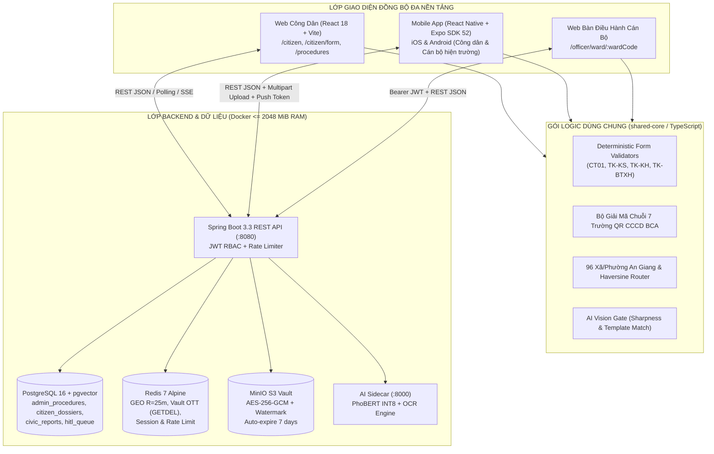

# SMARTWARD AI — UNIFIED SYSTEM & MOBILE APP SPECIFICATION (SINGLE SOURCE OF TRUTH FOR AI AGENTS)

> **Mục đích tài liệu:** Đây là **tài liệu đặc tả hợp nhất duy nhất (Single Source of Truth)** của toàn bộ hệ sinh thái **SmartWard AI (Web + Backend + AI Sidecar + Mobile App)**. Bất kỳ AI Agent hoặc Kỹ sư phần mềm nào chỉ cần đọc duy nhất tệp này là nắm trọn 100% kiến trúc, ràng buộc kỹ thuật, hợp đồng API (REST Contracts), cấu trúc CSDL, thuật toán AI Thị Giác, và kế hoạch phát triển **Mobile App (iOS/Android)** đồng bộ thời gian thực với nền tảng Web hiện hữu.

---

## PHẦN 1. TỔNG QUAN HỆ SINH THÁI & RÀNG BUỘC KỸ THUẬT BẮT BUỘC

### 1.1. Bài toán & Phạm vi địa lý
- **Đơn vị triển khai:** Hỗ trợ **96 Xã, Phường và Đặc khu thuộc tỉnh An Giang** (kèm khả năng mở rộng đa tỉnh/thành).
- **4 Module Nghiệp vụ Cốt lõi:**
  1. **Module 1 — Legal RAG & Abstention Guardrail:** Tư vấn pháp lý 40 Thủ tục hành chính (TTHC) cấp xã theo cấu trúc 5 phần chuẩn hóa; tích hợp đọc giọng nói tiếng Việt (TTS 2 chế độ MỞ/TẮT) và cỡ chữ `A / A+ / A++`.
  2. **Module 2 — AI Vision Gate & Multi-Form Deterministic Precheck:** Chốt chặn AI Thị Giác 3 tiêu chí (Độ sắc nét Laplacian $\ge 45/100$, Khớp đúng biểu mẫu đã chọn, Nhận diện chữ OCR/DOCX) + Động cơ kiểm định tất định 4 nhóm biểu mẫu trọng tâm (`CT01`, `TK-KS`, `TK-KH`, `TK-BTXH`) + Xuất trực tiếp file `.docx` / `.pdf` (tuyệt đối không dùng lệnh in `window.print()`).
  3. **Module 3 — High-Precision 25m GPS & Cross-Ward Incident Triage:** Quét GPS bán kính $R = 25\text{m}$, tự động điền địa chỉ hiện trường, định tuyến liên xã/phường (`Cross-Ward Jurisdiction Routing`) và gom cụm 2 pha (Redis GEO $R = 25\text{m}$ + pgvector Cosine $\tau = 0.82$).
  4. **Module 4 — Zero-Trust Document Vault, Officer Review & Electronic QR Pass:** Mã hóa tài liệu công dân bằng `AES-256-GCM`, đóng dấu chéo `Dynamic Watermark` theo Nghị định 13/2023/NĐ-CP, lưu MinIO, truy cập 1 lần qua Redis `GETDEL` One-Time Token (OTT), duyệt hồ sơ trên Bàn Cán Bộ và cấp **Phiếu Hẹn Sơ Duyệt Điện Tử Có Mã QR (`.pdf`) + Thông báo Email/Push miễn phí 100%** (không dùng SMS/Zalo thu phí).

### 1.2. Ràng buộc Kỹ thuật Bất biến (Hard Constraints — `AGENTS.md`)
1. **Ngân sách RAM Server Docker:** Toàn bộ 6 container (`postgres: 448m`, `redis: 128m`, `minio: 256m`, `ai-sidecar: 384m`, `backend: 768m`, `frontend: 64m`) **không vượt quá `2048 MiB` (2.0 GiB)**. Mobile App chạy native trên thiết bị của người dân/cán bộ nên **không làm tăng RAM của Docker Server**.
2. **Bảo mật Khóa:** `VAULT_ENCRYPTION_KEY` và `JWT_SECRET` bắt buộc tối thiểu 32 bytes (256-bit).
3. **Ngưỡng Chốt chặn RAG:** Giữ cố định $\theta = 0.78$ (ngưỡng trả lời trực tiếp) và $\theta_{\text{lower}} = 0.42$ (vùng xám đẩy vào hàng đợi `HITL Queue` để cán bộ duyệt).
4. **Chính sách Zero-Cost Notification:** Tuyệt đối không sử dụng SMS Brandname hoặc Zalo ZNS tính phí. Sử dụng **Email miễn phí + Push Notification (Expo Push / FCM) + Phiếu Hẹn Điện Tử Mã QR lưu Offline**.
5. **Quy trình Git (`AGENTS.md`):** Không bao giờ commit trực tiếp lên `main`. Mọi tính năng mới phát triển trên nhánh `feature/<ten-tinh-nang>` tách từ `develop`, vượt qua 100% test trước khi merge `--no-ff` vào `develop`.

---

## PHẦN 2. KIẾN TRÚC ĐỒNG BỘ WEB ↔ BACKEND ↔ MOBILE APP



### Nguyên tắc Đồng bộ Dữ liệu 100% giữa Web và Mobile App
1. **Đồng bộ Danh mục 40 TTHC (`admin_procedures`):** Cả Web và Mobile đều gọi `GET /api/v1/procedures` từ PostgreSQL và lưu đệm (cache) xuống bộ nhớ cục bộ (`AsyncStorage` / `expo-sqlite` trên Mobile) để tra cứu mượt cả khi mất sóng 4G.
2. **Đồng bộ Hồ sơ Sơ duyệt & Mã hẹn QR (`citizen_dossiers`):**
   - Người dân nộp tờ khai trên **Mobile App** $\rightarrow$ Lưu vào bảng `citizen_dossiers` trên PostgreSQL kèm ảnh mã hóa trong MinIO (`vaultDocIds`) $\rightarrow$ Xuất hiện tức thì trên **Web Bàn Điều Hành Cán Bộ** (`/officer/ward/:wardCode`).
   - Cán bộ bấm **"Duyệt Hợp Lệ & Gửi Email + Mã QR"** trên Web $\rightarrow$ Cập nhật `status = APPROVED`, sinh `appointment_code = LH-YYYYMMDD-XXXX` $\rightarrow$ Người dân mở **Mobile App** (hoặc **Web Công Dân**) đều thấy ngay **Phiếu Hẹn Điện Tử Có Mã QR** và nhận thông báo Email + Push Notification.
   - Ngược lại, người dân nộp trên **Web PC** tại nhà $\rightarrow$ Ra đường mở **Mobile App** nhập Mã hồ sơ + 4 số cuối CCCD (hoặc đăng nhập cùng Email/CCCD) là lấy được ngay **Phiếu Hẹn Mã QR** trên điện thoại để đưa cho cán bộ quầy Một cửa quét.
3. **Đồng bộ Báo cáo Sự cố Hiện trường (`civic_reports` & `issue_clusters`):**
   - Người dân dùng **Mobile App** chụp ảnh ổ gà/ngập nước ngoài đường $\rightarrow$ Tự động đính kèm tọa độ GPS phần cứng chính xác cao ($R = 25\text{m}$) $\rightarrow$ Backend gom cụm Redis GEO + pgvector và đẩy điểm nóng lên **Bản đồ GIS trên Web Cán Bộ** theo thời gian thực.

---

## PHẦN 3. HỢP ĐỒNG GIAO TIẾP API (COMPLETE REST API CONTRACTS)

Mobile App và Web Frontend sử dụng chung các endpoint dưới đây (Base URL mặc định: `http://<HOST_IP>:8080/api/v1`):

### 3.1. Nhóm API Danh mục 40 TTHC & Trợ lý Pháp lý RAG (Module 1)
| Method | Endpoint | Quyền | Mô tả & Payload |
| :--- | :--- | :--- | :--- |
| `GET` | `/api/v1/procedures` | Public | Lấy danh sách 40 TTHC chuẩn cấp xã. Query: `?category=Hộ tịch&keyword=...`. |
| `GET` | `/api/v1/procedures/{code}` | Public | Lấy chi tiết 1 TTHC (`TTHC-CR-01`, `TTHC-HT-01`, ...), hồ sơ cần nộp, lệ phí, thời hạn. |
| `POST` | `/api/v1/rag/ask` | Public | Hỏi đáp pháp lý RAG. Body: `{ "question": "...", "wardName": "Phường Mỹ Bình", "threshold": 0.78 }`. Trả về câu trả lời 5 phần, `maxSimilarity`, `abstained`, `citations[]`. |
| `GET` | `/api/v1/rag/hitl-queue` | Officer JWT | Lấy danh sách câu hỏi vùng xám ($0.42 \le S_{\max} < 0.78$) chờ cán bộ giải đáp. |
| `POST` | `/api/v1/rag/hitl-queue/{id}/resolve` | Officer JWT | Cán bộ phê duyệt câu trả lời chuẩn để lưu vào bộ nhớ đệm phục vụ người dân. |

### 3.2. Nhóm API Kiểm định Tờ khai, Zero-Trust Vault & Hồ sơ Công dân (Module 2 & 4)
| Method | Endpoint | Quyền | Mô tả & Payload |
| :--- | :--- | :--- | :--- |
| `POST` | `/api/v1/forms/precheck` | Public | Kiểm định tất định 4 mẫu tờ khai (`CT01`, `TK-KS`, `TK-KH`, `TK-BTXH`) + đối soát chéo OCR. Body: `StructuredFormPrecheckRequest` (bao gồm `citizenEmail`, `phoneNumber`, `formData`). |
| `POST` | `/api/v1/vault/upload` | Public | Upload ảnh chụp tờ khai / giấy tờ (Multipart `file`, `citizenCccd`, `documentType`). Đóng dấu watermark, mã hóa AES-256-GCM vào MinIO, trả về `{ "docId": "DOC_...", "oneTimeToken": "...", "viewUrl": "..." }`. |
| `GET` | `/api/v1/vault/view/{token}` | Officer JWT | Tiêu thụ nguyên tử (atomic `GETDEL`) token trên Redis, giải mã ảnh từ MinIO trả về stream ảnh có watermark. Gọi lần 2 trả về `410 GONE`. |
| `POST` | `/api/v1/dossiers` | Public | Nộp hồ sơ sơ duyệt chính thức vào PostgreSQL (`citizen_dossiers`). Body: `{ "procedureCode", "wardCode", "citizenCccd", "citizenName", "formData", "precheckReport", "vaultDocIds" }`. Trả về `{ "dossierCode": "HS-...", "slaDeadline": "...", "status": "PENDING" }`. |
| `GET` | `/api/v1/dossiers/track` | Public | Công dân tra cứu tiến độ & lấy Phiếu hẹn Mã QR trên Web/Mobile. Query: `?dossierCode=HS-...&last4Cccd=3490`. Trả về `status`, `officerFeedback`, `appointmentCode`, `slaDeadline`. |
| `GET` | `/api/v1/dossiers/officer/list` | Officer JWT | Cán bộ lấy danh sách hồ sơ theo `wardCode` và `status`. |
| `PUT` | `/api/v1/dossiers/{dossierCode}/review` | Officer JWT | Cán bộ phê duyệt (`APPROVED`) hoặc yêu cầu bổ sung (`SUPPLEMENT_REQUIRED`). Body: `{ "status": "APPROVED", "officerFeedback": "...", "appointmentCode": "LH-20261111-8899" }`. |

### 3.3. Nhóm API Báo cáo Sự cố GPS 25m & Xác thực Cán bộ (Module 3 & Security)
| Method | Endpoint | Quyền | Mô tả & Payload |
| :--- | :--- | :--- | :--- |
| `POST` | `/api/v1/triage/reports` | Public | Gửi phản ánh hiện trường kèm tọa độ GPS (`latitude`, `longitude`, `category`, `urgency`, `description`, `addressText`, `reporterPhone`, `wardCode`, `wardName`). Tự động gom cụm $R=25\text{m}$, $\tau=0.82$. |
| `GET` | `/api/v1/triage/clusters` | Public/Officer | Lấy danh sách cụm sự cố theo `wardCode` để hiển thị trên Bản đồ GIS và Bàn điều hành. |
| `POST` | `/api/v1/officer/login` | Public | Đăng nhập cán bộ bằng Mã thẻ công chức (`badgeId`, `password`, `wardCode`). Trả về JWT Bearer Token. |

---

## PHẦN 4. ĐẶC TẢ LOGIC NGHIỆP VỤ CỐT LÕI CẦN DÙNG CHUNG GIỮA WEB & MOBILE

Khi xây dựng Mobile App, **bắt buộc giữ nguyên 100% các thuật toán và quy tắc nghiệp vụ** sau từ thư mục `frontend/src/`:

1. **Giải mã QR CCCD chuẩn Bộ Công An (`frontend/src/utils/cccdQrParser.ts`):**
   - Định dạng chuỗi gốc quét từ QR mặt trước thẻ CCCD gắn chip:
     `089205023490|352412345|NGUYỄN MINH TUẤN KHANH|23062005|Nam|Số 18 Trần Hưng Đạo, Phường Mỹ Bình, TP. Long Xuyên, An Giang|15082021`
   - Tách 7 trường phân cách bởi dấu `|`, chuyển đổi ngày `ddMMyyyy` sang chuẩn ISO `yyyy-MM-dd`, tự động điền vào form và đối soát sai lệch.
2. **Chốt chặn AI Thị Giác 3 Tiêu chí (`frontend/src/services/tesseractOcr.ts`):**
   - **Tiêu chí 1 (Chống ảnh mờ/tối):** Điểm sắc nét `sharpnessScore` tính từ phương sai đạo hàm bậc hai Laplacian trên ảnh xám. Nếu `sharpnessScore < 45` (`isBlurry = true`) hoặc độ sáng `brightnessScore < 55` (`isTooDark = true`) $\rightarrow$ **Chặn nút gửi ngay trên Mobile/Web**, yêu cầu chụp lại.
   - **Tiêu chí 2 (Chống nộp nhầm mẫu):** Hàm `verifyTemplateMatch(rawText, fileName, expectedFormType)` kiểm tra từ khóa đặc trưng của từng biểu mẫu (`CT01`, `TK-KS`, `TK-KH`, `TK-BTXH`). Nếu công dân chọn mục `CT01` nhưng chụp ảnh tờ khai Khai sinh (`TK-KS`) $\rightarrow$ **Chặn nút gửi và cảnh báo rõ tên mẫu bị nhầm**.
   - **Tiêu chí 3 (Trích xuất trường đã điền):** Bóc tách tự động Họ tên, Số ĐDCN/CCCD, Ngày sinh, Giới tính, Địa chỉ cư trú từ ảnh chụp hoặc từ file `.docx` (giải nén XML `word/document.xml`).
3. **Định tuyến 96 Xã/Phường/Đặc khu An Giang (`frontend/src/data/angiangWards.ts`):**
   - Hàm `resolveWardFromLocationBox(addressText, lat, lon, fallbackWard)`: Ưu tiên 1 nhận diện tên xã/phường trong chuỗi địa chỉ (`TEXT_BOX`); Ưu tiên 2 tính khoảng cách Haversine gần nhất từ tọa độ GPS (`GPS_COORDS`).

---

## PHẦN 5. THIẾT KẾ CHI TIẾT MOBILE APP (`mobile/` — REACT NATIVE + EXPO SDK 52)

### 5.1. Cấu trúc thư mục Monorepo Mở rộng
Đặt mã nguồn Mobile App tại thư mục `e:\SmartWardAI\mobile` ngang hàng với `frontend/` và `backend/`:

```text
SmartWardAI/
├── backend/                  # Spring Boot 3.3 REST API (Giữ nguyên, phục vụ cả Web & Mobile)
├── frontend/                 # Web App React 18 + Vite (Đã hoàn thiện)
├── mobile/                   # [MỚI] Ứng dụng Di động React Native (Expo SDK 52 + TypeScript)
│   ├── app.json              # Cấu hình quyền Camera, GPS chính xác cao, FileSystem, Push Notification
│   ├── package.json          # Phụ thuộc: expo-camera, expo-location, expo-print, expo-sharing, axios...
│   └── src/
│       ├── api/              # Tái sử dụng 100% client.ts từ frontend/src/api/client.ts
│       ├── core/             # Symlink/Copy từ frontend/src/{data,services,utils} (angiangWards, cccdQrParser, VisionGate)
│       ├── context/          # WardContext, RoleContext, AccessibilityContext (dùng AsyncStorage thay localStorage)
│       ├── components/       # QrPassCard, VisionGateBadge, VoiceReaderButton, WardPickerSheet
│       └── screens/
│           ├── OnboardingWardScreen.tsx      # Màn hình 1: Chọn 96 Xã/Phường An Giang hoặc Định vị GPS 1 chạm
│           ├── LegalRagChatScreen.tsx        # Màn hình 2: Hỏi đáp AI 40 TTHC + Đọc giọng nói TTS (MỞ/TẮT) + Tải mẫu .docx/.pdf
│           ├── SmartFormPrecheckScreen.tsx   # Màn hình 3: Quét QR CCCD + Chụp ảnh tờ khai qua AI Vision Gate + Gửi sơ duyệt
│           ├── FieldIncidentReportScreen.tsx # Màn hình 4: Chụp ảnh sự cố hiện trường + GPS 25m tự điền + Định tuyến liên xã
│           ├── DossierAndQrPassScreen.tsx    # Màn hình 5: Tra cứu tiến độ, Hộp thư Email & Ví Phiếu Hẹn Mã QR (Lưu Offline)
│           └── OfficerMobileAuditScreen.tsx  # Màn hình 6 (Dành cho Cán bộ): Quét QR Phiếu hẹn công dân tại quầy & Duyệt nhanh
└── SMARTWARD_UNIFIED_AGENT_AND_MOBILE_SPEC.md # Tài liệu đặc tả hợp nhất này
```

### 5.2. Bảng Ánh Xạ Thư Viện Web sang Native Mobile
Để AI Agent chuyển đổi code từ `frontend/` sang `mobile/` nhanh và không lỗi tương thích:

| Chức năng trên Web (`frontend/`) | Giải pháp tương đương trên Mobile (`mobile/` - Expo SDK 52) |
| :--- | :--- |
| Lưu trữ cục bộ `window.localStorage` | `@react-native-async-storage/async-storage` (cho dữ liệu thường) & `expo-secure-store` (cho JWT Cán bộ) |
| Quét QR CCCD & Chụp ảnh tờ khai (`navigator.mediaDevices`) | `expo-camera` (`CameraView` tích hợp quét `qr` phần cứng siêu nhạy 60fps) + `expo-image-picker` |
| Chọn file `.docx` / `.pdf` đã điền từ máy | `expo-document-picker` + `expo-file-system` |
| Định vị GPS `R = 25m` (`navigator.geolocation`) | `expo-location` (`Accuracy.BestForNavigation`) |
| Đọc to kết quả TTS 2 chế độ MỞ/TẮT (`window.speechSynthesis`) | `expo-speech` (`Speech.speak(text, { language: 'vi-VN' })` & `Speech.stop()`) |
| Bản đồ sự cố GIS (`leaflet` + Google/OSM Tiles) | `react-native-maps` (`MapView`, `Marker`, `Circle` bán kính $R = 25\text{m}$) |
| Tải biểu mẫu `.docx` / `.pdf` & Phiếu hẹn Mã QR `.pdf` | `expo-file-system` + `expo-sharing` (Mở menu Lưu vào Tệp / Chia sẻ qua Email trên iOS & Android) |

---

## PHẦN 6. KỊCH BẢN THỰC THI TỪNG BƯỚC CHO AI AGENT (AGENT EXECUTION PLAYBOOK)

Khi người dùng yêu cầu AI Agent bắt đầu code Mobile App, AI Agent **phải thực hiện tuần tự 4 chặng (Milestones)** sau:

### Chặng M-App 1: Khởi tạo Khung Dự Án Mobile & Tầng Đồng Bộ Dữ Liệu (`mobile/src/api` & `core`)
1. Tạo nhánh Git mới từ `develop`: `git checkout develop && git checkout -b feature/mobile-app-sync`.
2. Khởi tạo dự án Expo TypeScript tại `mobile/`.
3. Sao chép và chuẩn hóa tầng dùng chung từ `frontend/src/`:
   - `angiangWards.ts` (96 xã/phường An Giang + thuật toán định tuyến Haversine).
   - `cccdQrParser.ts` (giải mã chuỗi 7 trường QR CCCD).
   - `client.ts` (cấu hình biến môi trường `EXPO_PUBLIC_API_BASE_URL` trỏ về IP LAN của Backend `:8080/api/v1`, thay `localStorage` bằng `AsyncStorage`).
4. **Tiêu chí nghiệm thu (Gate 1):** Ứng dụng chạy lên được thanh điều hướng 5 tab đáy (Bottom Tabs), đổi xã/phường đồng bộ với danh sách 40 TTHC từ `GET /api/v1/procedures`.

### Chặng M-App 2: Màn hình Hỏi đáp Pháp lý RAG, TTS MỞ/TẮT & Tải Mẫu `.docx`/`.pdf`
1. Xây dựng `LegalRagChatScreen.tsx` kết nối `POST /api/v1/rag/ask` và danh mục 40 TTHC.
2. Tích hợp `expo-speech` với nút bấm **2 chế độ rõ ràng (`MỞ` / `TẮT`)** giống hệt trên Web.
3. Tích hợp tính năng tải biểu mẫu `.docx` và `.pdf` về điện thoại bằng `expo-file-system` + `expo-sharing` (không có bất kỳ nút in ấn nào).

### Chặng M-App 3: Camera Quét QR CCCD, Chốt chặn AI Thị Giác & Gửi Sơ Duyệt
1. Xây dựng `SmartFormPrecheckScreen.tsx` cho 4 mẫu `CT01`, `TK-KS`, `TK-KH`, `TK-BTXH`.
2. Tích hợp `expo-camera` quét mã QR trên thẻ CCCD gắn chip $\rightarrow$ Tự động điền Họ tên, 12 số CCCD, Ngày sinh, Giới tính, Địa chỉ.
3. Tích hợp **Chốt chặn AI Thị Giác 3 tiêu chí** khi công dân chụp ảnh tờ khai bằng điện thoại hoặc chọn file `.docx`:
   - Kiểm tra độ nét ảnh chụp và khớp đúng mẫu thủ tục trước khi cho phép bấm **"Kiểm Tra & Gửi Sơ Duyệt Cán Bộ"**.
   - Bắt buộc nhập **Địa chỉ Email nhận kết quả miễn phí** + **Số điện thoại liên hệ**.
   - Gửi ảnh lên Zero-Trust Vault (`POST /api/v1/vault/upload`) và nộp hồ sơ (`POST /api/v1/dossiers`).

### Chặng M-App 4: Ví Phiếu Hẹn Mã QR Offline, Báo Sự Cố GPS 25m & Quét QR Phía Cán Bộ
1. Xây dựng `DossierAndQrPassScreen.tsx`:
   - Tự động đồng bộ trạng thái hồ sơ từ `GET /api/v1/dossiers/track`.
   - Hiển thị **Hộp Thư Thông Báo Email Từ Cán Bộ** và thẻ **Phiếu Hẹn Sơ Duyệt Điện Tử Có Mã QR** (lưu offline vào máy + xuất file `.pdf` bằng `expo-print` / `expo-sharing`).
2. Xây dựng `FieldIncidentReportScreen.tsx`:
   - Lấy tọa độ GPS phần cứng chính xác cao ($R = 25\text{m}$), tự động điền địa chỉ và gửi về `POST /api/v1/triage/reports`.
3. Xây dựng `OfficerMobileAuditScreen.tsx`:
   - Cho phép Cán bộ Một cửa dùng camera điện thoại quét Mã QR trên Phiếu hẹn của công dân (`LH-YYYYMMDD-XXXX`) để mở ngay hồ sơ đã sơ duyệt trên màn hình.
4. Kiểm thử E2E đồng bộ 2 chiều giữa Web và Mobile, sau đó merge `--no-ff` vào nhánh `develop`.
