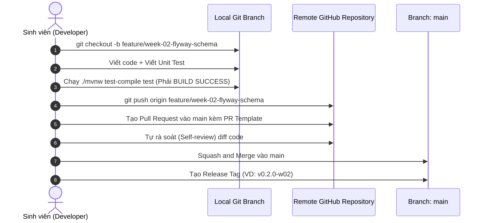

# QUY TRÌNH & RÀNG BUỘC QUẢN LÝ MÃ NGUỒN GIT CHUẨN CÔNG NGHIỆP
**Dự án:** SmartWard AI – Hệ thống Hỗ trợ Thủ tục Hành chính và Phân luồng Phản ánh Cấp Phường/Xã  
**Đơn vị:** Trường Đại học Giao thông vận tải TP.HCM (UTH) – Đồ án Tốt nghiệp & Thực tập Doanh nghiệp  
**Tài liệu:** `docs/GIT_WORKFLOW.md`

---

## 1. NGUYÊN TẮC CỐT LÕI (CORE PRINCIPLES)

Dù dự án được phát triển độc lập bởi 01 sinh viên, việc tuân thủ quy trình Git chuyên nghiệp là tiêu chí bắt buộc nhằm:
1. **Minh bạch hóa lịch sử phát triển trước Hội đồng:** Chứng minh tiến độ thực hiện đều đặn qua 12 tuần (không có hiện tượng "dồn code vào phút chót").
2. **Khả năng truy vết và hoàn tác (Traceability & Rollback):** Mọi tính năng, thực nghiệm thuật toán đều được gắn với commit/PR cụ thể.
3. **Bảo mật tuyệt đối (Zero-Leakage):** Ngăn chặn triệt để việc lộ lọt API Key hoặc dữ liệu công dân lên GitHub công khai.

---

## 2. CHIẾN LƯỢC PHÂN NHÁNH (BRANCHING STRATEGY)

Áp dụng mô hình **Trunk-based Development kết hợp Feature Branching** được chuẩn hóa:

```
  main (Stable / Production) ──────────────────● [v0.1.0-w01] ───────────────● [v0.2.0-w02]
                                              ▲                              ▲
                                              │ merge (squash)               │ merge (squash)
  feature/week-01-setup    ●───●───●──────────┘                              │
                                                                             │
  feature/week-02-flyway-rag-chunking                  ●───●───●─────────────┘
```

### 2.1. Nhánh Chính (Permanent Branches)
* **`main` (Nhánh phát hành & Ổn định):**
  * Chỉ chứa mã nguồn đã kiểm thử biên dịch thành công (`BUILD SUCCESS`, 100% test pass).
  * Mỗi tuần khi hoàn thành một Sprint sẽ được gắn thẻ phát hành (Release Tag) tương ứng (ví dụ: `v0.1.0-w01`, `v0.2.0-w02`).
  * Tuyệt đối không commit trực tiếp các tính năng lớn chưa hoàn thiện lên `main`.

### 2.2. Nhánh Tạm Thời (Temporary Branches)
* **Nhánh tính năng theo tuần:** `feature/week-<XX>-<tên-ngắn-gọn>`
  * Ví dụ: `feature/week-02-flyway-schema`, `feature/week-04-legal-rag`, `feature/week-05-form-rule-engine`.
  * Vòng đời: Tạo từ `main`, hoàn thiện, kiểm thử, merge ngược lại `main` và xóa nhánh sau khi merge.
* **Nhánh sửa lỗi phát sinh:** `fix/<mô-tả-lỗi>`
  * Ví dụ: `fix/cccd-validator-century-logic`, `fix/minio-upload-content-type`.
* **Nhánh tài liệu / Báo cáo:** `docs/<tên-chương-hoặc-báo-cáo>`
  * Ví dụ: `docs/chapter-02-architecture`, `docs/week-02-progress-report`.

---

## 3. QUY CHUẨN THÔNG ĐIỆP COMMIT (CONVENTIONAL COMMITS 1.0.0)

Mọi commit bắt buộc tuân theo định dạng chuẩn quốc tế:

$$\text{\bf <type>(<scope>): <subject>}$$

### 3.1. Các Loại Commit Hợp Lệ (`type`):
| Loại | Ý nghĩa | Ví dụ |
| :--- | :--- | :--- |
| **`feat`** | Thêm một tính năng mới hoặc API mới | `feat(rag): implement legal chunking service for articles` |
| **`fix`** | Sửa một lỗi logic hoặc lỗi kỹ thuật | `fix(formcheck): correct century digit calculation for year 2000+` |
| **`docs`** | Thêm hoặc sửa tài liệu, báo cáo, README | `docs(thesis): draft chapter 2 system architecture and ERD` |
| **`test`** | Thêm hoặc cập nhật Unit test / Integration test | `test(vault): add test cases for one-time token GETDEL atomicity` |
| **`refactor`**| Tái cấu trúc mã nguồn nhưng không đổi tính năng | `refactor(triage): optimize redis geosearch query performance` |
| **`perf`** | Cải thiện hiệu năng xử lý hoặc giảm bộ nhớ RAM | `perf(pgvector): add HNSW index to legal_chunks embedding` |
| **`chore`** | Cập nhật cấu hình build, dependencies, docker | `chore(deps): bump spring-boot-starter-parent to 3.3.5` |

### 3.2. Phạm Vi Commit Chuẩn (`scope`):
Chỉ sử dụng các scope tương ứng với các module trong kiến trúc:
* `rag`: Module Hỏi đáp pháp lý & Guardrail.
* `formcheck`: Module Kiểm tra biểu mẫu & Rule Engine.
* `triage`: Module Phân luồng & Gom cụm phản ánh 2 pha.
* `vault`: Module Bảo mật tài liệu & Watermark.
* `db`: Schema CSDL, Flyway migration, PostgreSQL pgvector.
* `infra`: Docker Compose, MinIO, Redis configuration.
* `ui`: Giao diện người dùng React, Tailwind, Leaflet.
* `eval`: Bộ đo đạc thực nghiệm, Grid search, Benchmark.
* `thesis`: Các chương Báo cáo tốt nghiệp & Báo cáo tiến độ tuần.

### 3.3. Ví Dụ Commit Đúng vs Commit Sai:
* ❌ **Sai (Tối kỵ):**
  * `update code`
  * `fix bug`
  * `done tuan 1`
  * `chinh sua ti`
* ✅ **Đúng (Chuẩn công nghiệp):**
  * `feat(rag): add abstention guardrail with configurable threshold theta`
  * `fix(triage): prevent merging civic reports from different categories`
  * `docs(weekly): add week 2 progress report for UTH supervisor`
  * `chore(docker): enforce 512m memory limit on postgres container`

---

## 4. QUY TRÌNH TẠO VÀ HỢP NHẤT PULL REQUEST (PR WORKFLOW)

Khi hoàn thành một tuần hoặc một module, quy trình merge vào `main` thực hiện qua các bước:



### 4.1. Mẫu Mô Tả Pull Request (PR Template)
Mỗi PR khi tạo trên GitHub cần có 3 mục ngắn gọn:
```markdown
## 1. Mô tả thay đổi
- Thực hiện các Task: [Task 2.1, Task 2.2...] trong TODO.md.
- Tóm tắt ngắn gọn các class/file mới được tạo.

## 2. Checklist kiểm tra an toàn
- [x] Code đã build thành công với `./mvnw test-compile test`.
- [x] Không có hardcode API Key (Gemini API key).
- [x] Không có dữ liệu cá nhân thật (100% synthetic data).
- [x] Đã cập nhật trạng thái tương ứng trong file `TODO.md`.

## 3. Ảnh chụp minh chứng kết quả (Screenshot / Logs)
- Đính kèm log BUILD SUCCESS hoặc ảnh Swagger UI.
```

---

## 5. RÀNG BUỘC AN TOÀN & BẢO MẬT (SECURITY CONSTRAINTS)

Để bảo vệ bí mật dự án và tuân thủ quy chế thực tập:

### 5.1. Danh mục Cấm Đưa Lên Git (Strictly Forbidden):
1. **API Keys / Secrets:** Tuyệt đối không commit trực tiếp chuỗi API Key (Gemini API key, MinIO Secret Key, mật khẩu DB production). Bắt buộc dùng biến môi trường `${GEMINI_API_KEY}`.
2. **Dữ liệu PII Thật (Personally Identifiable Information):** Cấm commit ảnh chụp CCCD thật, họ tên và địa chỉ của công dân thật. Chỉ sử dụng dữ liệu giả lập (Synthetic/Mock Data).
3. **Thư mục Build và Tệp Nhị phân Lớn:**
   * Thư mục `target/`, `node_modules/`, `.idea/`, `.vscode/`.
   * Các tệp ảnh/video test có kích thước $> 10\text{ MB}$ (nếu cần dữ liệu mẫu, lưu tệp nén nhỏ trong `docs/samples/`).

### 5.2. Công Cụ Hỗ Trợ `.gitignore`
Tệp `.gitignore` tại thư mục gốc phải luôn được kiểm tra định kỳ trước khi chạy lệnh `git add .`.

---

## 6. QUY TẮC ĐÁNH DẤU PHIÊN BẢN (SEMANTIC TAGGING & MILESTONES)

Để phục vụ trình bày trước Hội đồng và GVHD, mỗi tuần hoàn thành sẽ được gắn Git Tag:

| Mốc thời gian | Tên Git Tag | Ý nghĩa sản phẩm |
| :---: | :--- | :--- |
| **Hết Tuần 1** | `v0.1.0-w01` | Khởi tạo Docker Zero-cost, Spring Boot 3.3, Chương 1 Báo cáo. |
| **Hết Tuần 2** | `v0.2.0-w02` | Flyway 6 bảng, pgvector HNSW, băm 40 TTHC, Chương 2 Báo cáo. |
| **Hết Tuần 4** | `v0.4.0-w04` | Hoàn thành Module 1: Legal RAG & Abstention Guardrail. |
| **Hết Tuần 6** | `v0.6.0-w06` | Hoàn thành Module 2 (Rule Engine) & Module 3 (Triage 2 pha) - Sơ kết giữa kỳ. |
| **Hết Tuần 8** | `v0.8.0-w08` | Hoàn thành Module 4 (Vault) & Bộ đo đạc thực nghiệm Benchmark. |
| **Hết Tuần 10** | `v0.10.0-w10`| Hoàn thành Frontend React/Tailwind/Leaflet. |
| **Hết Tuần 12** | `v1.0.0-defense`| **Phiên bản hoàn chỉnh bảo vệ Đồ án Tốt nghiệp UTH.** |

---

## 7. BẢNG TRA CỨU NHANH CÁC LỆNH GIT THƯỜNG DÙNG (CHEAT SHEET)

```bash
# 1. Bắt đầu làm việc tuần mới:
git checkout main
git pull origin main
git checkout -b feature/week-02-flyway-schema

# 2. Kiểm tra trạng thái và commit đúng chuẩn:
git status
git add .
git commit -m "feat(db): add V1 flyway migration script for 6 core tables"

# 3. Đẩy nhánh lên GitHub để tạo Pull Request:
git push -u origin feature/week-02-flyway-schema

# 4. Gắn thẻ phiên bản sau khi hoàn thành tuần:
git checkout main
git pull origin main
git tag -a v0.2.0-w02 -m "Release Week 2: Flyway migration and legal chunking service"
git push origin v0.2.0-w02
```
