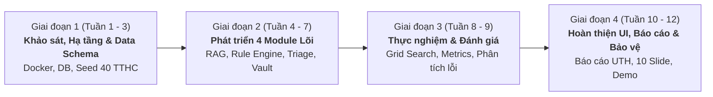

# Lộ Trình Triển Khai Chi Tiết (12 Tuần - 3 Tháng)
**Dự án:** SmartWard AI – Hệ thống Hỗ trợ Thủ tục Hành chính và Phân luồng Phản ánh Cấp Phường/Xã  
**Đơn vị:** Trường Đại học Giao thông vận tải TP.HCM (UTH) – Ngành Công nghệ Thông tin  
**Phạm vi:** Học kỳ Doanh nghiệp & Đồ án Tốt nghiệp Kỹ sư (01 Sinh viên thực hiện)

---

## 1. Sơ Đồ Tổng Quan 4 Giai Đoạn (Milestones Overview)

---

## 2. Kế Hoạch Chi Tiết Từng Tuần (Weekly Action Plan)

### GIAI ĐOẠN 1: KHỞI TẠO HẠ TẦNG, THIẾT KẾ DỮ LIỆU & BỘ THUẬT TOÁN NỀN TẢNG (TUẦN 1 – 3)
*Mục tiêu:* Thiết lập toàn bộ môi trường Docker Zero-cost, khung dự án Spring Boot, CSDL PostgreSQL pgvector, Redis, MinIO và thu thập dữ liệu gốc.  
*Phần Báo cáo tương ứng:* **Chương 1 (Tổng quan đề tài)** và **Chương 2 (Cơ sở lý thuyết & Bối cảnh)**.

#### Tuần 1: Khảo sát nghiệp vụ, Đặc tả yêu cầu & Khởi tạo Hạ tầng Docker
* **Công việc kỹ thuật:**
  * Khởi tạo repository Git, cấu hình `.gitignore` và branching strategy (`main`, `develop`, `feature/*`).
  * Xây dựng file `docker-compose.yml` tuân thủ nghiêm ngặt giới hạn RAM $< 2.0\text{ GB}$:
    * `postgres` (pgvector:pg16, limit 512MB).
    * `redis` (redis:7-alpine, limit 128MB, `volatile-lru`).
    * `minio` (limit 256MB) + `minio-init` tạo bucket `smartward-vault`, quota 5GB, ILM 7 ngày.
  * Khởi tạo khung dự án Spring Boot 3.3 (Java 21) với cấu trúc package `vn.edu.uth.smartward`.
* **Sản phẩm bàn giao:** File `docker-compose.yml` chạy ổn định với 1 lệnh `docker compose up -d`, khung Backend compile thành công.
* **Viết báo cáo:** Soạn thảo Mục 1.1 (Đặt vấn đề thực tiễn tại UBND phường/xã) và Mục 1.2 (3 Câu hỏi nghiên cứu RQ1-RQ3).

#### Tuần 2: Thu thập Dữ liệu Pháp lý & Thiết kế CSDL (Flyway Migrations)
* **Công việc kỹ thuật:**
  * Thu thập văn bản quy phạm pháp luật của 40 thủ tục hành chính cấp xã từ Cổng Dịch vụ công Quốc gia (Hộ tịch, Cư trú, Chứng thực, Bảo trợ).
  * Viết script Flyway migration `V1__init_schema.sql` tạo 6 bảng CSDL:
    * `admin_procedures`, `legal_chunks` (kèm vector 768 chiều & HNSW index).
    * `issue_clusters`, `civic_reports`.
    * `form_submissions`, `vault_documents`.
  * Viết bộ parser pháp lý (`LegalChunkingService`): Tự động phân tách văn bản theo cấu trúc *Chương $\rightarrow$ Điều $\rightarrow$ Khoản $\rightarrow$ Điểm* kèm metadata (`effective_date`, `status = ACTIVE`).
* **Sản phẩm bàn giao:** Script băm luật và nạp thành công 40 TTHC vào bảng `legal_chunks` trên PostgreSQL.
* **Viết báo cáo:** Soạn thảo Mục 2.1 (Kiến trúc Modular Monolith vs Microservices) và Mục 2.2 (Thiết kế cơ sở dữ liệu quan hệ kết hợp vector pgvector).

#### Tuần 3: Tích hợp Mock AI Client & Rate Limiter Redis
* **Công việc kỹ thuật:**
  * Thiết kế Interface `AiModelClient` và triển khai 2 profile:
    * `DeterministicMockAiClient` (`@Profile("dev | test")`): Trả về vector giả lập và OCR mock để test offline không tốn quota.
    * `GeminiAiClient` (`@Profile("prod")`): Kết nối Gemini API cho `text-embedding-004` và Vision OCR.
  * Cài đặt Redis Rate Limiter: Giới hạn tối đa 5 requests/phút/IP để bảo vệ hạn mức Free-tier API.
  * Cài đặt bộ nhớ đệm câu hỏi trùng lặp trên Redis với TTL 1 giờ.
* **Sản phẩm bàn giao:** Bộ test kiểm thử luồng Mock AI chạy offline 100% không cần API key.
* **Viết báo cáo:** Soạn thảo Mục 2.3 (Chiến lược xử lý giới hạn API và cơ chế caching tối ưu tài nguyên).

---

### GIAI ĐOẠN 2: PHÁT TRIỂN 4 MODULE NGHIỆP VỤ CỐT LÕI (TUẦN 4 – 7)
*Mục tiêu:* Hiện thực hóa toàn bộ logic nghiệp vụ xác định (Deterministic logic) và các luồng tương tác API.  
*Phần Báo cáo tương ứng:* **Chương 3 (Thiết kế và Cài đặt Hệ thống)**.

#### Tuần 4: Xây dựng Module 1 - Legal RAG & Abstention Guardrail
* **Công việc kỹ thuật:**
  * Viết `RagQueryService`: Chuyển đổi câu hỏi công dân thành vector embedding 768 chiều.
  * Truy vấn Cosine Distance (`<=>`) trên pgvector với bộ lọc `status = 'ACTIVE' AND effective_date <= NOW()`.
  * **Cài đặt Abstention Guardrail:** Nếu độ tương đồng cao nhất $S_{\max} < \theta$ (mặc định 0.78), lập tức trả về phản hồi từ chối an toàn, không gọi LLM sinh tự do.
  * Hậu kiểm trích dẫn: Kiểm tra mã điều khoản trong câu trả lời có nằm trong danh sách Top-K văn bản đã truy xuất hay không.
  * Cài đặt API: `POST /api/v1/rag/ask`.
* **Sản phẩm bàn giao:** API hỏi đáp TTHC phản hồi chính xác, từ chối câu hỏi ngoài phạm vi và đính kèm disclaimer.
* **Viết báo cáo:** Mô tả thuật toán RAG theo Điều-Khoản và cơ chế chốt chặn chống ảo giác bằng lưu đồ giải thuật.

#### Tuần 5: Xây dựng Module 2 - Deterministic Form Rule Engine
* **Công việc kỹ thuật:**
  * Viết `OcrExtractionClient`: Gọi Vision OCR trích xuất JSON các trường (`fullName`, `cccdNumber`, `birthDate`, `issueDate`, `address`, `confidence`).
  * Viết bộ quy tắc Java thuần (`DeterministicFormRuleEngine`):
    * `CccdValidator`: Kiểm tra regex 12 chữ số, tra cứu bảng mã 63 tỉnh/thành, giải mã chữ số thế kỷ/giới tính (`0-9`), khớp 2 số cuối năm sinh.
    * `DateLogicValidator`: Kiểm tra thứ tự logic `birthDate < issueDate <= today()`, điều kiện cấp CCCD $\ge 14$ tuổi.
    * `MandatoryFieldValidator`: Kiểm tra trường bắt buộc theo từng mã TTHC.
  * Đánh dấu cảnh báo `MANUAL_REVIEW_REQUIRED` nếu `confidence < 0.70`.
  * Cài đặt API: `POST /api/v1/forms/precheck`.
* **Sản phẩm bàn giao:** API phân tích ảnh tờ khai, chỉ rõ lỗi sai định dạng CCCD hoặc lỗi logic mâu thuẫn ngày tháng.
* **Viết báo cáo:** Trình bày chi tiết thuật toán kiểm tra cấu trúc 12 số CCCD và logic thời gian (không phó mặc cho AI đoán mò).

#### Tuần 6: Xây dựng Module 3 - Two-Stage Spatial-Semantic Triage
* **Công việc kỹ thuật:**
  * Xây dựng `SpatialSemanticTriageService` theo quy trình 2 pha:
    * **Pha 1 (Lọc không gian):** Sử dụng Redis `GEOSEARCH` quét các cụm sự cố `OPEN` trong bán kính $R$ mét.
    * **Pha 2 (So khớp nghiệp vụ & ngữ nghĩa):** Trong các cụm ứng viên, lọc chính xác theo `category` và đo Cosine Similarity vector mô tả với vector tâm cụm. Nếu $\text{Sim} \ge \tau$, gộp vào cụm cũ và tăng `report_count`; ngược lại tạo cụm mới.
  * Cài đặt API: `POST /api/v1/issues/report` và `GET /api/v1/issues/clusters`.
* **Sản phẩm bàn giao:** Hệ thống phân luồng phản ánh tự động, gom 2 phản ánh cùng vị trí & nội dung thành 1 cụm.
* **Viết báo cáo:** Sơ đồ thuật toán gom cụm 2 pha và phân tích độ phức tạp thuật toán.

#### Tuần 7: Xây dựng Module 4 - Zero-Trust Document Vault
* **Công việc kỹ thuật:**
  * Viết `ImageWatermarkService`: Sử dụng Java2D (`Graphics2D`) vẽ chìm watermark chéo với nội dung:  
    `"CHỈ DÙNG ĐỂ SƠ DUYỆT HỒ SƠ TẠI UBND - [TIMESTAMP]"`.
  * Viết `ZeroTrustVaultService`: Mã hóa ảnh đã đóng watermark bằng `AES/GCM/NoPadding` (256-bit) trước khi đẩy lên MinIO.
  * Cơ chế One-Time Read: Lưu token xem ảnh trên Redis với TTL 24 giờ. Khi gọi `GET /api/v1/vault/view/{token}`, dùng lệnh nguyên tử `GETDEL` để lấy dữ liệu và xóa ngay lập tức. Lần truy cập thứ hai trả về HTTP `410 Gone`.
  * Cài đặt API: `POST /api/v1/vault/upload` và `GET /api/v1/vault/view/{token}`.
* **Sản phẩm bàn giao:** Cơ chế kho tài liệu an toàn, chống chia sẻ trái phép và chống Race Condition.
* **Viết báo cáo:** Trình bày giải pháp bảo vệ dữ liệu công dân tuân thủ Nghị định 13/2023/NĐ-CP.

---

### GIAI ĐOẠN 3: THỰC NGHIỆM KHOA HỌC, QUÉT LƯỚI THAM SỐ & PHÂN TÍCH LỖI (TUẦN 8 – 9)
*Mục tiêu:* Thu thập số liệu thực nghiệm thực tế để trả lời 3 câu hỏi nghiên cứu RQ1, RQ2, RQ3; xuất bảng số liệu và biểu đồ khoa học.  
*Phần Báo cáo tương ứng:* **Chương 4 (Thực nghiệm, Đánh giá kết quả & Thảo luận)**.

#### Tuần 8: Xây dựng Bộ Dữ liệu Kiểm thử & Module Đo đạc Tự động
* **Công việc kỹ thuật:**
  * Tạo bộ dữ liệu kiểm thử chuẩn:
    * 80 câu hỏi RAG (40 câu trực tiếp, 25 câu tình huống thực tế, 15 câu hỏi bẫy/ngoài phạm vi).
    * 150 mẫu phản ánh hiện trường (30 sự cố gốc, 15 người viết khác nhau, thêm nhiễu tọa độ GPS $\sigma \in [10\text{m}, 40\text{m}]$, cài cắm chính xác 25 ca biên khó: 10 Colocated, 10 High Lexical, 5 Distant).
    * 40 ảnh chụp tờ khai (20 in, 20 viết tay kèm các lỗi logic cài cắm sẵn).
  * Viết `ExperimentRunnerService` và `EvaluationController`:
    * Endpoint `POST /api/v1/evaluation/run-rag-eval`: Đo Recall@3, MRR, Citation Precision, False Answer Rate.
    * Endpoint `POST /api/v1/evaluation/run-grid-search`: Quét lưới $(R, \tau)$ xuất ma trận Precision, Recall, F1-Score.
* **Sản phẩm bàn giao:** File CSV/JSON xuất tự động toàn bộ số liệu đánh giá mô hình.
* **Viết báo cáo:** Soạn thảo Mục 4.1 (Phương pháp xây dựng bộ dữ liệu kiểm thử giảm thiểu thiên lệch chủ quan).

#### Tuần 9: Thực nghiệm Grid Search, Phân tích Lỗi & Khảo sát Tham số Tối ưu
* **Công việc kỹ thuật:**
  * Chạy quét lưới với $R \in \{25\text{m}, 50\text{m}, 75\text{m}, 100\text{m}, 150\text{m}\}$ và $\tau \in \{0.70, 0.75, 0.80, 0.85, 0.90\}$.
  * Vẽ biểu đồ Precision-Recall curve và bản đồ nhiệt (Heatmap) F1-Score để chứng minh cơ sở khoa học của cấu hình $(R=75\text{m}, \tau=0.82)$.
  * Thực hiện **Error Analysis (Phân tích lỗi)**:
    * Phân tích các ca False Positive (gộp nhầm sự cố khác nhau ở 2 đầu ngõ).
    * Phân tích các ca False Negative (lệch GPS do đứng trong nhà cao tầng).
    * Phân tích lỗi OCR nhận diện sai số CCCD do chữ viết tay nối nét.
* **Sản phẩm bàn giao:** Toàn bộ biểu đồ, bảng nhiệt và bảng so sánh 3 cấu hình RAG đưa vào báo cáo.
* **Viết báo cáo:** Hoàn thiện toàn bộ nội dung Chương 4 (Số liệu thực nghiệm, Biểu đồ so sánh và Phân tích lỗi chuyên sâu).

---

### GIAI ĐOẠN 4: HOÀN THIỆN GIAO DIỆN, BÁO CÁO TỐT NGHIỆP & BẢO VỆ ĐỀ TÀI (TUẦN 10 – 12)
*Mục tiêu:* Hoàn thiện Frontend React/Vite, đóng gói sản phẩm hoàn chỉnh, hoàn thiện cuốn Báo cáo tốt nghiệp UTH và chuẩn bị slide bảo vệ.  
*Phần Báo cáo tương ứng:* **Lời cảm ơn, Kết luận, Tài liệu tham khảo, Slide thuyết trình**.

#### Tuần 10: Xây dựng Giao diện Người dùng Web-First Responsive / PWA (React + TailwindCSS + Leaflet)
* **Công việc kỹ thuật:**
  * Khởi tạo dự án Frontend `frontend/` sử dụng React (TypeScript) với Vite và TailwindCSS.
  * Xây dựng **Cổng Công dân (Route `/citizen` - Mobile-First PWA)**:
    * Tối ưu hiển thị trên màn hình di động, người dân quét mã QR tại UBND để truy cập tức thì không cần cài app.
    * Giao diện Chatbot tra cứu TTHC (Legal RAG) hiển thị trích dẫn căn cứ pháp lý và cảnh báo từ chối an toàn.
    * Tích hợp HTML5 Camera API để chụp trực tiếp tờ khai và hiển thị kết quả kiểm tra từng trường (Đạt / Cảnh báo / Lỗi logic).
    * Tích hợp Geolocation API tự động lấy tọa độ GPS hiện trường khi gửi phản ánh sự cố.
    * Hỗ trợ Web App Manifest để cài đặt dạng PWA (Add to Home Screen) trên thiết bị di động.
  * Xây dựng **Bàn làm việc Cán bộ (Route `/officer` - Desktop Dashboard)**:
    * Bản đồ số GIS Leaflet hiển thị các cụm sự cố theo phân loại màu sắc và mức độ ưu tiên.
    * Giao diện sơ duyệt tờ khai và xem ảnh giấy tờ bảo mật bằng One-time link (tự vô hiệu hóa sau xem).
    * Tab chạy đánh giá Benchmark hiển thị biểu đồ Chart.js trực quan.
  * *Lưu ý học thuật:* Phân hệ Native Mobile App (React Native/Expo) được quy hoạch vào mục "Hướng phát triển tương lai (Future Works)" trong báo cáo để tối ưu nguồn lực và tránh rủi ro vỡ tiến độ.
* **Sản phẩm bàn giao:** Ứng dụng Web-first responsive hoàn chỉnh kết nối mượt mà với Backend REST APIs.

#### Tuần 11: Đóng gói Hệ thống, Kiểm thử Tải & Hoàn thiện Cuốn Báo cáo UTH
* **Công việc kỹ thuật:**
  * Kiểm tra toàn diện tài nguyên hệ thống khi chạy đầy đủ Frontend + Backend + CSDL: Đảm bảo bộ nhớ RAM $\le 2.0\text{ GB}$.
  * Kiểm tra kịch bản kiểm thử offline (`@Profile("dev | test")`) đảm bảo ứng dụng có thể demo ở bất kỳ đâu không phụ thuộc Internet.
  * Rà soát mã nguồn, format chuẩn Clean Code, viết tài liệu hướng dẫn cài đặt trong `README.md`.
* **Hoàn thiện Báo cáo Đồ án:**
  * Định dạng cuốn báo cáo theo đúng Quy chuẩn Đồ án Tốt nghiệp của UTH (Font, lề, đánh số trang, phụ lục, tài liệu tham khảo).
  * Gửi bản thảo hoàn chỉnh cho Giảng viên hướng dẫn và Mentor doanh nghiệp duyệt.

#### Tuần 12: Thiết kế Slide Thuyết trình & Luyện tập Bảo vệ Trước Hội đồng
* **Công việc chuyên môn:**
  * Thiết kế bộ trình chiếu 10 Slide theo đúng cấu trúc chuẩn học thuật đã định hình trong `experimental-design-and-defense.md`:
    * *Vấn đề $\rightarrow$ Câu hỏi nghiên cứu $\rightarrow$ Đóng góp sinh viên $\rightarrow$ Kiến trúc Modular $\rightarrow$ Giải pháp RAG & Rule Engine $\rightarrow$ Gom cụm 2 pha $\rightarrow$ Thực nghiệm Grid Search $\rightarrow$ Phân tích lỗi $\rightarrow$ Demo kịch bản*.
  * Chuẩn bị kịch bản Demo cố định (2–3 phút) với 3 ca điển hình:
    1. Hỏi đáp thủ tục bình thường vs Hỏi đáp câu hỏi bẫy (hệ thống từ chối an toàn).
    2. Tải tờ khai sai logic ngày tháng / sai mã tỉnh CCCD $\rightarrow$ Rule Engine phát hiện ngay lập tức.
    3. Gửi 2 phản ánh cùng hẻm $\rightarrow$ Hệ thống tự động gộp vào cụm sự cố sẵn có.
  * Luyện tập trả lời 6 câu hỏi chất vấn trọng tâm của Hội đồng chấm tốt nghiệp UTH.
* **Sản phẩm bàn giao:** Slide thuyết trình `.pptx / .pdf`, video demo dự phòng, cuốn báo cáo in hoàn chỉnh sẵn sàng bảo vệ.

---

## 3. Bảng Theo Dõi Tiến Độ & Ma Trận Trách Nhiệm (Deliverables Matrix)

| Tuần | Hạng mục Kỹ thuật bàn giao | Hạng mục Báo cáo / Tài liệu tương ứng | Trạng thái |
| :---: | :--- | :--- | :---: |
| **W1** | `docker-compose.yml`, Khởi tạo Spring Boot 3.3 | Bối cảnh thực tiễn, 3 Câu hỏi RQ1-RQ3 | ⏳ Chuẩn bị |
| **W2** | Flyway SQL migrations, `LegalChunkingService`, Seed 40 TTHC | Kiến trúc Modular Monolith, Thiết kế CSDL | ⏳ Chuẩn bị |
| **W3** | `DeterministicMockAiClient`, Redis Rate Limiter & Cache | Quản lý tài nguyên, Tối ưu giới hạn API | ⏳ Chuẩn bị |
| **W4** | Module 1: Legal RAG, Abstention Guardrail ($\theta = 0.78$) | Thuật toán RAG và lưu đồ chống ảo giác | ⏳ Chuẩn bị |
| **W5** | Module 2: Java Rule Engine (CCCD 12 số, logic ngày tháng) | Quy tắc kiểm tra tính hợp lệ biểu mẫu | ⏳ Chuẩn bị |
| **W6** | Module 3: Triage 2 pha (Redis GEO $R$ + pgvector $\tau$) | Thuật toán gom cụm không gian - ngữ nghĩa | ⏳ Chuẩn bị |
| **W7** | Module 4: Dynamic Watermarking, AES-256, One-Time Token | Cơ chế bảo vệ dữ liệu theo Nghị định 13 | ⏳ Chuẩn bị |
| **W8** | Tạo tập dữ liệu (80 câu RAG, 150 phản ánh, 40 tờ khai) | Phương pháp luận xây dựng tập kiểm thử | ⏳ Chuẩn bị |
| **W9** | Chạy Grid Search $(R, \tau)$, xuất ma trận F1, Error Analysis | Chương 4: Kết quả thực nghiệm & Phân tích lỗi | ⏳ Chuẩn bị |
| **W10** | Frontend React/Tailwind/Leaflet: Cổng Công dân & Cán bộ | Hoàn thiện chương thiết kế giao diện | ⏳ Chuẩn bị |
| **W11** | Tối ưu Docker $\le 2\text{GB}$, Profile offline, Review code | Hoàn thiện cuốn Báo cáo Đồ án tốt nghiệp UTH | ⏳ Chuẩn bị |
| **W12** | Slide 10 trang, Kịch bản demo 3 phút, Luyện tập phản biện | Bảo vệ trước Hội đồng chấm Đồ án UTH | ⏳ Chuẩn bị |
