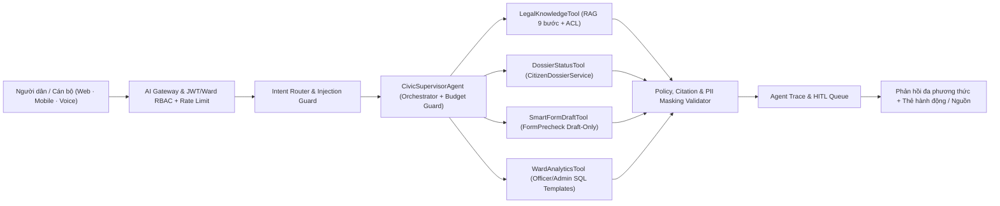

# SO SÁNH KIẾN TRÚC AI: SMARTWARD AI HIỆN TẠI VS. ENTERPRISE AI AGENT PLATFORM

> **Phạm vi tài liệu:** Đối chiếu kiến trúc hệ thống SmartWard AI hiện hữu (được xác minh trực tiếp trên mã nguồn nhánh `develop` / `main`) với mô hình chuẩn **Enterprise AI Agent Platform** (Hybrid RAG + Text-to-SQL + API Tools + Workflow + Multi-Agent), từ đó đề xuất lộ trình nâng cấp phù hợp cho bài toán Hành chính công & Đô thị thông minh cấp xã/phường trong ràng buộc ngân sách **`<= 2048 MiB` RAM**.

---

## 1. Định vị Tổng quan trên Lộ trình 4 Giai đoạn

Theo chuẩn tiến hóa **Enterprise AI Agent Platform** (4 giai đoạn: *1. Enterprise RAG → 2. Enterprise Data Access → 3. AI Agent Platform → 4. Enterprise AI Ecosystem*), trạng thái hiện tại của **SmartWard AI** được định vị như sau:

| Giai đoạn chuẩn | Trọng tâm năng lực | Mức độ SmartWard AI đạt được | Hiện trạng thực tế trong hệ thống |
| :--- | :--- | :---: | :--- |
| **Giai đoạn 1 — Enterprise RAG** | Quản trị tài liệu, Parsing/Chunking, Hybrid Search, Grounded Chat có trích dẫn nguồn | **~90%** | Đã có Crawler diff, chuẩn hóa tiếng Việt, chunking theo cấu trúc điều khoản, quản trị phiên bản 40 TTHC, `pgvector` HNSW 768 chiều, ngưỡng từ chối `theta = 0.78` và hậu kiểm citation. |
| **Giai đoạn 2 — Enterprise Data Access** | Kết nối DB, Text-to-SQL, REST API Connector, kiểm soát quyền dữ liệu | **~45%** | Đã có hệ thống REST API nghiệp vụ (hồ sơ công dân, tờ khai, sự cố GPS, Vault) phân quyền chặt theo JWT và `wardCode`, nhưng AI chưa kết nối trực tiếp vào DB/API qua công cụ chuẩn hóa. |
| **Giai đoạn 3 — AI Agent Platform** | Supervisor Agent, Tool Calling, Workflow điều phối, HITL, Agent Memory | **~35%** | Đã có hàng đợi Human-in-the-Loop vùng xám `[0.42, 0.78)` (`hitl_gray_zone_queue`), quy trình duyệt hồ sơ & duyệt TTHC; nhưng chưa có **Supervisor Agent** và **Tool Calling** động. |
| **Giai đoạn 4 — Enterprise AI Ecosystem** | Multi-Tenant, Multi-Agent, Plugin Marketplace, Model Gateway, Evaluation | **~40%** | Đã cô lập dữ liệu 96 xã/phường (`wardCode`), có `AiModelClient` đổi model và bộ `ExperimentRunnerService` đánh giá benchmark; chưa có Tool/Connector Marketplace và Tracing cấp Agent. |

**Điểm khác biệt cốt lõi về triết lý thiết kế:**
- **Enterprise AI Agent Platform:** Tối ưu cho **tổng hợp linh hoạt đa nguồn và tự hành theo kế hoạch** (Agent tự chọn RAG, SQL hay gọi API rồi tổng hợp).
- **SmartWard AI hiện tại:** Tối ưu cho **tính tất định, an toàn pháp lý tuyệt đối và chi phí hạ tầng siêu gọn (`<= 2048 MiB` RAM)**. Mỗi nghiệp vụ chạy qua một pipeline tách biệt có kiểm soát, tránh ảo giác pháp lý và tránh rò rỉ dữ liệu công dân.

---

## 2. Bảng So sánh Chi tiết theo 7 Lớp Kiến trúc & Hạ tầng

| Lớp kiến trúc / Tiêu chí | Mô hình Enterprise AI Agent Platform (Đề xuất chuẩn) | SmartWard AI Hiện tại (Thực tế trong mã nguồn) | Mức đáp ứng & Nhận xét kỹ thuật |
| :--- | :--- | :--- | :--- |
| **Luồng xử lý cốt lõi** | `User → AI Gateway → Intent Router → Agent Orchestrator → (RAG / SQL / API / Workflow) → Validation → Answer` | Đã vượt mức `User → LLM → Vector` đơn giản, nhưng đang tổ chức thành **các endpoint chuyên biệt độc lập** (`/api/v1/rag/ask`, `/forms/precheck`, `/dossiers/track`, `/issues/report`) | **~60%** — Mỗi luồng riêng có Validation chặt, nhưng chưa có `Agent Orchestrator` hợp nhất nhiều thao tác trong 1 lượt hội thoại. |
| **01. User Interaction Layer** | Web Chat · Mobile · Internal Portal · Voice · API | Đầy đủ cả 5 kênh: Web PWA (`frontend/`), Mobile Expo 6 màn hình (`mobile/`), Dashboard Cán bộ/Admin, Voice TTS (`VoiceService.java` + Piper ONNX), REST API | **~95%** — Đã đồng bộ đa nền tảng và có TTS tiếng Việt ngoại tuyến. |
| **02. AI Gateway & Security** | Auth · RBAC/ABAC · Tenant · Rate Limit · Audit | Spring Security stateless JWT RBAC (`OfficerSecurityConfig.java`: `OFFICER`, `ADMIN`, `PIN_CHANGE_ONLY`), cách ly theo `wardCode`, `RedisRateLimiter.java`, `ClientIpResolver.java`, `AuditService.java`, `ZeroTrustVaultService.java` (AES-256-GCM + OTT 410 GONE) | **~90% (Điểm mạnh)** — Bảo mật dữ liệu nhạy cảm công dân sâu hơn mô hình chuẩn; chỉ thiếu lọc quyền ngay trong truy vấn chunk RAG (ACL-aware retrieval). |
| **03. AI Orchestration Layer** *(Router · Planner · Tool Executor · Synthesizer)* | Phân loại ý định → Lập kế hoạch đa bước → Thực thi Tools → Tổng hợp phản hồi | Có phân loại 6 intent ở Sidecar (`ml/sidecar/serve.py`) và frontend (`intentClassifier.ts`), nhưng **chưa có Agent Planner và Tool Executor** để LLM tự gọi ngược vào service nghiệp vụ | **~25% (Khoảng trống chính)** — Bộ định tuyến mới dùng để chặn ngoài phạm vi hoặc rẽ nhánh trả lời văn bản tĩnh. |
| **04. Intelligence Engine** *(RAG · SQL · Tool · Workflow)* | Kết hợp đủ 4 engine dưới một tầng điều phối | **RAG:** `RagQueryService.java` hoàn chỉnh. **Text-to-SQL:** Chưa có. **API Tools:** Service đã có (`CitizenDossierService`, `FormPrecheckService`, `TwoStageTriageService`) nhưng chưa bọc thành Tool cho AI. **Workflow:** Quy trình cứng 2 lớp (duyệt hồ sơ & duyệt TTHC/HITL). | **1.5 / 4 cơ chế** — Năng lực xử lý nghiệp vụ đã viết sẵn ở backend nhưng chưa mở khóa cho AI gọi. |
| **Mô hình Multi-Agent** | `Supervisor Agent` điều phối `Knowledge`, `Data Analyst`, `Business`, `Action`, `Report`, `Support Agent` | **Modular Monolith Service** đơn nhiệm; chưa có tách Agent theo vai trò và bộ quyền Tool riêng | **~15%** — Phù hợp nâng cấp lên mô hình gọn (`1 Supervisor + 3–4 Tool/Agent`). |
| **05. Data & Knowledge Layer** | Vector DB · Document Store · SQL · Data Warehouse · Metadata · Cache | `PostgreSQL 16 + pgvector` (`LegalChunk`, `CitizenDossier`, `CivicReport`, `HitlGrayZoneItem`, `ProcedureVersion`), `Redis 7` (`QueryCacheService`, GEO `R = 25m`, OTT Vault), `MinIO / S3 Bucket` (ảnh mã hóa Vault) | **~85%** — Rất sạch và nhất quán; chưa có tầng `Agent Memory` theo phiên/ngữ cảnh dài hạn và bảng `agent_traces`. |
| **06. Enterprise Data Sources** | ERP / CRM / HRM · DB nội bộ · PDF/DOCX/Excel · Email/KB · Webhook · Cloud Storage | 40 bộ JSON TTHC chuẩn hóa (`db/seed/procedures/`), Crawler web hành chính (`.github/workflows/knowledge-pipeline.yml`), DB hồ sơ & phản ánh hiện trường, biểu mẫu `.DOCX`/`.PDF`, `MinIO/S3` | **~70%** — Khối tri thức pháp lý rất chuẩn, nhưng chưa tích hợp trực tiếp CSDL Quốc gia/Hệ thống Một cửa bên ngoài qua Connector chuẩn. |
| **07. Governance & Observability** | Monitoring · Evaluation · Logging · Cost · Security · Feedback | `ExperimentRunnerService.java` (benchmark RAG/Form/Triage), `MaskingMessageConverter.java` (che CCCD/SĐT trong log), `CorrelationIdFilter.java`, `/rag/feedback`, HITL queue | **~75%** — Thiếu bảng truy vết chuỗi gọi Tool của Agent, đo mức tiêu thụ token/chi phí Gemini và bộ dò Prompt Injection chuyên dụng. |
| **Hạ tầng & Ngân sách RAM** | Microservices tách rời (Qdrant/Milvus, Elasticsearch, Kafka, Keycloak, LangGraph...) thường tốn `8–16 GB RAM` | Modular Monolith Spring Boot 3 (Java 21) + PostgreSQL/`pgvector` + Redis + Sidecar PhoBERT INT8 + Nginx Alpine nằm gọn trong **`<= 2048 MiB` RAM** (trên Railway thực tế dùng `~626 MiB`) | **SmartWard AI vượt trội về tối ưu chi phí vận hành** cho hạ tầng cấp phường/xã. |

---

## 3. Đối chiếu 4 Cơ chế Xử lý Dữ liệu

| Cơ chế | Yêu cầu của Enterprise AI Agent | Hiện trạng SmartWard AI | Khoảng trống cần bổ sung |
| :--- | :--- | :--- | :--- |
| **1. RAG** *(Tìm kiếm tri thức)* | Truy xuất văn bản, chính sách, quy định có trích dẫn nguồn & kiểm soát quyền | **Đã triển khai đầy đủ:** `RagQueryService.java` truy vấn 768 chiều trên `pgvector`, tách 5 phần chuẩn Nghị định, chặn `theta = 0.78`, vùng xám `0.42–0.78` đẩy HITL | Bổ sung lọc quyền `visibility_scope` (Công dân vs. Cán bộ), Hybrid RRF (`pgvector` + PostgreSQL FTS `tsvector`) và đồng bộ `embedding_model` nhất quán trên cloud. |
| **2. Text-to-SQL** *(Truy vấn dữ liệu sống)* | Truy vấn số liệu theo thời gian thực để phân tích nguyên nhân & lập báo cáo | **Chưa có:** Toàn bộ thống kê/danh sách đang viết cố định qua Spring Data JPA Repositories | **Không mở Text-to-SQL thô** cho LLM (nguy cơ lộ CCCD/dữ liệu liên xã); thay bằng **Parameterized Analytics Tools** khóa cứng `wardCode` từ JWT. |
| **3. API Tools** *(Thao tác hệ thống)* | AI gọi API tra cứu hồ sơ, điền nháp tờ khai, kiểm tra điều kiện | **Mới có REST API riêng lẻ:** `CitizenDossierService.trackDossier`, `FormPrecheckService`, `TwoStageTriageService` chưa được khai báo thành Tool | Đóng gói 3–4 luồng đọc/kiểm tra/điền nháp thành Tool có schema JSON rõ ràng cho `CivicSupervisorAgent` gọi tự động. |
| **4. Workflow** *(Điều phối quy trình)* | AI kích hoạt quy trình phê duyệt, gửi thông báo, yêu cầu người dùng xác nhận | **Có Workflow cứng:** Duyệt TTHC (`ProcedureGovernanceService.java`), duyệt hồ sơ + QR (`CitizenDossierService.java`), duyệt câu trả lời vùng xám HITL | Cho phép Agent khởi tạo bước trung gian (VD: tạo bản nháp tờ khai / đẩy câu hỏi vào HITL) nhưng **luôn dừng ở nút xác nhận của con người** trước khi ghi DB chính thức. |

---

## 4. Đối chiếu 9 Bước Enterprise RAG & 6 Yếu tố Linh hoạt

### 4.1. Pipeline Enterprise RAG 9 bước

| Bước | Thành phần chuẩn | Trạng thái ở SmartWard AI | Bằng chứng / Ghi chú kỹ thuật |
| :---: | :--- | :---: | :--- |
| **1** | **Data Ingestion** | ✅ Có | `knowledge-pipeline.yml` thu thập và kiểm tra SHA-256 hash theo lịch định kỳ; `ProcedureDataSeeder.java` nạp seed non-destructive. |
| **2** | **Document Parsing** | ⚠️ Một phần | Chủ yếu ingest JSON đã cấu trúc; phía tờ khai có OCR Vision & chuẩn hóa text, chưa có bộ parser PDF/Word đa cột tự động thành chunk. |
| **3** | **Normalization** | ✅ Có | `VietnameseTextNormalizer.java`, `TextNormalizationUtils.java`, giải nghĩa từ viết tắt/phương ngữ Nam Bộ. |
| **4** | **Chunking** | ✅ Có | `LegalChunkingService.java` giữ nguyên `header_path`, `section_name`, `chunk_type`. |
| **5** | **Metadata & ACL** | ⚠️ Một phần | `LegalChunk.java` đã có `effective_date`, `content_hash`, `embedding_model`, `status`, nhưng **chưa có cột `visibility_scope` / `ward_code` ACL**. |
| **6** | **Embedding & Indexing** | ✅ Có | Hỗ trợ `gemini-embedding-001` (MRL 768-dim) và Sidecar PhoBERT INT8 kèm pgvector HNSW + Incremental re-index khi duyệt bản mới (`ProcedureGovernanceService`). |
| **7** | **Hybrid Retrieval** | ⚠️ Một phần | Đã có Vector Search + Hybrid Keyword Match fallback; chưa dùng công thức **RRF (Reciprocal Rank Fusion)** chuẩn với PostgreSQL `tsvector`. |
| **8** | **Reranking** | ❌ Chưa có | Chưa có bước chấm điểm lại (Cross-Encoder hoặc Lexical/Section Reranker) cho top-K đoạn trước khi qua ngưỡng `theta = 0.78`. |
| **9** | **Grounded Generation** | ✅ Có | Ràng buộc trích dẫn `[CHUNK_CODE]`, hậu kiểm citation trong câu trả lời và fallback cấu trúc DB khi LLM ngoài gặp HTTP 503. |

*(Các yêu cầu đặc biệt của Enterprise RAG: **Document Versioning** & **Incremental Indexing** đã có ở `ProcedureGovernanceService.java` + `ProcedureVersion.java`; **Source Citation** & **Feedback/Evaluation** đã có ở `RagQueryService.java` + `ExperimentRunnerService.java`; **Access Control** ở tầng chunk là phần cần bổ sung tiếp theo.)*

### 4.2. 6 yếu tố linh hoạt của nền tảng

| Yếu tố | Đánh giá ở SmartWard AI | Khoảng trống cần mở rộng |
| :--- | :---: | :--- |
| **Model Agnostic** | **✅ Tốt** | `AiModelClient.java` tách hoàn toàn `GeminiAiClient`, `SidecarAiModelClient`, `DeterministicMockAiClient`; dễ cắm thêm OpenAI/Claude/Ollama nội bộ. |
| **Connector Agnostic** | **⚠️ Thấp** | Dữ liệu nguồn mới đọc từ seed JSON, PostgreSQL nội bộ và MinIO/S3; chưa có interface `DataConnector` chuẩn cho Cổng Dịch vụ công Quốc gia hay hệ thống Một cửa ngoài. |
| **Agent Extensibility** | **❌ Chưa có** | Chưa có abstraction cho Agent chuyên môn với prompt, quyền và tập Tool riêng. |
| **Tool Extensibility** | **❌ Chưa có** | Chưa có `ToolRegistry` khai báo mô tả/schema các hàm nghiệp vụ để LLM gọi động. |
| **Knowledge Isolation** | **⚠️ Một phần** | Dữ liệu hồ sơ & phản ánh đã cách ly 96 xã/phường qua `wardCode`; tri thức RAG vẫn dùng chung 1 bảng công khai. |
| **Dynamic Configuration** | **⚠️ Một phần** | Quản trị viên đã sửa/duyệt/rollback 40 TTHC và đổi ngưỡng `RAG_DEFAULT_THRESHOLD` qua biến môi trường, chưa có bảng cấu hình Agent/Prompt động trên UI Admin. |

---

## 5. Đối chiếu Nguyên tắc Bảo mật & Quản trị AI

| Nguyên tắc bảo mật Enterprise AI | Trạng thái SmartWard AI | Cơ chế cụ thể |
| :--- | :---: | :--- |
| Không cho LLM truy cập tự do toàn bộ DB | ✅ An toàn tuyệt đối | Hiện chưa cấp SQL access cho LLM (nếu nâng cấp chỉ mở hàm thống kê có tham số hóa). |
| Kiểm tra & giới hạn câu lệnh SQL | ➖ Chưa phát sinh / Phải khóa sẵn | Bắt buộc whitelist bảng/view chỉ đọc và ép `WHERE ward_code = :jwtWardCode` khi bổ sung Analytics Tool. |
| Phân quyền tài liệu ngay trong quá trình Retrieval | ⚠️ Cần bổ sung | Cần thêm `visibility_scope` + `ward_code` ngay trong query SQL `pgvector` trước khi đưa context cho LLM. |
| Tách dữ liệu từng Tenant / Đơn vị | ✅ Rất chặt | Cách ly 96 xã/phường (`wardCode`) cho hồ sơ, phản ánh hiện trường và tài khoản công chức. |
| Chặn Agent tự thực hiện giao dịch khi chưa phê duyệt | ✅ Đạt | Mọi thao tác thay đổi trạng thái pháp lý (nộp hồ sơ, duyệt QR, ban hành TTHC) đều qua endpoint có xác nhận con người. |
| Nhật ký truy vết đầy đủ | ⚠️ Đạt một phần | `AuditService.java` + `MaskingMessageConverter.java` ghi đầy đủ đăng nhập/duyệt/Vault OTT, cần thêm bảng `agent_traces` cho chuỗi gọi Tool. |
| Phát hiện Prompt Injection từ tài liệu & nguồn ngoài | ⚠️ Một phần | Hiện có lọc từ khóa & ngưỡng cosine/keyword; cần thêm lớp kiểm tra ký tự ẩn/chỉ thị giả mạo trong văn bản crawl và payload input của người dân. |

---

## 6. Phản biện Kiến trúc: 3 Thành phần KHÔNG NÊN bê nguyên xi vào SmartWard AI

1. **Không mở Text-to-SQL tự do (LLM tự sinh SQL thô):**
   - CSDL `smartward_db` chứa thông tin CCCD, số điện thoại công dân và ranh giới bảo mật 96 xã/phường. Nếu để LLM tự sinh SQL từ câu hỏi tự nhiên, rủi ro bị Prompt Injection chèn điều kiện đọc chéo xã khác hoặc lộ dữ liệu cá nhân rất cao.
   - **Giải pháp thay thế an toàn:** Dùng **Semantic Analytics Tools** (VD: `getWardSlaSummary(wardCode, days)`, `getTopReturnedProcedures(wardCode)`) nơi `wardCode` luôn lấy từ JWT đã xác thực chứ không lấy từ LLM.
2. **Không thêm Qdrant / Elasticsearch / Kafka / Keycloak:**
   - Stack microservices nặng này đòi hỏi `8–16 GB RAM`, phá vỡ trần ngân sách **`<= 2048 MiB` RAM** (và chạy cloud miễn phí/tối ưu ~`626 MiB` như trên Railway).
   - **Giải pháp thay thế:** Khai thác tối đa cặp **PostgreSQL 16 (`pgvector` + `tsvector` GIN FTS)** và **Redis 7 (Cache + GEO + Pub/Sub)** đã có sẵn.
3. **Không để Action Agent tự ý nộp hồ sơ hoặc ký duyệt thay công chức:**
   - Trong hành chính công, chữ ký/tờ khai và quyết định trả hồ sơ có giá trị pháp lý. Agent chỉ nên **điền nháp (Pre-fill Draft)** và kiểm tra thiếu sót qua `FormPrecheckService`; người dân hoặc cán bộ luôn là người bấm nút gửi/duyệt cuối cùng.

---

## 7. Kiến trúc Đề xuất cho SmartWard AI: "Civic AI Agent Platform" (`<= 2048 MiB` RAM)

Thay vì thay thế hoàn toàn hạ tầng đang chạy ổn định, SmartWard AI chỉ cần chèn thêm lớp **Agent Orchestration & Tool Registry** ngay trong Spring Boot 3 Modular Monolith hiện có:

### Lộ trình 4 Chặng Nâng cấp Cụ thể (Từ Hiện tại → Civic AI Agent Platform)

| Chặng | Mục tiêu nâng cấp | Thay đổi kỹ thuật dự kiến | Tác động RAM |
| :---: | :--- | :--- | :---: |
| **Chặng 1** | **RAG 9/9 bước + ACL & Sửa lệch Embedding Cloud** | Thêm `visibility_scope` / `ward_code` vào `LegalChunk`; dùng `pgvector + tsvector RRF` + Lightweight Reranker; tự động đồng bộ lại `gemini-embedding-001` khi khởi động nếu thiếu chunk. | `+0 MiB` *(tận dụng PostgreSQL)* |
| **Chặng 2** | **Lớp Orchestrator & 4 API Tools (`CivicSupervisorAgent`)** | Thêm package `vn.edu.uth.smartward.agent`: `CivicSupervisorAgent`, `ToolRegistry` (dùng Gemini Function Calling / Spring AI) bọc `LegalKnowledgeTool`, `DossierStatusTool`, `SmartFormDraftTool` (trả payload điền sẵn cho Web/Mobile) và `WardAnalyticsTool` (chỉ role `OFFICER`/`ADMIN`). | `+20–40 MiB` *(trong heap JVM 512 MB)* |
| **Chặng 3** | **Truy vết Agent & Chống Prompt Injection** | Tạo bảng `agent_traces` gắn với `X-Correlation-ID`; hiển thị các bước suy luận/gọi Tool trên giao diện chat Web & Mobile; thêm bộ lọc Injection trên đầu vào & tài liệu crawl. | `+0–10 MiB` |
| **Chặng 4** | **Agent Memory có TTL & Kết nối ngoài chuẩn hóa** | Lưu ngữ cảnh hội thoại ngắn hạn theo phiên trên Redis (TTL 30 phút, `noeviction` tách key rõ ràng); chuẩn hóa interface `CivicDataConnector` để cắm thêm CSDL địa phương/Webhook mà không sửa Orchestrator. | `+10 MiB` *(Redis)* |

---

### Kết luận ngắn

SmartWard AI **không phải xây lại từ đầu** để tiệm cận mô hình **Enterprise AI Agent Platform**. Nền tảng hiện tại đã nắm giữ sẵn **3 phần khó nhất** ở cấp production là **bảo mật phân quyền + Zero-Trust Vault**, **RAG pháp lý có chốt chặn chống ảo giác (`theta = 0.78`)**, và **các nghiệp vụ lõi đã chạy thật** (40 TTHC, Sơ duyệt 4 biểu mẫu, Theo dõi hồ sơ QR, Sự cố GPS 25m). Việc bổ sung thêm **lớp `CivicSupervisorAgent` + Tool Calling có kiểm soát + ACL Retrieval** chính là cầu nối gọn nhẹ nhất để biến các phân hệ rời rạc hiện nay thành một nền tảng AI Agent thống nhất.
