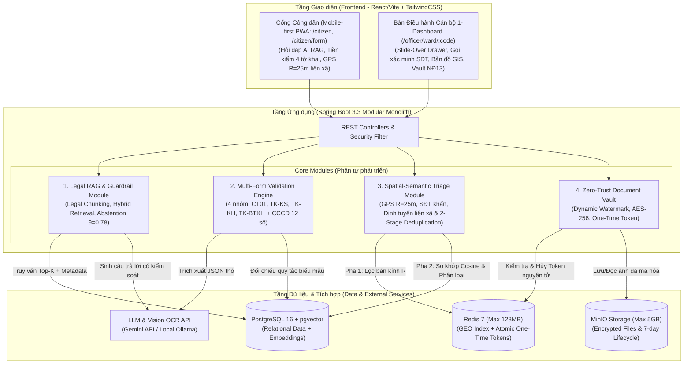
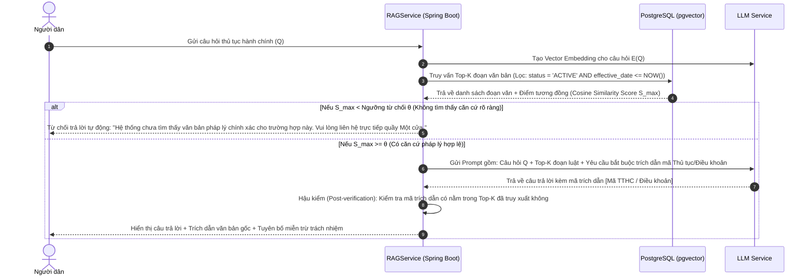
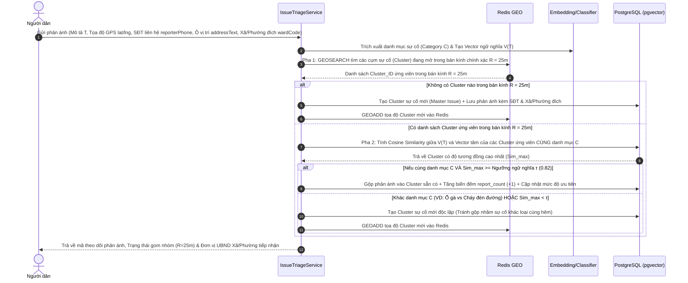
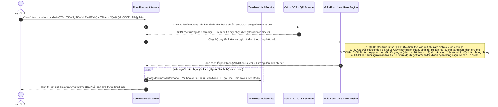
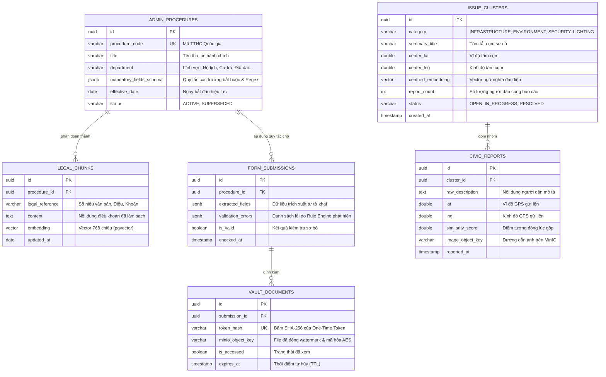

# Kiến trúc Hệ thống, Luồng Xử lý & Cơ sở Dữ liệu
**Dự án:** SmartWard AI (Civic Governance & Legal RAG Platform)  
**Tài liệu tham khảo cho:** Báo cáo Học kỳ Doanh nghiệp & Đồ án Tốt nghiệp (Chương 2 & Chương 3)

---

## 1. Lý giải Lựa chọn Công nghệ (Tránh Over-engineering)

Trong quy mô đồ án tốt nghiệp và giai đoạn thực tập 3 tháng do 1 sinh viên thực hiện, kiến trúc hệ thống được tinh gọn thành **Modular Monolith** thay vì Microservices hay phân tán phức tạp:

* **Vì sao không dùng Apache Kafka?**  
  Với lưu lượng cấp phường/xã (vài trăm đến vài nghìn yêu cầu/ngày), việc duy trì và vận hành một cụm Kafka là dư thừa tài nguyên (Over-engineering) và tiêu tốn tối thiểu 1–2 GB RAM. Hệ thống tận dụng cơ chế `Spring ApplicationEvents` kết hợp `@Async ThreadPoolExecutor` và hàng đợi nhẹ trên Redis để xử lý các tác vụ nền (như gọi OCR API, sinh vector embedding) mà vẫn đảm bảo giao diện phản hồi mượt mà không bị block.
* **Vì sao chọn Web-First Responsive / PWA thay vì phát triển thêm Native Mobile App?**  
  Người dân khi đến làm thủ tục hành chính tại UBND rất ngại cài đặt thêm ứng dụng di động mới lên điện thoại cá nhân. Thay vào đó, giải pháp Web Responsive / PWA cho phép người dân chỉ cần quét mã QR tại quầy Một cửa để mở ứng dụng ngay trên trình duyệt di động: tận dụng trực tiếp HTML5 Camera API để chụp tờ khai và Geolocation API để bắt tọa độ GPS sự cố hiện trường mà không cần cài đặt. Điều này vừa tối ưu hóa trải nghiệm tiếp cận dịch vụ công, vừa loại bỏ rủi ro vỡ tiến độ khi 1 sinh viên phải duy trì 2 codebase giao diện độc lập trong 12 tuần (phân hệ Native App được quy hoạch là hướng phát triển mở rộng trong tương lai).
* **Vì sao dùng PostgreSQL kèm pgvector?**  
  Gộp chung dữ liệu quan hệ (thông tin thủ tục, hồ sơ, phản ánh hiện trường, người dùng) và dữ liệu vector (embedding điều khoản pháp luật, vector mô tả sự cố) vào cùng một hệ quản trị CSDL giúp đảm bảo toàn vẹn giao dịch (ACID). Điều này cho phép thực hiện các truy vấn kết hợp (Hybrid Search: lọc metadata SQL kết hợp đo khoảng cách cosine) trong một câu lệnh duy nhất mà không cần đồng bộ dữ liệu sang một Vector DB độc lập (như Milvus hay Pinecone).
* **Vì sao dùng Redis?**  
  Redis giải quyết hai bài toán chuyên biệt mà SQL truyền thống xử lý chậm hơn khi tần suất cao:  
  1. Truy vấn bán kính địa lý (`GEOSEARCH`) với độ trễ mili-giây.  
  2. Thao tác kiểm tra và xóa token truy cập một cách nguyên tử (`GETDEL` hoặc Redis Lua Script) để triển khai cơ chế kho tài liệu một lần xem (One-Time Token Vault) chống race conditions.
* **Vì sao dùng MinIO?**  
  Tách biệt hoàn toàn việc lưu trữ tệp nhị phân (ảnh chụp tờ khai, ảnh phản ánh hiện trường) khỏi CSDL PostgreSQL, giảm kích thước backup database, hỗ trợ Pre-signed URL và tận dụng chính sách vòng đời tệp (ILM - Lifecycle Policy) tự động hủy sau 7 ngày.

---

## 2. Sơ đồ Kiến trúc Hệ thống (System Architecture Diagram)

---

## 3. Sơ đồ Tuần tự cho 3 Luồng Nghiệp vụ Lõi (Sequence Diagrams)

### Luồng 1: Hỏi đáp Thủ tục Hành chính với Cơ chế Từ chối Trả lời (RAG + Abstention Guardrail)

---

### Luồng 2: Phân loại và Gom nhóm Phản ánh Hiện trường 2 Pha (Spatial-Semantic Deduplication)

---

### Luồng 3: Tiền Kiểm Định Đa Biểu Mẫu Hành Chính (OCR + 4-Form Deterministic Rule Engine)

---

## 4. Thiết kế Cơ sở Dữ liệu (ERD - 6 Bảng Cốt lõi trên PostgreSQL)

