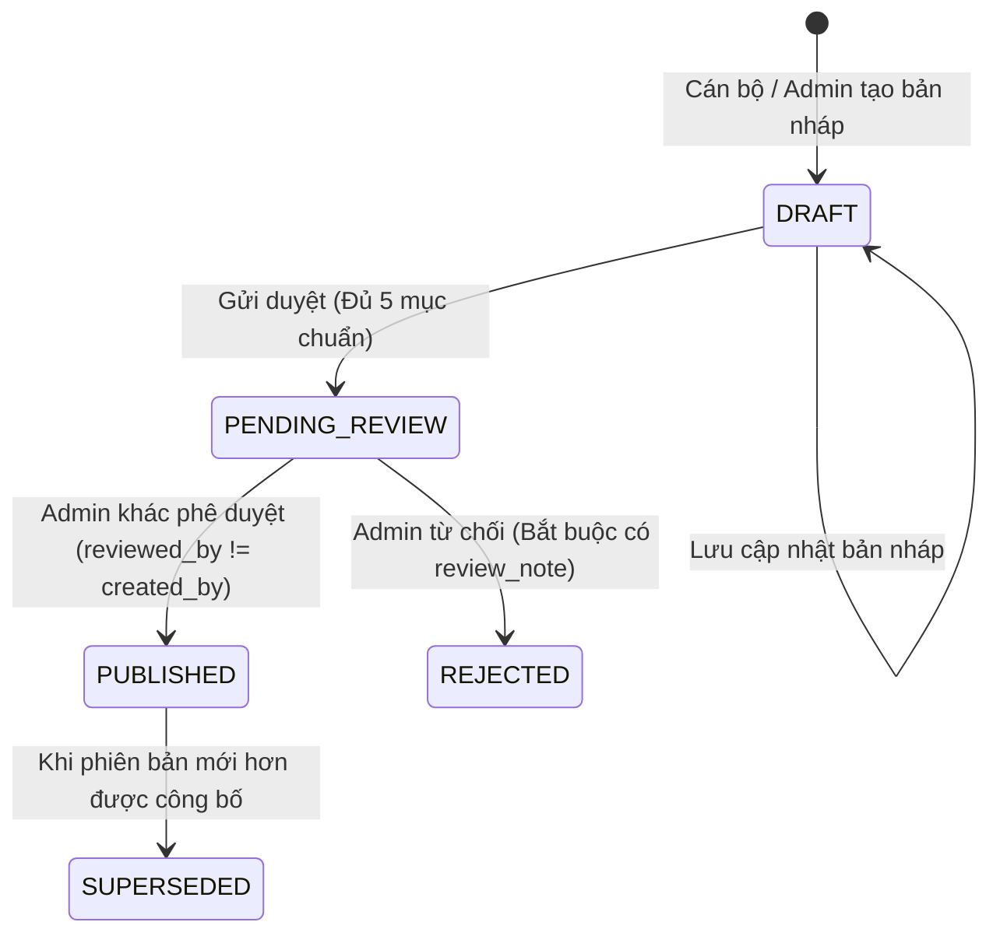

# ĐẶC TẢ QUẢN TRỊ 40 THỦ TỤC HÀNH CHÍNH (VÒNG LẶP ĐỀ XUẤT → DUYỆT → CÔNG BỐ)

## 1. Mục tiêu Kiến trúc
Thiết lập **Một Nguồn Sự Thật Duy Nhất (Single Source of Truth)** trong PostgreSQL (`admin_procedures` + `procedure_versions`) cho toàn bộ 40 Thủ tục hành chính cấp xã/phường/đặc khu Tỉnh An Giang, đảm bảo mọi thay đổi nội dung pháp lý bắt buộc đi qua kiểm soát 4 mắt (**Soạn nháp → Gửi duyệt → Admin phê duyệt → Tự động cập nhật RAG & Audit Log bất biến**).

## 2. Sơ đồ Vòng đời Phiên bản (State Machine)

## 3. Cấu trúc Cơ sở dữ liệu (`V10__procedure_governance_compact.sql`)
1. **`admin_procedures` (Mở rộng):**
   - `current_version_id BIGINT NULL` (Khóa ngoại `DEFERRABLE INITIALLY DEFERRED` trỏ tới `procedure_versions(id)`).
   - `form_template_key VARCHAR(32) NOT NULL DEFAULT 'GENERAL'` (`CT01`, `TK-KS`, `TK-KH`, `TK-BTXH`, `GENERAL`).
2. **`procedure_versions` (Bảng mới):**
   - Lưu nội dung theo khung 5 mục chuẩn trong cột `content JSONB`:
     1. `trinh_tu` (Trình tự thực hiện)
     2. `thanh_phan_ho_so` (Thành phần hồ sơ)
     3. `thoi_han_le_phi` (Thời hạn giải quyết & Lệ phí)
     4. `co_quan_thuc_hien` (Cơ quan thực hiện)
     5. `can_cu_phap_ly` (Căn cứ pháp lý)
   - Ràng buộc `uq_procedure_versions_one_published`: Partial Unique Index (`WHERE state = 'PUBLISHED'`) cam kết mỗi TTHC chỉ có tối đa 1 bản `PUBLISHED` tại mọi thời điểm.
3. **`audit_log` (Bất biến ở tầng PostgreSQL Engine):**
   - Bổ sung `version_no INT`, `before_snapshot JSONB`, `after_snapshot JSONB`.
   - Trigger `trg_audit_log_no_update_delete` (`BEFORE UPDATE OR DELETE FOR EACH ROW`) và `trg_audit_log_no_truncate` (`BEFORE TRUNCATE FOR EACH STATEMENT`) chặn mọi hành vi sửa/xóa lịch sử kiểm toán.

## 4. Đặc tả REST API (`/api/v1/admin/*`)

| Phương thức | Endpoint | Quyền tối thiểu | Mô tả nghiệp vụ |
| :--- | :--- | :--- | :--- |
| `GET` | `/api/v1/admin/procedures` | `ROLE_OFFICER` | Danh sách 40 TTHC kèm phiên bản hiện hành, độ đầy đủ (`5/5 mục`) và số đề xuất chờ duyệt |
| `GET` | `/api/v1/admin/procedures/{code}` | `ROLE_OFFICER` | Chi tiết TTHC, bản `PUBLISHED` hiện tại và lịch sử các phiên bản |
| `POST` | `/api/v1/admin/procedures/{code}/proposals` | `ROLE_OFFICER` | Tạo mới hoặc cập nhật bản nháp (`DRAFT`); làm sạch HTML/XSS |
| `POST` | `/api/v1/admin/proposals/{id}/submit` | `ROLE_OFFICER` | Kiểm tra đủ 5 mục chuẩn và chuyển `DRAFT` → `PENDING_REVIEW` |
| `GET` | `/api/v1/admin/proposals?state=PENDING_REVIEW` | `ROLE_ADMIN` | Lấy hàng đợi các đề xuất chờ phê duyệt |
| `GET` | `/api/v1/admin/proposals/{id}/diff` | `ROLE_ADMIN` | So sánh từng mục giữa bản đang công bố và bản đề xuất mới |
| `POST` | `/api/v1/admin/proposals/{id}/approve` | `ROLE_ADMIN` | Kiểm tra `reviewed_by != created_by` (`403` nếu trùng), chuyển bản cũ sang `SUPERSEDED`, công bố bản mới và chỉ re-embed những chunk có `content_hash` thay đổi |
| `POST` | `/api/v1/admin/proposals/{id}/reject` | `ROLE_ADMIN` | Từ chối đề xuất (bắt buộc có `reviewNote`) |

## 5. Hướng phát triển giai đoạn tiếp theo (Backlog)
- Nút Rollback nhanh về phiên bản `SUPERSEDED` bất kỳ trên giao diện.
- Cờ đỏ xác nhận từng trường nhạy cảm (`acknowledgedFlags`).
- Đồng bộ tự động từ pipeline thu thập dữ liệu (`source = 'PIPELINE'`) và nút tạo đề xuất trực tiếp từ phản hồi vùng xám HITL (`source = 'FEEDBACK'`).
- Chuyển toàn bộ bộ phân loại ý định Frontend sang đọc động từ `/api/v1/procedures/catalog`.
