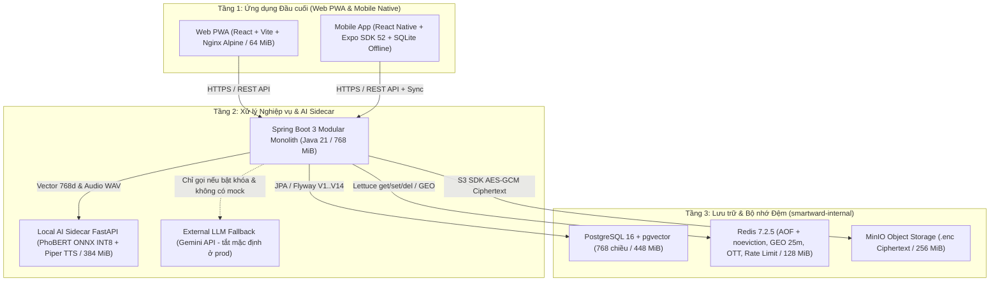
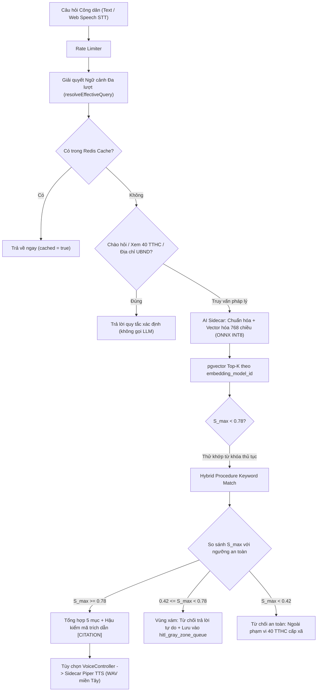
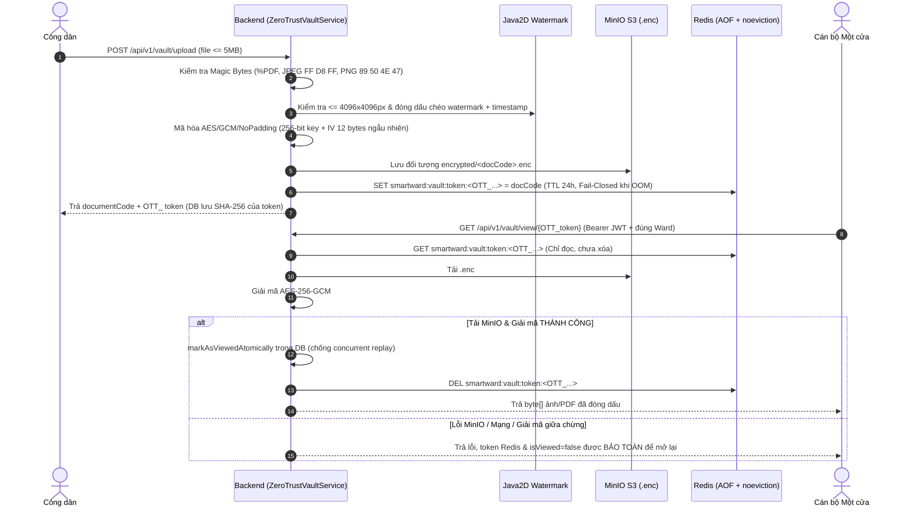
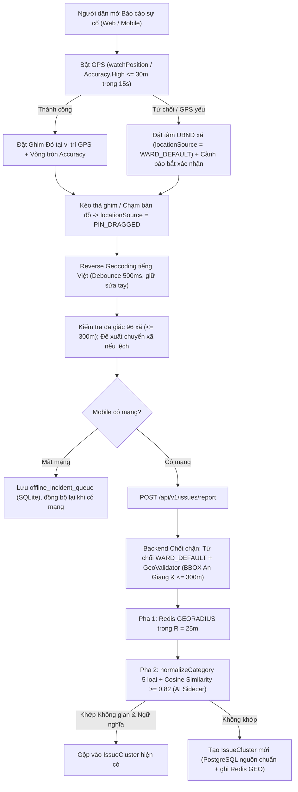

# TỔNG QUAN HỆ THỐNG SMARTWARD AI

> **Tên hệ thống:** SmartWard AI — Trợ lý Hành chính công & Đô thị thông minh cấp Xã/Phường  
> **Phạm vi địa bàn:** Tỉnh An Giang — theo phương án sắp xếp toàn tỉnh có **102 đơn vị hành chính cấp xã**; mã nguồn và dữ liệu hình học hiện hành (`wards.geo.json` & `angiangWardsCatalog.ts`) đã nạp **96 đơn vị** (`14` Phường, `79` Xã, `3` Đặc khu: Phú Quốc, Kiên Hải, Thổ Châu), còn **thiếu 6 xã** (đang chờ đồng bộ từ nhánh `1c`, tuyệt đối không tự tạo ranh giới giả lập).  
> **Phạm vi nghiệp vụ:** **40 Thủ tục Hành chính (TTHC) cấp xã** (đã loại bỏ 3 mã cũ: `TTHC-BT-06`, `TTHC-CR-05`, `TTHC-CT-03`), **4 Mẫu Tờ khai Điện tử**, **Kho Bảo mật Zero-Trust Vault**, **Hàng đợi Vùng xám HITL bền vững**, và **Phản ánh Sự cố Hiện trường GIS 2 Pha**.  
> **Nhánh mã nguồn đối chiếu:** `bugfix/hardening-vault-redis-sla-hitl` (tạo từ `develop` `a5547ee`, cập nhật ngày `2026-11-20`).

---

## 1. Mục tiêu & Cơ sở Pháp lý

SmartWard AI đóng vai trò **"Bộ đệm Tiền kiểm và Trợ lý Hướng dẫn Hành chính" (Pre-screening Buffer & Civic Assistant)** trước khi công dân nộp hồ sơ trực tiếp tại Bộ phận Một cửa UBND cấp xã/phường hoặc qua Cổng Dịch vụ công:

1. **Giảm sai sót hồ sơ giấy:** Hỗ trợ kiểm tra chất lượng ảnh chụp tờ khai, quét QR CCCD và kiểm tra logic ngày tháng/CCCD trước khi đi lại.
2. **Hỗ trợ tra cứu 40 TTHC có kiểm soát:** Truy xuất theo ngữ nghĩa kết hợp từ khóa và trích dẫn điều khoản, ép từ chối trả lời tự do khi độ tương đồng thấp hơn ngưỡng an toàn.
3. **Bảo vệ dữ liệu cá nhân theo khung pháp lý mới:**
   * **Cơ sở pháp lý định hướng:** **Luật Bảo vệ dữ liệu cá nhân số 91/2025/QH15** và **Nghị định 356/2025/NĐ-CP** (có hiệu lực từ `01/01/2026`, thay thế Nghị định 13/2023/NĐ-CP).
   * **Lưu ý minh bạch:** *Nhóm phát triển chưa đọc trực tiếp toàn văn điều khoản gốc của Luật 91/2025/QH15 và Nghị định 356/2025/NĐ-CP. Trên nhánh `bugfix/hardening-vault-redis-sla-hitl`, toàn bộ chuỗi hiển thị `"Nghị định 13/2023/NĐ-CP"` đã được gỡ khỏi 5 lớp Backend (`FormPrecheckService`, `RagQueryService`, `ZeroTrustVaultService`, `ImageWatermarkService`, `VaultController`), các DTO Swagger và luồng Form/Tracking/QR Mobile để sử dụng cách diễn đạt trung tính ("theo quy định pháp luật hiện hành về bảo vệ dữ liệu cá nhân") cho tới khi đối chiếu văn bản gốc. Lưu ý: `OfficerDashboardDrawers.tsx` phía Web Cán bộ vẫn còn 2 chuỗi cũ và cần dọn nốt khi đụng tới module UI cán bộ.*
4. **Hoạt động trong hạ tầng giới hạn tài nguyên:** Toàn bộ backend/frontend/AI/DB gói trong **6 Docker container có trần RAM `2048 MiB` (`2.0 GiB`)**, kết hợp ứng dụng Mobile Offline-First (`expo-sqlite`) cho vùng yếu sóng.

---

## 2. Mô hình Hệ thống & Kiến trúc Tổng thể

### 2.1. Sơ đồ Kiến trúc 3 Tầng (Modular Monolith + AI Sidecar)

Kiến trúc **Modular Monolith** cho phần lõi nghiệp vụ kết hợp **1 Local AI Sidecar** giúp tránh chi phí mạng nội bộ, độ phức tạp điều phối và overhead bộ nhớ của microservices trong giới hạn `2048 MiB` RAM:

### 2.2. Ngân sách Tài nguyên 6 Container Docker (`2048 MiB`)

Theo [docker-compose.yml](file:///e:/SmartWardAI/docker-compose.yml), 6 container chạy thường trực nằm trong mạng nội bộ `smartward-internal` (`172.28.0.0/24`), duy chỉ container `frontend` nối ra `smartward-public` (`3000:80`):

| STT | Container / Service | Image / Công nghệ | Trần RAM (`mem_limit`) | Vai trò & Cấu hình tài nguyên |
| :--- | :--- | :--- | :--- | :--- |
| 1 | `smartward-backend` | Spring Boot 3 / Java 21 (Heap `-Xmx512m`) | **768 MiB** | API REST, Legal RAG, Form Rules, GeoValidator, Triage 2 pha, Zero-Trust Vault, RBAC |
| 2 | `smartward-postgres` | `pgvector/pgvector:pg16` | **448 MiB** | CSDL quan hệ (nguồn dữ liệu chuẩn) + vector 768 chiều (`14` Flyway migrations `V1..V14`) |
| 3 | `smartward-ai-sidecar` | Python FastAPI + `bkai_finetuned_int8.onnx` + Piper TTS | **384 MiB** | Chuẩn hóa tiếng Việt vùng miền, Vector hóa 768d, phân loại 6 ý định, TTS WAV miền Tây |
| 4 | `smartward-minio` | `minio/minio:RELEASE.2024-05-10T01-41-38Z` | **256 MiB** | Lưu trữ đối tượng `.enc` mã hóa `AES-256-GCM` |
| 5 | `smartward-redis` | `redis:7.2.5-alpine` (`--appendonly yes --maxmemory 100mb --maxmemory-policy noeviction`) | **128 MiB** | Chừa `28 MiB` đệm cho kết nối & AOF buffer; lưu token `OTT_`, chỉ mục `GEO`, cache & rate limit |
| 6 | `smartward-frontend` | React + Vite + Tailwind + Nginx Alpine | **64 MiB** | Phục vụ Web SPA tĩnh & Reverse Proxy sang Backend |
| — | **Tổng ngân sách (6 containers)** | — | **`2048 MiB` (`2.0 GiB`)** | Đúng bằng trần `2048 MiB`, **không còn phần dư (`0 MiB` headroom)** |

### 2.3. Mô hình Dữ liệu Cốt lõi & Lịch sử Flyway (`V1..V14`)

#### A. Bằng chứng Truy vết Lịch sử Flyway (`V2, V5, V8` & Chuỗi `V1..V14`)
Qua kiểm tra `git log --all --full-history --stat` và `git show --stat 3e243b59d30499258dff06fa531d47fb6dac104b`:
* Ba tệp `V2__seed_legal_chunks.sql` (tạo ở `da0213c`, `2026-11-05`), `V5__sync_an_giang_2026_procedures.sql` (tạo ở `aa2e8a1`, `2026-11-15`), và `V8__seed_all_96_wards_officers.sql` (tạo ở `0546cb1`, `2026-11-17`) **không bị xóa**, mà được **di chuyển nguyên vẹn (`0 insertions, 0 deletions`, giữ nguyên nội dung & checksum)** tại commit `3e243b5` (`2026-11-18`) từ `backend/src/main/resources/db/migration/` sang `backend/src/main/resources/db/seed/`.
* **Môi trường có thể đã áp dụng `V2, V5, V8`:** Mọi CSDL Postgres (local Docker dev, hoặc Render/Cloud DB) được khởi tạo/migrate trước ngày `2026-11-18` đều đã ghi nhận `V2`, `V5`, `V8` trong bảng `flyway_schema_history`. Do đó tuyệt đối không xóa/đổi tên `V2, V5, V8`; cấu hình `spring.flyway.locations: classpath:db/migration,classpath:db/seed` (đã bổ sung vào cả [application.yml](file:///e:/SmartWardAI/backend/src/main/resources/application.yml) gốc ngoài `-dev.yml` và `-prod.yml`) giúp Flyway quét đủ toàn bộ **14 phiên bản liên tục (`V1..V14`: `11` file trong `db/migration` + `3` file trong `db/seed`)**.

#### B. Các bảng CSDL chính trên PostgreSQL + `pgvector`
* `admin_procedures` & `procedure_versions`: Danh mục 40 TTHC cấp xã (`V14` bổ sung `sla_working_days INT NULL`) và lịch sử phiên bản theo ràng buộc trạng thái `DRAFT`, `PENDING_REVIEW`, `PUBLISHED`, `REJECTED`, `SUPERSEDED` ([V10__procedure_governance_compact.sql](file:///e:/SmartWardAI/backend/src/main/resources/db/migration/V10__procedure_governance_compact.sql)).
* `legal_chunks`: Phân đoạn văn bản pháp lý kèm `embedding vector(768)` và `embedding_model_id`. *(Thực tế: ở quy mô 40 TTHC chỉ có vài trăm chunks, tìm chính xác `exact scan` đủ nhanh và tốn ít RAM hơn HNSW; giữ HNSW để chuẩn bị mở rộng).*
* `hitl_gray_zone_queue`: Bảng PostgreSQL mới ([V14__hardening_sla_and_hitl_queue.sql](file:///e:/SmartWardAI/backend/src/main/resources/db/migration/V14__hardening_sla_and_hitl_queue.sql)) lưu bền vững hàng đợi câu hỏi vùng xám chờ cán bộ duyệt, thay thế `CopyOnWriteArrayList` trong RAM để tránh mất dữ liệu khi restart backend.
* `citizen_dossiers` & `dossier_events`: Hồ sơ công dân (`HS-YYYYMMDD-<WARD>-...`), `sla_deadline` (**đã bỏ ràng buộc `NOT NULL` ở `V14`**, nhận `NULL` khi thủ tục chưa xác minh `sla_working_days`) và timeline sự kiện.
* `form_submissions` & `vault_documents`: Lưu kết quả tiền kiểm tờ khai; metadata Vault (lưu hàm băm SHA-256 của One-Time Token và đường dẫn `.enc` trên MinIO).
* `civic_reports` & `issue_clusters`: Nguồn dữ liệu chuẩn (`Single Source of Truth`) về phản ánh sự cố hiện trường (`V13` bổ sung `address_text`, `location_accuracy_m`, `location_source`).
* `officers` & `audit_log`: Tài khoản cán bộ/quản trị viên (`BCrypt` cost `12`, `locked_until`, `must_change_pin`, `pin_expires_at`) và bảng kiểm toán **`audit_log`**.
  * **Kiểm chứng tính bất biến của `audit_log`:** Trong [V10__procedure_governance_compact.sql](file:///e:/SmartWardAI/backend/src/main/resources/db/migration/V10__procedure_governance_compact.sql#L132-L148) **đã cài đặt 2 trigger PostgreSQL** `trg_audit_log_no_update_delete` (`BEFORE UPDATE OR DELETE`) và `trg_audit_log_no_truncate` (`BEFORE TRUNCATE`) gọi `prevent_audit_log_mutation()` báo lỗi `AUDIT_LOG_IMMUTABLE`. Tuy nhiên, ứng dụng hiện kết nối DB bằng tài khoản chủ sở hữu bảng (`smartward`), nên nếu bị chiếm quyền DDL ở tầng DB vẫn có thể `DROP TRIGGER`; môi trường production cần tách user DB riêng chỉ có quyền `SELECT, INSERT` trên `audit_log`.

#### C. Redis & CSDL Offline Mobile (`smartward_mobile.db`)
* **Redis (`AOF` + `noeviction`):** Lưu `smartward:vault:token:<OTT_...>` (`TTL = 24h`), chỉ mục `GEO` cụm sự cố (`active-window-hours = 72h`, `R = 25m`), `QueryCacheService`, và `RedisRateLimiter`. Khi Redis chạm trần `100 MiB`, `noeviction` trả lỗi từ chối ghi mới thay vì âm thầm xóa mất token `OTT_` hay revocation `jti`; kết hợp `failClosed = true` trên Vault trả rõ `STORAGE_UNAVAILABLE`.
* **Mobile SQLite (`expo-sqlite` tại [sqliteDb.ts](file:///e:/SmartWardAI/mobile/src/storage/sqliteDb.ts)):** 3 bảng cục bộ `cached_procedures`, `wallet_qr_passes` (`SMARTWARD_PASS|{dossierCode}|{appointmentCode}|{wardCode}`), và `offline_incident_queue`. *(Chưa mã hóa SQLite ở mức tệp).*

---

## 3. Danh mục Toàn bộ Chức năng Hệ thống (Theo Phân quyền)

### 3.1. Phân hệ Công dân (Web PWA & Mobile Expo)

| Nhóm chức năng | Web PWA (`/onboarding`, `/citizen/*`) | Mobile Expo (`Onboarding`, `LegalRagChat`, `SmartFormPrecheck`, `FieldIncidentReport`, `DossierAndQrPass`) |
| :--- | :--- | :--- |
| **Chọn địa bàn & Hỗ trợ Tiếp cận** | Chọn `96` xã/phường/đặc khu An Giang đã nạp (tỉnh có `102` đơn vị, còn `6` xã chờ nhánh `1c`); cỡ chữ `A`, `A+`, `A++` | Chọn địa bàn (lọc Phường / Xã / Đặc khu); cỡ chữ người cao tuổi (`1.0x`, `1.15x`, `1.32x`), nút chạm tối thiểu `48dp` |
| **Tra cứu & Hỏi đáp 40 TTHC** | Chat RAG đa lượt có giải quyết ngữ cảnh (`resolveEffectiveQuery`), lọc 40 TTHC, Web Speech STT & Piper TTS | Chat RAG + tra cứu **40 TTHC Offline từ SQLite**, TTS qua `expo-av` + `VoiceReaderToggle` |
| **Tiền kiểm Tờ khai Hành chính** | Tải mẫu `.docx`/`.pdf`, kiểm tra độ nét/độ sáng Canvas, OCR + đọc QR CCCD từ ảnh tải lên, kiểm tra 4 mẫu (`CT01`, `TK-KS`, `TK-KH`, `TK-BTXH`), xuất A4 PDF (theo thể thức NĐ 30/2020/NĐ-CP) & `.docx` | Quét **QR CCCD trực tiếp bằng Camera**, nén ảnh `<= 1920px`, Vision Quality Gate 3 tiêu chí, kiểm tra biểu mẫu & xuất PDF |
| **Kho Tài liệu Zero-Trust Vault** | Tải ảnh/PDF giấy tờ (`<= 5MB`), đóng dấu watermark & mã hóa `AES-256-GCM`, nhận mã `OTT_` | Đính kèm ảnh giấy tờ qua Vault khi nộp hồ sơ từ điện thoại |
| **Nộp, Tra cứu Hồ sơ & Ví QR** | Nộp hồ sơ trực tuyến (`idempotencyKey`); tra cứu bằng Mã hồ sơ + 4 số cuối CCCD; hiển thị `"Chưa xác định (chờ cán bộ Một cửa xác nhận)"` nếu SLA chưa xác minh | Nộp hồ sơ + lưu tự động vào **Ví Phiếu hẹn QR Offline** (`wallet_qr_passes`), xuất PDF phiếu hẹn (kèm hiển thị SLA `"Chưa xác định..."` khi `null`) |
| **Báo cáo Sự cố Hiện trường (GIS)** | Google Maps JS API (dự phòng Leaflet OSM khi thiếu khóa API); GPS `watchPosition` (`<= 30m` / `15s`); ghim đỏ kéo thả + chạm bản đồ; Reverse Geocoding debounce `500ms`; kiểm tra đa giác `<= 300m` | `react-native-maps` (`PROVIDER_GOOGLE` khi có khóa) + fallback; `expo-location` High Accuracy; nút **"Mở Cài đặt vị trí"**; hàng đợi offline SQLite tự đồng bộ |

### 3.2. Phân hệ Cán bộ Một cửa (`ROLE_OFFICER`) & Quản trị viên (`ROLE_ADMIN`)

* **Cán bộ Một cửa (`ROLE_OFFICER`):** Đăng nhập JWT/HMAC (cách ly địa bàn `SEC-09`, hạ quyền `PIN_CHANGE_ONLY` nếu `mustChangePin = true`); quét QR `SMARTWARD_PASS` xử lý hồ sơ; xem tài liệu Vault 1 lần (`OTT_`); duyệt hàng đợi vùng xám HITL từ PostgreSQL; xem bản đồ cụm sự cố chi tiết (`/officer/map`) và đề xuất chỉnh sửa TTHC.
* **Quản trị viên cấp tỉnh (`ROLE_ADMIN`):** Giám sát liên xã chỉ đọc 96 đơn vị (`/admin/wards/:wardCode`); quản trị 40 TTHC theo luồng Maker-Checker (xem Diff, phê duyệt chống tự duyệt, bản cũ sang `SUPERSEDED`, Rollback & Re-index); cấp PIN 1 lần CSPRNG Base32 ($\ge 12$ ký tự, 24h); chạy benchmark đánh giá nội bộ (`/api/v1/evaluation`).

---

## 4. Chi tiết 7 Luồng Chức năng Nghiệp vụ Cốt lõi

### Luồng 1: Tư vấn Pháp lý 40 TTHC bằng Legal RAG có Ngưỡng Ngăn chặn

* **Giới hạn Trung thực của Chốt chặn Ngưỡng (`θ = 0.78`, `θ_lower = 0.42`):** Ngưỡng tương đồng kết hợp hậu kiểm trích dẫn chỉ **giảm rủi ro sinh câu trả lời ngoài tập văn bản**, **không bảo đảm nội dung cuối cùng đúng 100%** (vì bộ dữ liệu 40 TTHC chưa được thẩm định pháp lý toàn diện và ngữ cảnh người hỏi có thể lệch nội dung đoạn trích).
* **Nguồn gốc Bộ dữ liệu Benchmark ([ExperimentRunnerService.java](file:///e:/SmartWardAI/backend/src/main/java/vn/edu/uth/smartward/evaluation/ExperimentRunnerService.java)):** Bộ đánh giá gồm `80` câu hỏi RAG (`Recall@3`, `MRR`, `abstentionAccuracy`, `falseAnswerRate`, `citationPrecision`), `40` tờ khai (`Accuracy`, `Precision`, `Recall`, `F1`), và `150` báo cáo sự cố (`overallClusteringAccuracy`, `colocatedSeparationRate`, `distantSeparationRate`) **là bộ dữ liệu tự xây dựng bởi nhóm phát triển**, không phải bộ đánh giá độc lập từ cơ quan bên ngoài; không đưa ra số đo kết quả khi chưa chạy kiểm chuẩn trực tiếp.

---

### Luồng 2: Tiền kiểm định Tờ khai Hành chính Đa tầng & Xuất Bản in A4

1. **Chốt chặn Ảnh tại Thiết bị (`Vision Quality Gate`):** Web dùng HTML5 Canvas (`brightness < 42`, `sharpness < 18`); Mobile dùng `visionQualityGate.ts` (độ nét `>= 45/100`, độ sáng `>= 55/255`, nén `<= 1920px`, khớp mẫu & đủ số trường); Backend `ImageWatermarkService` chặn ảnh vượt `4096 x 4096 px` (`> 5 MB`).
2. **Kiểm định Quy tắc (`FormPrecheckService.java`):** Quét QR CCCD/OCR -> chạy 4 chiến lược biểu mẫu -> `MandatoryFieldValidator`, `DateLogicValidator`, `CccdValidator` (12 số, 63 mã tỉnh, thế kỷ/giới tính, năm sinh) -> `DocumentCrossCheckEngine`; trường tin cậy `< 0.70` gắn cảnh báo `MANUAL_REVIEW_REQUIRED`.
3. **Xuất Bản in:** Xuất `.docx`/`.pdf` khổ A4 theo thể thức NĐ 30/2020/NĐ-CP.

---

### Luồng 3: Kho Lưu trữ Tài liệu Bảo mật Zero-Trust Vault (Tiêu thụ An toàn Sau Giải mã)

---

### Luồng 4: Nộp Hồ sơ, Hạn SLA (`NULL` khi chưa xác minh) & Ví Phiếu hẹn QR Offline

1. **Nộp hồ sơ (`POST /api/v1/dossiers`):** Hỗ trợ `idempotencyKey`; Backend tự sinh mã `HS-YYYYMMDD-<WARD>-<RANDOM>`.
2. **Quy tắc SLA Bắt buộc ([CitizenDossierService.java](file:///e:/SmartWardAI/backend/src/main/java/vn/edu/uth/smartward/dossier/CitizenDossierService.java)):**
   * Đã **loại bỏ hoàn toàn** logic gán cứng mặc định `3 ngày làm việc` hoặc `1 ngày` cho `HT-01/HT-13/CR-02`.
   * Hiện tại, `resolveStatutoryWorkingDays` chỉ đọc `admin_procedures.sla_working_days` từ DB: nếu `sla_working_days` là `NULL` (chưa xác minh pháp lý từng thủ tục), Backend lưu và trả `slaDeadline = NULL`. Web ([dossier.api.ts](file:///e:/SmartWardAI/frontend/src/api/modules/dossier.api.ts)) và Mobile ([qrPassPdfExporter.ts](file:///e:/SmartWardAI/mobile/src/core/qrPassPdfExporter.ts)) hiển thị rõ **`"Chưa xác định (chờ cán bộ Một cửa xác nhận)"`**.
   * *Lưu ý lịch nghỉ lễ:* Hàm `calculateWorkingDayDeadline` khi được kích hoạt (cho các thủ tục đã có `sla_working_days > 0`) hiện chỉ bỏ qua cuối tuần và 5 ngày lễ Dương lịch (`1/1, 30/4, 1/5, 2/9, 3/9`), vẫn còn **thiếu Tết Âm lịch và Giỗ Tổ Hùng Vương (10/3 Âm lịch)** — cần bổ sung lịch nghỉ lễ theo năm trước khi cấp `sla_working_days` trong dữ liệu thật.
3. **Ví QR Offline & Tra cứu Bảo mật:** Mobile lưu `SMARTWARD_PASS|{dossierCode}|{appointmentCode}|{wardCode}` vào `wallet_qr_passes`; tra cứu đối soát `last4Cccd` bằng `MessageDigest.isEqual` (giới hạn `5 lần / 15 phút / (IP, dossierCode)`).

---

### Luồng 5: Báo cáo Sự cố Hiện trường, GPS / Ghim Bản đồ & Gom cụm 2 Pha (`GIS Triage`)

* Chuẩn hóa 5 danh mục (`LIGHTING_ELECTRICAL`, `ORDER_SECURITY`, `ENVIRONMENT`, `FLOODING`, `ROAD_DAMAGE`); tách bạch log `%.3f`, API công khai làm tròn `%.3f` (ẩn địa chỉ/accuracy) và API cán bộ chi tiết theo địa bàn.

---

### Luồng 6 & Luồng 7: Xác thực Cán bộ & Quản trị Tri thức 40 TTHC (`Maker-Checker`)

* **Luồng 6 (`OfficerAuthService`, `OfficerSecurityConfig`):** Đăng nhập JWT/HMAC `TTL = 8h`, cách ly địa bàn `SEC-09`, xử lý hồ sơ & hàng đợi HITL `hitl_gray_zone_queue`.
* **Luồng 7 (`ProcedureGovernanceService`):** Quy trình Maker-Checker (`DRAFT` $\rightarrow$ `PENDING_REVIEW` $\rightarrow$ xem Diff $\rightarrow$ `APPROVE` chống tự duyệt / `REJECT` $\rightarrow$ `PUBLISHED` / `SUPERSEDED` / Rollback).

---

## 5. Rủi ro Kiến trúc, Lỗ hổng Nhánh 1a & Luồng Dữ liệu Ra Ngoài

Ngoài các hạng mục đã được vá ở `bugfix/hardening-vault-redis-sla-hitl` (Vault tiêu thụ sau giải mã, Redis AOF/`noeviction`, `sla_working_days` nullable, HITL lưu PostgreSQL) và `bugfix/auth-ip-and-ram-bounds` (khóa PIN mẫu `'8942'` sau `import.meta.env.DEV`, log IP thật vào `audit_log`, khóa đăng nhập theo `(badgeId, clientIp)` trên Redis, chặn trần RAM cache), hệ thống vẫn còn các rủi ro kiến trúc và bảo mật **chưa xử lý hết** sau đây:

| Nhóm / Nguồn | Trạng thái / Rủi ro trong mã nguồn hiện tại | Hệ quả & Hướng xử lý |
| :--- | :--- | :--- |
| **Nhánh `1a` — UI Đăng nhập** | **[Đã xử lý ở `bugfix/auth-ip-and-ram-bounds`]** [RoleGateway.tsx](file:///e:/SmartWardAI/frontend/src/pages/RoleGateway.tsx#L56) & [OfficerAuthModal.tsx](file:///e:/SmartWardAI/frontend/src/components/OfficerAuthModal.tsx#L21) chỉ điền sẵn `'8942'` và hiện nút đăng nhập nhanh khi `import.meta.env.DEV === true`; bản production khởi tạo rỗng `''`. [OfficerDashboardDrawers.tsx](file:///e:/SmartWardAI/frontend/src/features/officer-dashboard/OfficerDashboardDrawers.tsx#L561) đã gỡ chuỗi `"Nghị định 13/2023/NĐ-CP"`. | Đã khóa demo credential khỏi production bundle (`vite build`). |
| **Nhánh `1a` — Giả mạo / Sai lệch IP thật** | **[Còn tồn tại]** [ClientIpResolver.java](file:///e:/SmartWardAI/backend/src/main/java/vn/edu/uth/smartward/common/ClientIpResolver.java#L48-L55) tin `True-Client-IP` / `CF-Connecting-IP` từ bất kỳ peer IP nội bộ/CGNAT nào khi `render-edge-trust-enabled=true`; kết hợp `forward-headers-strategy: NATIVE` ở [application-prod.yml](file:///e:/SmartWardAI/backend/src/main/resources/application-prod.yml) có thể nhận nhầm IP dùng chung của Cloudflare/Edge. | Chỉ bật trust edge đúng với dải CIDR proxy thực tế của môi trường đã chốt; tách bạch cấu hình Docker Nginx vs Render. |
| **Nhánh `1a` — Audit IP Đăng nhập** | **[Đã xử lý ở `bugfix/auth-ip-and-ram-bounds`]** [OfficerAuthController.java](file:///e:/SmartWardAI/backend/src/main/java/vn/edu/uth/smartward/security/OfficerAuthController.java) giải quyết `clientIp` qua `ClientIpResolver` và truyền xuống [OfficerAuthService.java](file:///e:/SmartWardAI/backend/src/main/java/vn/edu/uth/smartward/security/OfficerAuthService.java) cho `LOGIN_FAILED`, `LOGIN_LOCKED`, `LOGIN_SUCCESS`, `PIN_CHANGED`. | Loại bỏ chuỗi cứng `"127.0.0.1"` khỏi `audit_log` đăng nhập/đổi PIN. |
| **Nhánh `1a` — Khóa tài khoản theo `badgeId`** | **[Đã xử lý ở `bugfix/auth-ip-and-ram-bounds`]** [OfficerAuthService.java](file:///e:/SmartWardAI/backend/src/main/java/vn/edu/uth/smartward/security/OfficerAuthService.java) áp dụng đếm sai trên Redis theo cặp `(badgeId, clientIp)` (`smartward:auth:fail:<badge>:<ip>`, `TTL = 15m`, tối đa `5` lần) và chỉ fallback DB `lockedUntil` khi không có Redis. | Ngăn kẻ xấu ở IP khác cố ý gửi 5 request sai để khóa tài khoản quầy Một cửa hợp lệ. |
| **Vault — Xoay khóa** | **[Còn tồn tại]** Chỉ có 1 biến `VAULT_ENCRYPTION_KEY`, chưa gắn `key_id` vào header tệp `.enc`. | Cần thêm `key_id` để phục vụ xoay khóa mà vẫn đọc được hồ sơ cũ. |
| **Dữ liệu cá nhân ra ngoài** | **[Còn tồn tại]** Gemini API fallback (câu hỏi công dân) & Google Maps / Google Geocoding / Nominatim OSM (tọa độ GPS). | Mặc định tắt Gemini ở prod (`mock-offline-mode`), che PII (CCCD/SĐT) trước khi gửi ra ngoài, giữ thông báo minh bạch trên màn hình công dân. |
| **Governance đồng bộ** | **[Còn tồn tại]** Publish TTHC và re-embed vector nằm chung một bước trong `ProcedureGovernanceService`. | Nếu AI Sidecar timeout thì bản mới đã `PUBLISHED` nhưng vector vẫn cũ; cần tách `index_status` (`PENDING_INDEX` / `INDEXED` / `FAILED`) chạy bất đồng bộ. |
| **JWT & Thu hồi token** | **[Còn tồn tại]** JWT ký/xác thực tự cài đặt (`signToken` / `verifyToken` trong `OfficerAuthService`); `revokedTokenIds` giữ tập in-memory bên cạnh Redis. | Nên thay bằng thư viện chuẩn (`nimbus-jose-jwt` / Spring OAuth2) và chốt Fail-Closed với Redis blacklist. |
| **NAT UBND & Mobile Offline** | **[Còn tồn tại]** Rate limit theo IP (`5 req/phút` RAG mặc định, `30 rpm` prod) dễ chặn cả quầy UBND dùng chung NAT; SQLite Mobile chưa mã hóa và `offline_incident_queue` thiếu `idempotencyKey`. | Tách rate limit theo JWT cán bộ & `sessionId` công dân; bổ sung UUID `idempotencyKey` ngay khi lưu `offline_incident_queue`. |
| **Nhất quán không gian & Heap (`BUG-02`)** | **[Đã giảm nhẹ một phần ở `bugfix/auth-ip-and-ram-bounds`]** Đã giới hạn kích thước in-memory cho `CitizenDossierService.idempotencyCache` (`<= 1000`) và `OfficerAuthService.revokedTokenIds` (`<= 2000`). Hai nguồn PostgreSQL (`issue_clusters`) vs `Redis GEO` vẫn tách rời. | Tiếp tục chuyển dần map tạm sang Redis TTL và giữ nguyên tắc PostgreSQL là Single Source of Truth (`/rebuild-index`). |

---

## 6. Vận hành Thực tế & Nhật ký Kiểm thử Trung thực

### 6.1. Ngân sách RAM Sát trần (`2048/2048 MiB`) & Sao lưu / Giám sát
* Tổng trần RAM là `2048 MiB`, **không còn `MiB` dự phòng**. Cần giám sát RSS thực tế từng container dưới tải thật (`docker stats`). Hai map tạm trong RAM (`idempotencyCache <= 1000`, `revokedTokenIds <= 2000`) đã được chặn trần ở nhánh `bugfix/auth-ip-and-ram-bounds` (`BUG-02`).
* **Sao lưu & Quan sát hệ thống:** Repo **chưa có** kịch bản sao lưu tự động/kiểm thử phục hồi (`pg_dump` + WAL cho Postgres, `mc mirror` cho MinIO, chỉ tiêu `RPO`/`RTO`), cũng chưa có log tập trung, Prometheus/Grafana metrics hay cảnh báo tự động (mới có `CorrelationIdFilter`, `MaskingMessageConverter`, `/api/v1/health`).

### 6.2. Quyết định Mô hình Triển khai Thật & TLS/HTTPS
* Việc chọn kiến trúc triển khai thật (**VPS Docker Compose sau Reverse Proxy Nginx/Caddy có TLS**, hay **tách Frontend Vercel + Backend Render**) là **quyết định bắt buộc của chủ dự án/người vận hành**, không phải quyết định tự động của AI.
* Kiến trúc được chọn sẽ trực tiếp chi phối: (a) **HTTPS/TLS 1.2+ bắt buộc** (vì `navigator.geolocation` bị trình duyệt chặn trên HTTP thường khi test ngoài `localhost`), (b) cấu hình `ClientIpResolver` (`RemoteIpValve` vs Edge headers), và (c) danh sách `CORS`.

### 6.3. Nhật ký Kiểm thử Thực tế & Những Gì Chưa Kiểm được
* **Phiên kiểm thử gần nhất:** Ngày **`2026-11-21`**, nhánh **`bugfix/auth-ip-and-ram-bounds`** (sau khi đã merge `--no-ff` `feature/google-maps-incident-location` (`77e31fc`) và `bugfix/hardening-vault-redis-sla-hitl` (`e4a6b09`) vào `develop`):
  1. **Backend (`.\mvnw.cmd test -B`):** `546 tests run, 0 failures, 0 errors, 2 skipped` (`544` test chạy thực tế PASS, gồm các test hồi quy cho log IP thật vào `audit_log`, khóa Redis theo `(badgeId, clientIp)`, giới hạn `revokedTokenIds <= 2000` và `idempotencyCache <= 1000`). **Hai bài skipped gồm:** `1` bài pre-existing ở `ChallengerM3AdversarialTest` và `1` bài **`RealDatabaseAndRedisBootSmokeTest`** (`@Testcontainers(disabledWithoutDocker = true)`).
  2. **Web Frontend (`npm.cmd run test:all` với `CI_FRONTEND_ONLY=true`):** **11/11 hạng mục PASS** (10 regression suites + `tsc -b && vite build`).
  3. **Mobile App (`npm.cmd run typecheck && npm.cmd test`):** **0 lỗi TypeScript**, **9/9 files, 76/76 tests PASS** (Vitest).
* **Những hạng mục CHƯA kiểm chứng thực tế trên máy host ngày `2026-11-21`:**
  * Không thể chạy trực tiếp `RealDatabaseAndRedisBootSmokeTest` (`@SpringBootTest` với PostgreSQL + Redis Testcontainers thật) và `docker compose up -d --build` + `GET /api/v1/health = UP` vì **Docker Desktop Engine (`dockerDesktopLinuxEngine` pipe) trên máy Windows đang tắt** và không tự khởi chạy được trong phiên shell không nâng quyền UAC.
  * Do đó, **vẫn cần chạy kiểm tra trực tiếp trên máy đã bật Docker Desktop (hoặc trên GitHub Actions runner `ubuntu-latest`)** để xác nhận boot tích hợp toàn cụm trên `develop`.
