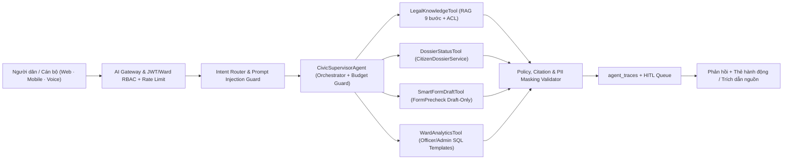

# KẾ HOẠCH TRIỂN KHAI KIẾN TRÚC CIVIC AI AGENT PLATFORM (SMARTWARD AI)

> **Ngày lập kế hoạch:** 2026-11-25  
> **Cơ sở kiến trúc:** [AI_ARCHITECTURE_COMPARISON_AND_ROADMAP.md](file:///e:/SmartWardAI/docs/architecture/AI_ARCHITECTURE_COMPARISON_AND_ROADMAP.md)  
> **Nguyên tắc bắt buộc (`AGENTS.md`):**
> - Tổng RAM toàn bộ 6 container Docker **không vượt quá `2048 MiB`** (dự trù tăng tối đa `+40–60 MiB` trong Heap JVM / Redis, tuyệt đối không cài thêm Qdrant/Elasticsearch/Kafka).
> - Giữ nguyên chốt chặn an toàn RAG ($\theta = 0.78$, $\theta_{lower} = 0.42$), phân quyền cách ly địa bàn 96/102 xã (`SEC-09`), và nguyên tắc **Agent chỉ điền nháp (Draft-Only)** — con người luôn xác nhận trước khi ghi DB chính thức.
> - Không phát triển trực tiếp lên `main` — tạo nhánh `feature/civic-ai-agent-phase-<n>` từ `develop`, đạt 100% PASS JUnit Backend & Frontend/Mobile tests trước khi merge.

---

## 1. Mục tiêu & Kiến trúc Mục tiêu

Nâng cấp SmartWard AI từ tập hợp các phân hệ rời rạc thành **Civic AI Agent Platform** ngay trong Spring Boot 3 Modular Monolith hiện có, cho phép công dân và cán bộ thực hiện chuỗi tác vụ đa bước (tra cứu pháp lý + tra cứu hồ sơ + điền nháp tờ khai + thống kê xã) trong cùng một khung hội thoại có kiểm soát.

---

## 2. Kế hoạch Triển khai Tuần tự 4 Chặng (10 Đầu việc `TASK-033` → `TASK-042`)

### CHẶNG 1 — Hoàn thiện Enterprise RAG 9/9 bước & Phân quyền Dữ liệu (ACL)
*Tác động RAM dự kiến: `+0 MiB` (tận dụng tối đa PostgreSQL 16 sẵn có).*

#### `TASK-033` — Bổ sung Metadata Phân quyền (`visibility_scope`, `ward_code`) & Hybrid RRF (`pgvector` + `tsvector`)
- **Mục tiêu:** Lọc quyền truy cập tài liệu ngay trong truy vấn DB (chặn triệt để rò rỉ tài liệu nội bộ cán bộ sang công dân) và tăng độ chính xác truy hồi từ khóa hành chính.
- **Thay đổi kỹ thuật:**
  - Tạo Flyway migration `V16__add_legal_chunk_acl_and_fts.sql`: thêm `visibility_scope VARCHAR(20) DEFAULT 'PUBLIC'`, `ward_code VARCHAR(50) NULL`, và cột sinh `search_vector tsvector` + chỉ mục GIN trên bảng `legal_chunks`.
  - Cập nhật `LegalChunk.java`, `LegalChunkRepository.java` và `RagQueryService.java` sử dụng công thức **Reciprocal Rank Fusion (RRF)**: $\text{score} = \frac{1}{k + r_{vec}} + \frac{1}{k + r_{fts}}$ ($k=60$), ép bộ lọc `visibility_scope` theo vai trò gọi API.
- **Tiêu chí nghiệm thu:** Công dân không bao giờ truy hồi được chunk `OFFICER_ONLY`; bộ benchmark 80 câu RAG đạt Recall@3 cao hơn hoặc bằng bản cũ; JUnit pass 100%.

#### `TASK-034` — Bổ sung Lightweight Reranker & Tự động Đồng bộ Embedding Model
- **Mục tiêu:** Hoàn thiện bước 8/9 của Enterprise RAG (Reranking) và loại bỏ rủi ro lệch `embedding_model_id` khi chạy giữa Local Sidecar (PhoBERT) và Cloud (`gemini-embedding-001`).
- **Thay đổi kỹ thuật:**
  - Xây dựng `LegalChunkReranker.java` (chấm điểm lại top-K dựa trên khớp tiêu đề thủ tục, loại đoạn `section_name`, từ khóa pháp lý và điểm cosine trước khi áp ngưỡng $\theta = 0.78$).
  - Bổ sung kiểm tra khởi động trong `ProcedureDataSeeder.java`: phát hiện số chunk thiếu vector cho `activeModelId` và tự re-embed nền an toàn.
- **Tiêu chí nghiệm thu:** Tỷ lệ trả lời đúng thủ tục mục tiêu (MRR) tăng; khởi động trên môi trường mới không bị rỗng kết quả tìm kiếm vì lệch model; RAM không tăng thêm.

---

### CHẶNG 2 — Xây dựng Lớp Điều phối `CivicSupervisorAgent` & 4 API Tools An toàn
*Tác động RAM dự kiến: `+20–40 MiB` (nằm trong JVM Heap 512 MiB hiện có).*

#### `TASK-035` — Thiết kế Lõi `CivicSupervisorAgent`, `ToolRegistry` & Ngân sách thực thi (Budget Guard)
- **Mục tiêu:** Tạo tầng điều phối trung tâm trong package `vn.edu.uth.smartward.agent` có khả năng lập kế hoạch ngắn (tối đa 3 bước gọi Tool/lượt), kiểm soát timeout và ngăn vòng lặp vô hạn.
- **Thay đổi kỹ thuật:**
  - Định nghĩa interface `CivicAgentTool` (`name`, `description`, `allowedRoles`, `inputSchemaJson`, `execute(context, args)`).
  - Tạo `ToolRegistry.java` chỉ nạp các Tool đúng với vai trò hiện tại (`CITIZEN`, `OFFICER`, `ADMIN`) để LLM **không nhìn thấy** Tool ngoài thẩm quyền.
  - Tạo `CivicSupervisorAgent.java` + endpoint `POST /api/v1/agent/chat` với trần `maxToolCalls = 3`, `totalTimeoutMs = 15000`, fallback về `RagQueryService` chuẩn nếu LLM ngoài quá tải/503.
- **Tiêu chí nghiệm thu:** `POST /api/v1/agent/chat` hoạt động ổn định cả ở chế độ có LLM và fallback deterministic; quá 3 bước Tool tự ngắt an toàn; JUnit pass 100%.

#### `TASK-036` — Đóng gói 2 Tool Công dân: `LegalKnowledgeTool` & `DossierStatusTool`
- **Mục tiêu:** Cho phép người dân vừa hỏi quy định thủ tục vừa kiểm tra tiến độ hồ sơ thật trong cùng 1 câu hỏi tự nhiên.
- **Thay đổi kỹ thuật:**
  - `LegalKnowledgeTool`: bọc `RagQueryService` (giữ nguyên ngưỡng $\theta = 0.78$, trích dẫn `[CHUNK_CODE]`, đẩy HITL vùng xám).
  - `DossierStatusTool`: bọc `CitizenDossierService.trackDossier`, **bắt buộc đủ `dossierCode` + `last4Cccd`**, giữ nguyên rate-limit 5 lần/15 phút và trả kết quả che PII (`********1234`).
- **Tiêu chí nghiệm thu:** Hỏi *"Kiểm tra hồ sơ HS-... CCCD đuôi 1234 và cho biết cần bổ sung giấy tờ gì"* trả về đúng tình trạng hồ sơ thật kèm trích dẫn điều khoản thủ tục.

#### `TASK-037` — Đóng gói `SmartFormDraftTool` (Chỉ điền nháp — Draft-Only)
- **Mục tiêu:** Giúp AI trích xuất thông tin công dân kể bằng ngôn ngữ tự nhiên để điền sẵn bản nháp cho 4 mẫu tờ khai (`CT01`, `TK-KS`, `TK-KH`, `TK-BTXH`) và kiểm tra thiếu sót ngay lập tức.
- **Thay đổi kỹ thuật:**
  - Bọc `FormPrecheckService` thành `SmartFormDraftTool`: trả về `draftPayload` + danh sách trường còn thiếu/lỗi định dạng + nút hành động `OPEN_PREFILLED_FORM`.
  - **Cấm tuyệt đối** Tool tự gọi `POST /api/v1/dossiers` để nộp hồ sơ thay người dân.
- **Tiêu chí nghiệm thu:** Agent trả payload JSON hợp lệ khớp Zod schema Frontend; người dân bấm mở form thấy dữ liệu điền sẵn và tự xác nhận nộp; 0 thao tác ghi DB trái phép.

#### `TASK-038` — Đóng gói `WardAnalyticsTool` (Thống kê có tham số hóa cho Cán bộ & Admin — Không dùng Text-to-SQL thô)
- **Mục tiêu:** Giúp Cán bộ xã và Admin hỏi thống kê vận hành bằng tiếng Việt (VD: *"Tuần này xã mình có bao nhiêu hồ sơ sắp quá hạn SLA và điểm sự cố nào tồn đọng?"*) mà tuyệt đối không mở SQL tự do cho LLM.
- **Thay đổi kỹ thuật:**
  - Tạo các hàm truy vấn cố định đã tham số hóa (`getWardSlaSummary`, `getTopPendingProcedures`, `getOpenIncidentClustersByCategory`) với `wardCode` **ép cứng từ JWT `OfficerPrincipal`** (bỏ qua mọi `wardCode` do LLM truyền vào).
  - Chỉ mở Tool này trong `ToolRegistry` khi vai trò là `ROLE_OFFICER` hoặc `ROLE_ADMIN`.
- **Tiêu chí nghiệm thu:** Công dân gọi bị từ chối; Cán bộ xã A hỏi số liệu xã B bị chặn hoặc khóa cứng về xã A (`SEC-09`); không có câu SQL động nào được sinh từ LLM.

---

### CHẶNG 3 — Truy vết Agent (`agent_traces`), Chống Prompt Injection & Giao diện Chat Đa bước
*Tác động RAM dự kiến: `+0–10 MiB`.*

#### `TASK-039` — Bảng Truy vết `agent_traces` & Bộ lọc Chống Prompt Injection
- **Mục tiêu:** Minh bạch 100% lý do Agent chọn Tool nào, đầu vào/ra ra sao (đã che PII), kiểm soát chi phí token và ngăn tấn công tiêm lệnh.
- **Thay đổi kỹ thuật:**
  - Tạo migration `V17__create_agent_traces.sql` (`trace_id`, `correlation_id`, `actor_role`, `ward_code`, `steps_json`, `latency_ms`, `token_usage`, `injection_flagged`, `created_at`).
  - Tạo `PromptInjectionGuard.java` quét mẫu chỉ thị giả mạo (system override, role spoof, SQL/secret extraction) trên cả câu hỏi đầu vào và văn bản crawl từ web ngoài; che sạch CCCD/SĐT qua `MaskingMessageConverter` trước khi lưu trace.
- **Tiêu chí nghiệm thu:** Mọi lượt gọi `POST /api/v1/agent/chat` đều có bản ghi `agent_traces` nối với `X-Correlation-ID`; bộ test đối kháng Prompt Injection chặn thành công 100% payload giả mạo.

#### `TASK-040` — Nâng cấp Giao diện Chat Web & Mobile hiển thị Thẻ hành động (Action Cards) & Bước suy luận
- **Mục tiêu:** Hiển thị kết quả từ `CivicSupervisorAgent` thân thiện, dễ hiểu cho người dân và cán bộ (không dùng thuật ngữ kỹ thuật lập trình).
- **Thay đổi kỹ thuật:**
  - Cập nhật `CitizenPortal.tsx`, `PerWardDashboard.tsx` (Web) và `LegalRagChatScreen.tsx` (Mobile) kết nối `POST /api/v1/agent/chat` (giữ fallback `/api/v1/rag/ask`).
  - Render thẻ trạng thái hồ sơ trực quan, nút **"Mở tờ khai đã điền sẵn"**, và thanh tiến trình gọn (VD: *"Đang kiểm tra hồ sơ..." → "Đang tra cứu quy định..."*).
- **Tiêu chí nghiệm thu:** Hiển thị chuẩn từ `320px` đến `1280px` trên Web và Mobile; giữ ngôn ngữ phổ thông dễ hiểu cho người dân.

---

### CHẶNG 4 — Bộ nhớ Phiên Agent (TTL Redis), Connector Chuẩn hóa & Kiểm thử Toàn diện
*Tác động RAM dự kiến: `+10 MiB` (Redis).*

#### `TASK-041` — Bộ nhớ Hội thoại Agent trên Redis (TTL 30 phút) & Interface `CivicDataConnector`
- **Mục tiêu:** Giúp Agent nhớ ngữ cảnh nhiều lượt (VD: nhớ mã thủ tục/tờ khai đang làm dở) trong 30 phút tự hủy và sẵn sàng cắm nguồn dữ liệu ngoài (Cổng DVC Quốc gia / Webhook) mà không sửa lõi Agent.
- **Thay đổi kỹ thuật:**
  - Tạo `AgentSessionMemoryService.java` lưu tối đa 6 lượt gần nhất (đã che PII) dưới key `smartward:agent:mem:<sessionId>` với `TTL = 30m` và giới hạn kích thước mỗi phiên `<= 8 KB` để bảo vệ ngưỡng `100 MiB` Redis `noeviction`.
  - Định nghĩa interface `CivicDataConnector` + triển khai mẫu `LocalProcedureJsonConnector` và `MinioDocumentConnector`.
- **Tiêu chí nghiệm thu:** Hội thoại 3–5 lượt giữ đúng ngữ cảnh; key tự hết hạn sau 30 phút; không ảnh hưởng bộ nhớ Redis của Vault/GEO.

#### `TASK-042` — Kiểm thử Đối kháng AI Agent, Benchmark & Xác minh Trần RAM `<= 2048 MiB`
- **Mục tiêu:** Chứng minh nền tảng Civic AI Agent an toàn, chính xác và chạy bền vững dưới trần RAM `2048 MiB` trước khi gộp vào phát hành `v1.2.0` / `v2.0.0`.
- **Thay đổi kỹ thuật:**
  - Viết bộ JUnit `CivicAgentAdversarialTest.java` (test Prompt Injection, test cố gọi `WardAnalyticsTool` trái quyền, test Tool timeout fallback, test Draft-Only không ghi DB).
  - Chạy đo tải 10 luồng đồng thời trên Docker Compose (`docker stats`), xác nhận tổng RAM 6 container `< 2048 MiB` (0 OOMKill).
- **Tiêu chí nghiệm thu:** 100% JUnit Backend, Frontend & Mobile tests PASS; báo cáo benchmark lưu tại `docs/testing/`.

---

## 3. Lịch trình Dự kiến Tổng thể (Từ 2026-11-25)

| Giai đoạn / Phiên bản | Phạm vi công việc chính | Thời gian dự kiến |
| :--- | :--- | :---: |
| **Hoàn tất chốt MVP (`v1.0.0`)** | Đóng nốt luồng ảnh sự cố (`TASK-032`), Mobile máy thật (`TASK-008`), 6 xã nhánh 1c (`TASK-009`), đối chiếu luật, TLS/Backup, Refactor & chốt phát hành (`TASK-017`, `TASK-019`, `TASK-022`, `TASK-026`) | `2026-11-25` → `2026-12-07` |
| **Mở rộng (`v1.1.0` & `v1.2.0`)** | API 102 xã (`/api/v1/wards`), Mobile Push Notification & SQLCipher (`TASK-024`, `TASK-023`, `TASK-025`) | `2026-12-08` → `2026-12-16` |
| **Civic AI Agent — Chặng 1 & 2 (`v2.0.0-civic-ai-agent`)** | RAG 9/9 + ACL (`TASK-033`, `TASK-034`) + `CivicSupervisorAgent` & 4 Tools (`TASK-035`..`TASK-038`) | `2026-12-17` → `2026-12-31` |
| **Civic AI Agent — Chặng 3 & 4 (`v2.0.0-civic-ai-agent`)** | `agent_traces` + Injection Guard + Action Cards UI + Redis Memory + Adversarial QA (`TASK-039`..`TASK-042`) | `2027-01-02` → `2027-01-08` |
