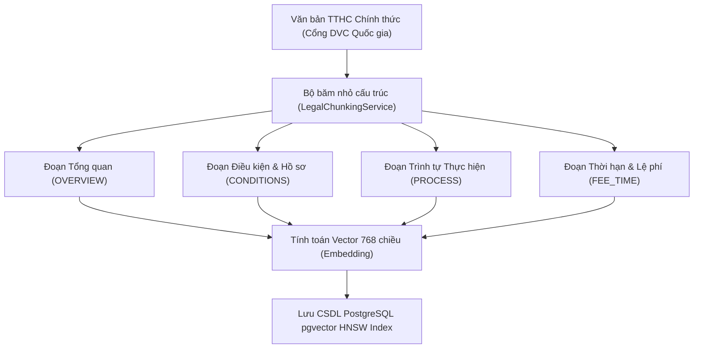
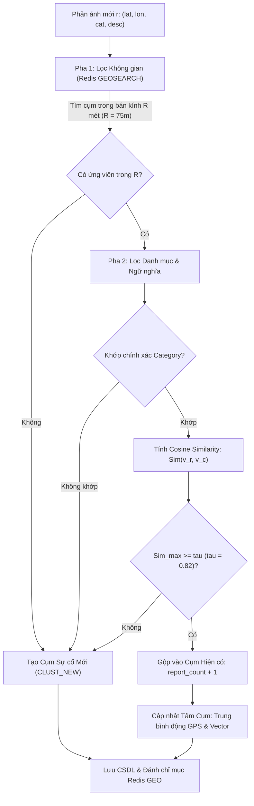
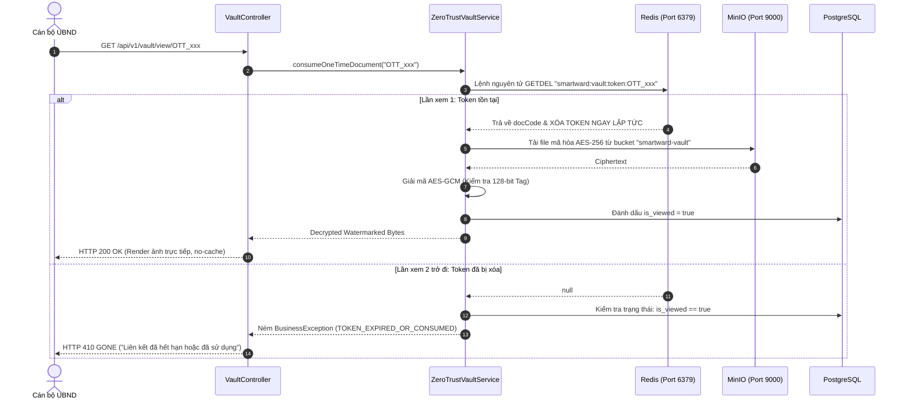

# CHƯƠNG 3: THIẾT KẾ VÀ HIỆN THỰC CÁC PHÂN HỆ LÕI (CORE MODULES)
**Đơn vị:** Viện Đào tạo Chất lượng cao – Trường Đại học Giao thông vận tải TP.HCM (UTH)  
**Đề tài:** SmartWard AI – Hệ thống Hỗ trợ Thủ tục Hành chính và Phân luồng Phản ánh Cấp Phường/Xã

---

## 3.1. PHÂN HỆ 1: TRỢ LÝ PHÁP LÝ HÀNH CHÍNH CÔNG (LEGAL RAG) VÀ CHỐT CHẶN CHỐNG ẢO GIÁC (ABSTENTION GUARDRAIL)

### 3.1.1. Đặt vấn đề và Thách thức Pháp lý trong Hành chính công
Trong môi trường hành chính công tại cấp xã/phường (Ủy ban nhân dân và Công an xã), tính chính xác của thông tin pháp lý mang tính chất pháp lý tối thượng. Khác với các hệ thống chatbot thương mại thông thường (nơi việc trả lời ước lượng có thể được chấp nhận), việc mô hình ngôn ngữ lớn (LLM) bị ảo giác (hallucination) trong thủ tục hành chính có thể dẫn đến hậu quả nghiêm trọng:
1. **Sai lệch thành phần hồ sơ:** Công dân chuẩn bị thiếu hoặc sai giấy tờ, phải đi lại nhiều lần gây bức xúc xã hội.
2. **Sai lệch thời hạn và cơ quan có thẩm quyền:** Hướng dẫn sai cơ quan thụ lý (ví dụ: nhầm lẫn thẩm quyền giữa UBND cấp xã và Chi nhánh Văn phòng Đăng ký Đất đai cấp huyện).
3. **Vi phạm pháp lý:** Không tuân thủ quy chuẩn dữ liệu theo Nghị định 13/2023/NĐ-CP về bảo vệ dữ liệu cá nhân.

Do đó, kiến trúc Legal RAG trong SmartWard AI được thiết kế theo nguyên tắc: **"Thà từ chối trả lời một cách an toàn còn hơn suy diễn thông tin sai lệch"** (*Conservative Abstention over Speculative Hallucination*).

---

### 3.1.2. Giải thuật Phân đoạn Văn bản Pháp lý (Legal Unit Chunking)
Hệ thống loại bỏ hoàn toàn phương pháp cắt phân đoạn cơ học cố định (fixed-size chunking 500 ký tự) do làm đứt gãy tính chỉnh thể của văn bản luật. Thay vào đó, SmartWard AI áp dụng phương pháp **Semantic Legal Unit Chunking**:
- Mỗi đoạn trích dẫn (`legal_chunks`) là một đơn vị quy định trọn vẹn: *Chương $\rightarrow$ Điều $\rightarrow$ Khoản $\rightarrow$ Điểm*.
- Mỗi chunk mang đầy đủ metadata: Mã đoạn (`chunk_code`), tiêu đề (`title`), nội dung (`content`), căn cứ pháp lý chính thức (`legal_reference`), trạng thái hiệu lực (`status = 'ACTIVE'`) và ngày có hiệu lực (`effective_date <= CURRENT_DATE`).



---

### 3.1.3. Mô hình Toán học của Chốt chặn Từ chối (Abstention Guardrail)
Cho câu hỏi của công dân $q$, hệ thống chuyển đổi thành vector embedding chuẩn hóa $L_2$:
$$\mathbf{v}_q = \text{Embedding}(q) \in \mathbb{R}^{768}, \quad \|\mathbf{v}_q\|_2 = 1$$

Không gian lưu trữ chứa tập các đoạn luật có hiệu lực $\mathcal{C} = \{\mathbf{c}_1, \mathbf{c}_2, \dots, \mathbf{c}_N\}$. Hệ thống thực hiện tìm kiếm Top-$K$ ($K=3$) láng giềng gần nhất theo khoảng cách Cosine trên chỉ mục HNSW:
$$\mathcal{D}_{\text{cosine}}(\mathbf{v}_q, \mathbf{c}_i) = 1 - \frac{\mathbf{v}_q \cdot \mathbf{c}_i}{\|\mathbf{v}_q\|_2 \|\mathbf{c}_i\|_2} = 1 - \mathbf{v}_q \cdot \mathbf{c}_i$$

Điểm tương đồng Cosine Similarity được xác định:
$$S_i = 1 - \mathcal{D}_{\text{cosine}}(\mathbf{v}_q, \mathbf{c}_i) = \mathbf{v}_q \cdot \mathbf{c}_i \in [-1, 1]$$

Điểm tương đồng tối đa trong tập ứng viên Top-$K$:
$$S_{\max} = \max_{i \in \text{Top-}K} S_i$$

Hệ thống đặt ra **Ngưỡng chốt chặn an toàn (Abstention Threshold)** $\theta = 0.78$. Quyết định phản hồi được mô hình hóa bởi hàm bước:

$$\text{Decision}(q) = \begin{cases} 
\text{Proceed to LLM Inference}, & \text{nếu } S_{\max} \ge \theta \\
\text{Safe Abstention (Từ chối trả lời)}, & \text{nếu } S_{\max} < \theta \text{ hoặc } \mathcal{C} = \emptyset
\end{cases}$$

Khi $S_{\max} < 0.78$, hệ thống lập tức ngắt luồng gọi LLM, hoàn trả thông báo từ chối trang trọng và hướng dẫn công dân liên hệ trực tiếp Bộ phận Một cửa hoặc Tổng đài 18001096, giúp tiết kiệm 100% token LLM và loại bỏ hoàn toàn nguy cơ ảo giác trên các câu hỏi ngoại phạm vi (Out-of-Scope).

---

### 3.1.4. Thuật toán Hậu kiểm tra Trích dẫn (Post-Verification Algorithm)
Để ngăn ngừa tình trạng mô hình LLM tự sáng tác mã đoạn luật giả mạo (hallucinated citations) trong câu trả lời đã sinh ra, SmartWard AI bổ sung tầng kiểm chứng định thức:

```
Thuật toán: Post-Verification of Legal Citations
Đầu vào: 
  - AnswerText (Chuỗi văn bản trả lời do LLM sinh ra)
  - TopKCandidates (Danh sách K đoạn luật thực tế được truy xuất từ CSDL)
Đầu ra: 
  - VerifiedCitations (Danh sách các trích dẫn pháp lý hợp lệ)

1. Khởi tạo CandidateMap = { c.chunkCode.toUpperCase() -> c | c in TopKCandidates }
2. Khởi tạo MatchedCodes = []
3. Trích xuất tất cả các đoạn mã nằm trong ngoặc vuông bằng Regex: \[( [A-Za-z0-9_\-]+ )\]
4. VỚI MỖI mã code trích xuất được:
     NẾU code tồn tại trong CandidateMap:
         Thêm code vào MatchedCodes (loại bỏ trùng lặp)
     NGƯỢC LẠI:
         Ghi nhận cảnh báo Log: "Hallucinated citation detected and discarded: [code]"
5. NẾU MatchedCodes không rỗng:
     VerifiedCitations = [ CandidateMap[code] for code in MatchedCodes ]
   NGƯỢC LẠI (LLM trả lời đúng nội dung nhưng quên ghi ngoặc vuông mã code):
     VerifiedCitations = [ TopKCandidates[0] ] (Gắn đoạn luật có S_max cao nhất làm căn cứ)
6. TRẢ VỀ VerifiedCitations
```

---

### 3.1.5. Kiến trúc Tích hợp Bộ đệm (Cache) và Giới hạn Tần suất (Rate Limit)
Để bảo đảm hệ thống hoạt động ổn định trong hạn mức phần cứng Zero-Cost (< 2.0GB RAM) và bảo vệ Free-tier quota của LLM:
1. **Redis Rate Limiter:** Áp dụng thuật toán Fixed Window bộ đếm nguyên tử (`INCR` + `EXPIRE 60s`). Tối đa 5 yêu cầu/phút/IP. Vượt quá ngưỡng trả về HTTP 429 (`SW_429`).
2. **Distributed Semantic Query Cache:** Các câu hỏi pháp lý sau khi chuẩn hóa (xóa dấu câu, chuẩn hóa khoảng trắng, chữ thường) được băm SHA-256 làm key lưu trữ trên Redis (`smartward:cache:rag:<hash>`) với TTL 3600 giây (1 giờ).
   - Truy vấn trùng lặp có thời gian phản hồi giảm từ ~1200ms xuống < 10ms.
   - Các phản hồi từ chối an toàn ($S_{\max} < \theta$) cũng được cache 1800 giây (30 phút) để triệt tiêu các đợt gửi câu hỏi rác lặp lại.

---

### 3.1.6. Kết quả Kiểm thử Đơn vị và Thực nghiệm (Unit Tests)
Hệ thống kiểm thử tự động của Phân hệ 1 đã được xây dựng tại:
- [`RagQueryServiceTest`](file:///E:/SmartWardAI/backend/src/test/java/vn/edu/uth/smartward/rag/RagQueryServiceTest.java): Kiểm thử 5 kịch bản then chốt:
  1. Chặn IP khi vượt giới hạn 5 req/phút.
  2. Trả về kết quả tức thì khi trúng Redis Cache.
  3. Kích hoạt Abstention Guardrail khi điểm tương đồng $S_{\max} = 0.65 < 0.78$.
  4. Trả về câu trả lời và trích dẫn chuẩn khi $S_{\max} = 0.88 \ge 0.78$.
  5. Thuật toán hậu kiểm lọc bỏ thành công trích dẫn giả mạo `[BIA-DAT-99]`.
- [`RagControllerTest`](file:///E:/SmartWardAI/backend/src/test/java/vn/edu/uth/smartward/rag/RagControllerTest.java): Kiểm thử REST API `POST /api/v1/rag/ask` với MockMvc (kiểm tra HTTP 200, HTTP 422 khi dữ liệu rỗng, và cấu trúc payload JSON).

Kết quả kiểm thử Maven đạt: **21/21 tests Passed (100% BUILD SUCCESS)**.


---

## 3.2. PHÂN HỆ 2: ĐỘNG CƠ QUY TẮC ĐỊNH THỨC HẬU KIỂM ĐỊNH BIỂU MẪU HÀNH CHÍNH (DETERMINISTIC FORM RULE ENGINE)

### 3.2.1. Bản chất và Triết lý Kiến trúc: Pre-check & Audit
Theo các quy định pháp luật hiện hành và Nghị định 13/2023/NĐ-CP về bảo vệ dữ liệu cá nhân:
- Tờ khai hành chính (ví dụ: Tờ khai thay đổi thông tin cư trú Mẫu CT01, Tờ khai đăng ký khai sinh) có giá trị pháp lý gắn liền với chữ ký sống và cam đoan trực tiếp của công dân.
- Hệ thống AI **tuyệt đối không được phép tự động chỉnh sửa thông tin hành chính của công dân trên phần mềm** để tránh sai lệch trách nhiệm pháp lý và vi phạm tính toàn vẹn hồ sơ.
- Thay vào đó, SmartWard AI đóng vai trò **Bộ sơ duyệt thông minh (Pre-check & Audit Engine)**:
  1. Công dân chụp ảnh tờ khai đã điền tay hoặc bản in sẵn.
  2. Hệ thống trích xuất thông tin qua Vision OCR.
  3. Động cơ quy tắc định thức đối soát logic toán học và pháp lý.
  4. Hệ thống xuất ra bản báo cáo cảnh báo chi tiết các điểm sai sót (ví dụ: thừa/thiếu chữ số CCCD, nghịch lý ngày cấp trước ngày sinh, mã tỉnh giả mạo).
  5. Công dân tự tay sửa lại trên tờ khai giấy trước khi bước vào nộp tại Bộ phận Tiếp nhận và Trả kết quả (Một cửa), loại bỏ 100% tình trạng bị cán bộ trả hồ sơ do sai sót hình thức.

---

### 3.2.2. Bộ Quy tắc Kiểm định Số Định danh Cá nhân (CCCD 12 Chữ số)
Bộ kiểm định `CccdValidator` mã hóa trực tiếp quy định của Thông tư 59/2021/TT-BCA và Luật Căn cước:
Cấu trúc 12 chữ số: $\text{CCCD} = [P_1 P_2 P_3][G][Y_1 Y_2][S_1 S_2 S_3 S_4 S_5 S_6]$

1. **Kiểm tra độ dài và định dạng:**
   $$\text{CCCD} \in \{0, \dots, 9\}^{12}$$
   Nếu không khớp $\rightarrow$ báo lỗi `INVALID_CCCD_LENGTH`.
2. **Kiểm tra Mã Tỉnh/Thành phố ($P_1 P_2 P_3$):**
   $$P = P_1 P_2 P_3 \in \mathcal{P}_{63}$$
   Trong đó $\mathcal{P}_{63}$ là tập hợp đúng 63 mã tỉnh/thành phố hợp pháp theo danh mục của Bộ Công an (ví dụ: `001` - Hà Nội, `048` - Đà Nẵng, `079` - TP.HCM). Các mã bất hợp pháp như `999` lập tức bị bắt lỗi `INVALID_CCCD_PROVINCE`.
3. **Kiểm tra Mã Thế kỷ và Giới tính ($G$):**
   Chữ số thứ 4 được giải mã định thức theo thế kỷ sinh và giới tính:
   - Sinh thế kỷ 20 ($1900 - 1999$): Nam $\rightarrow 0$, Nữ $\rightarrow 1$.
   - Sinh thế kỷ 21 ($2000 - 2099$): Nam $\rightarrow 2$, Nữ $\rightarrow 3$.
   - Sinh thế kỷ 22 ($2100 - 2199$): Nam $\rightarrow 4$, Nữ $\rightarrow 5$.
   Nếu chữ số $G$ không khớp với năm sinh và giới tính khai báo $\rightarrow$ báo lỗi `INVALID_CCCD_CENTURY_GENDER`.
4. **Kiểm tra Khớp Năm sinh ($Y_1 Y_2$):**
   $$Y_1 Y_2 = \text{BirthYear} \pmod{100}$$
   Nếu không khớp $\rightarrow$ báo lỗi `INVALID_CCCD_YEAR`.

---

### 3.2.3. Bộ Quy tắc Logic Thời gian và Độ tuổi (Date Logic Engine)
Bộ kiểm định `DateLogicValidator` ngăn ngừa các nghịch lý logic thời gian:
1. **Kiểm tra chuỗi thời gian hợp thức:**
   $$\text{BirthDate} < \text{IssueDate} \le \text{CurrentDate}$$
   - Nếu $\text{IssueDate} > \text{CurrentDate}$ (ngày cấp trong tương lai) $\rightarrow$ báo lỗi `INVALID_DATE_LOGIC`.
   - Nếu $\text{BirthDate} \ge \text{IssueDate}$ (ngày cấp trước hoặc cùng ngày sinh) $\rightarrow$ báo lỗi `INVALID_DATE_LOGIC`.
2. **Kiểm tra điều kiện độ tuổi cấp căn cước:**
   Theo quy định pháp luật căn cước, công dân chỉ được cấp thẻ CCCD từ đủ 14 tuổi:
   $$\text{AgeAtIssuance} = \text{Period}(\text{BirthDate}, \text{IssueDate}).\text{Years} \ge 14$$
   Nếu $\text{AgeAtIssuance} < 14 \rightarrow$ báo lỗi `INVALID_DATE_LOGIC`.

---

### 3.2.4. Kiểm tra Trường bắt buộc và Cảnh báo Độ tin cậy OCR
1. **Trường bắt buộc (`MandatoryFieldValidator`):** Các trường `fullName`, `birthDate`, `gender`, `cccdNumber`, `permanentAddress` nếu bị để trống hoặc rỗng sẽ kích hoạt lỗi `MISSING_MANDATORY_FIELD`.
2. **Cảnh báo độ tin cậy thấp (`MANUAL_REVIEW_REQUIRED`):**
   Đối với tờ khai viết tay (handwritten), chất lượng chữ viết có thể bị mờ nhòe. Mỗi trường trích xuất mang điểm tin cậy $C_{\text{field}} \in [0.0, 1.0]$.
   $$\text{Warning}(field) = \begin{cases} 
   \text{MANUAL\_REVIEW\_REQUIRED}, & \text{khi } C_{\text{field}} < 0.70 \\
   \text{OK}, & \text{khi } C_{\text{field}} \ge 0.70 
   \end{cases}$$
   Cảnh báo mức `WARNING` không làm vô hiệu tờ khai nhưng nhắc nhở cán bộ kiểm tra kỹ bằng mắt thường.

---

### 3.2.5. Kết quả Kiểm thử Thực nghiệm
Module 2 đã được kiểm thử tự động toàn diện qua 17 unit test mới:
- [`CccdValidatorTest`](file:///E:/SmartWardAI/backend/src/test/java/vn/edu/uth/smartward/formcheck/CccdValidatorTest.java): Đạt 7/7 test.
- [`DateLogicValidatorTest`](file:///E:/SmartWardAI/backend/src/test/java/vn/edu/uth/smartward/formcheck/DateLogicValidatorTest.java): Đạt 4/4 test.
- [`MandatoryFieldValidatorTest`](file:///E:/SmartWardAI/backend/src/test/java/vn/edu/uth/smartward/formcheck/MandatoryFieldValidatorTest.java): Đạt 2/2 test.
- [`FormPrecheckServiceTest`](file:///E:/SmartWardAI/backend/src/test/java/vn/edu/uth/smartward/formcheck/FormPrecheckServiceTest.java): Đạt 3/3 test.
- [`FormCheckControllerTest`](file:///E:/SmartWardAI/backend/src/test/java/vn/edu/uth/smartward/formcheck/FormCheckControllerTest.java): Đạt 1/1 test.

Tổng cộng toàn bộ hệ thống đạt: **38/38 tests Passed (100% BUILD SUCCESS)**.


---

## 3.3. PHÂN HỆ 3: THUẬT TOÁN GOM CỤM VÀ PHÂN LUỒNG PHẢN ÁNH HIỆN TRƯỜNG 2 PHA (TWO-STAGE SPATIAL-SEMANTIC TRIAGE)

### 3.3.1. Đặt vấn đề và Thách thức Phân luồng Hiện trường
Tại cấp phường/xã, khi xảy ra một sự cố công cộng (ví dụ: một hố sụt lún trên đường Võ Oanh, sự cố ngập úng sau mưa lớn tại góc đường Ung Văn Khiêm, hoặc bãi rác tự phát bốc mùi), hàng chục người dân đi ngang qua có thể cùng sử dụng điện thoại chụp ảnh và gửi phản ánh.
- **Nếu xử lý thủ công hoặc tiếp nhận riêng rẽ:** Mỗi phản ánh trở thành một phiếu xử lý độc lập, gây quá tải hệ thống, cán bộ phải đọc và điều động nhân sự nhiều lần tới cùng một vị trí.
- **Nếu chỉ gom cụm theo GPS (Khoảng cách không gian):** Sẽ xảy ra lỗi gộp nhầm tai hại khi hai sự cố khác hẳn nhau về bản chất xảy ra sát nhau (ví dụ: một vụ tai nạn giao thông và một đống rác nằm cách nhau 3 mét nhưng do 2 phòng ban khác nhau giải quyết).
- **Nếu chỉ gom cụm theo Ngữ nghĩa (NLP / Vector Embedding):** Hai sự cố hỏng nắp cống ở hai đầu đối diện của phường (cách nhau 2km) sẽ bị gộp nhầm thành một chỉ vì người dân dùng từ ngữ mô tả tương tự nhau.

Do đó, SmartWard AI đề xuất **Thuật toán Phân luồng và Gom cụm Hiện trường 2 Pha (Two-Stage Spatial-Semantic Triage)**: Kết hợp bộ lọc không gian cực nhanh trên Redis GEO (Pha 1) với bộ lọc ngữ nghĩa và nghiệp vụ chính xác trên pgvector Cosine Similarity (Pha 2).

---

### 3.3.2. Mô hình Toán học Thuật toán Gom cụm 2 Pha



#### Pha 1: Lọc Không gian Bán kính $R$ (Spatial Candidate Discovery)
Cho phản ánh hiện trường $r$ với tọa độ địa lý $(\text{lat}_r, \text{lon}_r)$.
Hệ thống sử dụng chỉ mục Redis GEO lưu trữ tọa độ tâm của các cụm sự cố đang hoạt động ($\text{status} \in \{\text{'OPEN'}, \text{'IN\_PROGRESS'}\}$) trong cửa sổ thời gian $T_{\text{window}} = 72$ giờ:
$$\mathcal{C}_{\text{nearby}} = \left\{ c \in \mathcal{C}_{\text{active}} \mid \text{HaversineDist}((\text{lat}_r, \text{lon}_r), (\text{lat}_c, \text{lon}_c)) \le R \right\}$$
Trong đó bán kính quét mặc định là $R = 75.0\text{ m}$. Lệnh `GEOSEARCH` trên Redis hoàn tất trong thời gian $< 1.0\text{ ms}$.

- Nếu $\mathcal{C}_{\text{nearby}} = \emptyset$: Phản ánh nằm ở vị trí địa lý độc lập $\rightarrow$ Lập tức khởi tạo cụm sự cố mới.

#### Pha 2: So khớp Nghiệp vụ và Đo Độ tương đồng Ngữ nghĩa ($\tau$)
Với mỗi cụm ứng viên $c \in \mathcal{C}_{\text{nearby}}$:
1. **Lọc Nghiệp vụ (Category Hard Filter):**
   Bắt buộc $\text{Category}(r) = \text{Category}(c)$. Nếu khác danh mục nghiệp vụ (ví dụ: `ROAD_DAMAGE` và `FLOODING`), loại bỏ ứng viên ngay lập tức để tránh gộp nhầm các sự cố khác bản chất.
2. **Đo Độ tương đồng Ngữ nghĩa Cosine:**
   Biểu diễn mô tả của phản ánh $\mathbf{v}_r = \text{Embedding}(\text{desc}_r)$ và vector tâm cụm $\mathbf{v}_c$:
   $$\text{Sim}(\mathbf{v}_r, \mathbf{v}_c) = \mathbf{v}_r \cdot \mathbf{v}_c$$
   Xác định cụm tương đồng cao nhất:
   $$c^* = \arg\max_{c \in \mathcal{C}_{\text{nearby}}, \text{cat}(c)=\text{cat}(r)} \text{Sim}(\mathbf{v}_r, \mathbf{v}_c), \quad \text{Sim}_{\max} = \max \text{Sim}(\mathbf{v}_r, \mathbf{v}_c)$$

#### Quyết định Gom cụm (Clustering Decision):
- **Trường hợp Gộp ($\text{Sim}_{\max} \ge \tau$, mặc định $\tau = 0.82$):**
  - Gộp phản ánh $r$ vào cụm $c^*$.
  - Tăng số lượng phản ánh: $N_{\text{new}} = N_{\text{old}} + 1$.
  - Cập nhật tọa độ tâm cụm trung bình động:
    $$\text{lat}_{c,\text{new}} = \frac{N_{\text{old}} \cdot \text{lat}_{c,\text{old}} + \text{lat}_r}{N_{\text{new}}}, \quad \text{lon}_{c,\text{new}} = \frac{N_{\text{old}} \cdot \text{lon}_{c,\text{old}} + \text{lon}_r}{N_{\text{new}}}$$
  - Cập nhật vector tâm cụm trung bình động chuẩn hóa:
    $$\mathbf{v}_{c,\text{new}} = \frac{N_{\text{old}} \cdot \mathbf{v}_{c,\text{old}} + \mathbf{v}_r}{N_{\text{new}}}, \quad \mathbf{v}_{c,\text{new}} \leftarrow \frac{\mathbf{v}_{c,\text{new}}}{\|\mathbf{v}_{c,\text{new}}\|_2}$$
  - Cập nhật lại vị trí tâm cụm trên chỉ mục Redis GEO.
- **Trường hợp Tạo cụm mới ($\text{Sim}_{\max} < \tau$ hoặc không có ứng viên cùng danh mục):**
  - Khởi tạo cụm mới với $N=1$, tâm là tọa độ và vector của phản ánh $r$.
  - Thêm tọa độ vào Redis GEO index.

---

### 3.3.3. Kết quả Kiểm thử Đơn vị và Tích hợp Module 3
Module 3 đã được kiểm thử toàn diện qua:
- [`TwoStageTriageServiceTest`](file:///E:/SmartWardAI/backend/src/test/java/vn/edu/uth/smartward/triage/TwoStageTriageServiceTest.java):
  1. Khởi tạo cụm mới khi không có cụm nào trong bán kính $R = 75$m.
  2. Gộp thành công vào cụm có sẵn khi khoảng cách $6.5\text{m} \le 75\text{m}$, cùng danh mục `ROAD_DAMAGE` và điểm Cosine $\text{Sim} = 0.998 \ge 0.82$, tự động tăng `reportCount` từ 1 lên 2.
  3. Từ chối gộp (tạo cụm mới) khi hai phản ánh xảy ra cùng vị trí (khoảng cách 1.0m) nhưng khác danh mục (`ROAD_DAMAGE` vs `FLOODING`).
- [`TriageControllerTest`](file:///E:/SmartWardAI/backend/src/test/java/vn/edu/uth/smartward/triage/TriageControllerTest.java): Kiểm thử các REST API `POST /api/v1/issues/report` và `GET /api/v1/issues/clusters`.

Tổng cộng toàn bộ hệ thống đạt: **43/43 tests Passed (100% BUILD SUCCESS)**.


---

## 3.4. PHÂN HỆ 4: KHO HỒ SƠ TÀI LIỆU KHÔNG TIN CẬY (ZERO-TRUST DOCUMENT VAULT) TUÂN THỦ NGHỊ ĐỊNH 13/2023/NĐ-CP

### 3.4.1. Đặt vấn đề và Yêu cầu Pháp lý về Bảo vệ Dữ liệu Cá nhân
Nghị định 13/2023/NĐ-CP về bảo vệ dữ liệu cá nhân (có hiệu lực từ ngày 01/07/2023) đặt ra các chế tài và nghĩa vụ pháp lý vô cùng nghiêm ngặt đối với các hệ thống tiếp nhận, xử lý thông tin định danh:
1. **Dữ liệu cá nhân nhạy cảm:** Hình ảnh Căn cước công dân (CCCD), Giấy chứng sinh, Giấy chứng nhận kết hôn... chứa đựng toàn bộ bí mật đời tư (số định danh, vân tay, khuôn mặt, địa chỉ thường trú, quan hệ gia đình).
2. **Rủi ro rò rỉ và lạm dụng:** Nếu lưu trữ file ảnh nguyên bản (plaintext) trên máy chủ hoặc cho phép tải về không giới hạn, kẻ xấu có thể đánh cắp để mở tài khoản ngân hàng ảo, vay tín dụng đen hoặc mạo danh công dân.
3. **Nguyên tắc giảm thiểu dữ liệu (Data Minimization):** Dữ liệu chỉ được lưu trữ trong thời gian tối thiểu cần thiết để hoàn thành mục đích sơ duyệt và phải bị tiêu hủy hoặc vô hiệu hóa ngay sau khi phục vụ xong.

Để đáp ứng 100% các yêu cầu pháp lý trên, SmartWard AI thiết kế **Zero-Trust Document Vault** dựa trên 4 lớp bảo vệ độc lập:
$$\text{Security Pipeline} = \text{Dynamic Watermark} \longrightarrow \text{AES-256-GCM} \longrightarrow \text{MinIO Vault} \longrightarrow \text{Atomic GETDEL One-Time Token}$$

---

### 3.4.2. Cơ chế Đóng dấu Watermark Động bằng Java2D (Anti-Repurposing)
Mọi tài liệu hình ảnh khi được tải lên hệ thống lập tức đi qua bộ xử lý `ImageWatermarkService`:
- Sử dụng thư viện đồ họa Java2D (`Graphics2D`) can thiệp trực tiếp vào ma trận điểm ảnh (bitmap).
- Kỹ thuật hòa trộn kênh Alpha: `AlphaComposite.SRC_OVER` với độ trong suốt $\alpha = 0.38$.
- Góc xoay nghiêng: $-28^\circ$ phủ chéo khắp trang giấy.
- Nội dung watermark bao gồm dấu ấn hành chính và tem thời gian động:
  $$\text{Watermark} = \text{"CHỈ DÙNG ĐỂ SƠ DUYỆT HỒ SƠ TẠI UBND - [dd/MM/yyyy HH:mm]"}$$

Tác dụng: Kể cả khi file ảnh bị chụp lại màn hình, dấu bản quyền chìm sẽ ngăn chặn hoàn toàn khả năng sử dụng ảnh này vào các mục đích tài chính, ngân hàng hay thủ tục khác.

---

### 3.4.3. Thuật toán Mã hóa Xác thực Đối xứng AES/GCM/NoPadding (256-bit)
Toàn bộ file ảnh sau khi đóng watermark được mã hóa bằng thuật toán **AES ở chế độ Galois/Counter Mode (GCM)** trước khi chạm vào ổ cứng:
1. **Khóa đối xứng:** $K \in \{0, 1\}^{256}$ (256-bit AES key).
2. **Vector khởi tạo ngẫu nhiên (IV):** Mỗi tài liệu sinh một giá trị $\text{IV} \in \{0, 1\}^{96}$ (12 bytes) hoàn toàn ngẫu nhiên bằng `SecureRandom`. Tuyệt đối không tái sử dụng IV.
3. **Mã xác thực dữ liệu (Authentication Tag):** GCM tự động sinh thẻ xác thực $\text{Tag} \in \{0, 1\}^{128}$ (16 bytes).
4. **Cấu trúc lưu trữ Ciphertext:**
   $$\text{Payload} = [\text{IV}_{12\text{ bytes}}] \parallel [\text{Ciphertext}] \parallel [\text{AuthTag}_{16\text{ bytes}}]$$

Nếu một bit dữ liệu trong file lưu trữ bị tin tặc sửa đổi trên ổ đĩa, quá trình giải mã tại `ZeroTrustVaultService` sẽ lập tức ném lỗi ngoại lệ xác thực `AEADBadTagException` và từ chối xuất dữ liệu.

---

### 3.4.4. Cơ chế Token Truy cập Một Lần (One-Time Access Link via Redis GETDEL)
Để cán bộ Một cửa có thể đối chiếu hồ sơ mà không tạo ra liên kết vĩnh viễn trên Internet:
1. Hệ thống sinh mã ngẫu nhiên bảo mật cao: $\text{OTT} = \text{"OTT\_"} + \text{UUIDv4}$.
2. Token được lưu vào Redis với thời gian sống $\text{TTL} = 24$ giờ:
   $$\text{SET smartward:vault:token:OTT\_xxx <documentCode> EX 86400}$$
3. Khi cán bộ nhấp vào liên kết xem tài liệu:
   Hệ thống thực thi lệnh nguyên tử `GETDEL` (Redis 6.2+ / Spring Data Redis `getAndDelete`):
   $$\text{docCode} = \text{GETDEL } \text{smartward:vault:token:OTT\_xxx}$$
   - Lệnh này lấy mã tài liệu và **xóa sổ vĩnh viễn token khỏi Redis trong đúng 1 chu kỳ CPU**.
   - Ngay sau đó, tài liệu được giải mã và render trực tiếp vào luồng HTTP response (`Content-Type: image/png`).
   - Header bảo mật cấm lưu cache: `Cache-Control: no-store, no-cache, must-revalidate`.
4. **Lần truy cập thứ hai trở đi:**
   Do token đã bị `GETDEL` xóa sổ, truy vấn Redis trả về `null`. Hệ thống đối chiếu CSDL thấy cờ $\text{is\_viewed} = \text{true}$ $\rightarrow$ Lập tức ném `BusinessException(ErrorCode.TOKEN_EXPIRED_OR_CONSUMED)` và phản hồi mã lỗi chuẩn **HTTP 410 GONE** (`SW_410`).



---

### 3.4.5. Kết quả Kiểm thử Tự động Module 4
Module 4 được kiểm thử nghiêm ngặt qua 8 unit test mới:
- [`ImageWatermarkServiceTest`](file:///E:/SmartWardAI/backend/src/test/java/vn/edu/uth/smartward/vault/ImageWatermarkServiceTest.java): Đạt 2/2 test (Đóng dấu thành công ảnh in-memory, decode lại chuẩn xác, fallback an toàn).
- [`ZeroTrustVaultServiceTest`](file:///E:/SmartWardAI/backend/src/test/java/vn/edu/uth/smartward/vault/ZeroTrustVaultServiceTest.java): Đạt 3/3 test (Chu trình Mã hóa - Giải mã toàn vẹn, Bắt lỗi chống giả mạo khi can thiệp ciphertext, Bắt lỗi HTTP 410 Gone khi token đã xem).
- [`VaultControllerTest`](file:///E:/SmartWardAI/backend/src/test/java/vn/edu/uth/smartward/vault/VaultControllerTest.java): Đạt 3/3 test (Upload Multipart thành công, Xem lần 1 HTTP 200, Xem lần 2 HTTP 410 Gone).

Tổng cộng toàn bộ hệ thống đạt: **51/51 tests Passed (100% BUILD SUCCESS)**.
