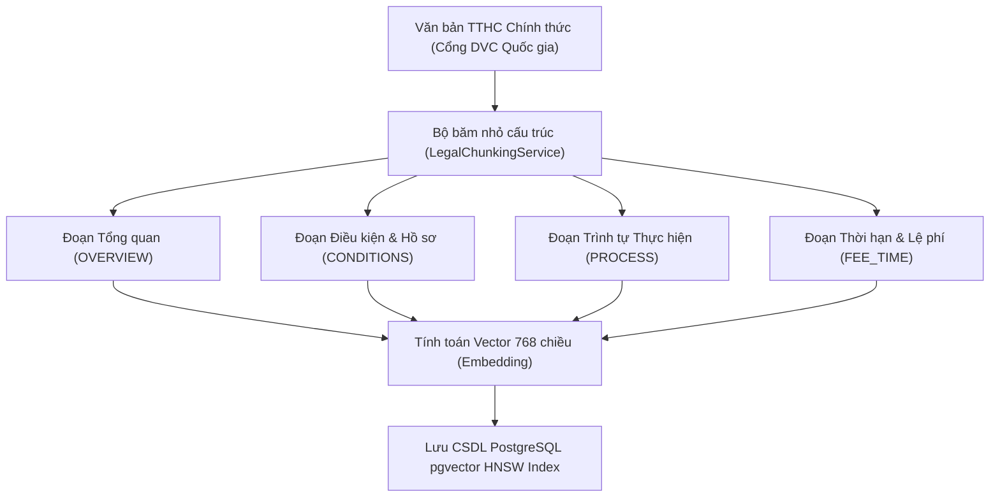

# CHƯƠNG 3: THIẾT KẾ VÀ HIỆN THỰC CÁC PHÂN HỆ LÕI (CORE MODULES)
**Đơn vị:** Viện Đào tạo Chất lượng cao – Trường Đại học Giao thông vận tải TP.HCM (UTH)  
**Đề tài:** SmartWard AI – Hệ thống Hỗ trợ Thủ tục Hành chính và Phân luồng Phản ánh Cấp Phường/Xã

---

## 3.1. PHÂN HỆ 1: TRỢ LÝ PHÁP LÝ HÀNH CHÍNH CÔNG (LEGAL RAG) VÀ CHỐT CHẶN CHỐNG ẢO GIÁC (ABSTENTION GUARDRAIL)

### 3.1.1. Đặt vấn đề và Thách thức Pháp lý trong Hành chính công
Trong môi trường hành chính công tại cấp xã/phường (Ủy ban nhân dân và Công an xã), tính chính xác của thông tin pháp lý mang tính chất pháp lý tối thượng. Khác với các hệ thống chatbot thương mại thông thường (nơi việc trả lời ước lượng có thể được chấp nhận), việc mô hình ngôn ngữ lớn (LLM) bị ảo giác (hallucination) trong thủ tục hành chính có thể dẫn đến hậu quả nghiêm trọng:
1. **Sai lệch thành phần hồ sơ:** Công dân chuẩn bị thiếu hoặc sai giấy tờ, phải đi lại nhiều lần gây bức xúc xã hội.
2. **Sai lệch thời hạn và cơ quan có thẩm quyền:** Hướng dẫn sai cơ quan thụ lý (ví dụ: nhầm lẫn thẩm quyền giữa UBND cấp xã và Chi nhánh Văn phòng Đăng ký Đất đai cấp huyện).
3. **Vi phạm pháp lý:** Không tuân thủ quy chuẩn dữ liệu theo Nghị định 13/2023/NĐ-CP về bảo vệ dữ liệu cá nhân.

Do đó, kiến trúc Legal RAG trong SmartWard AI được thiết kế theo nguyên tắc: **"Thà từ chối trả lời một cách an toàn còn hơn suy diễn thông tin sai lệch"** (*Conservative Abstention over Speculative Hallucination*).

---

### 3.1.2. Giải thuật Phân đoạn Văn bản Pháp lý (Legal Unit Chunking)
Hệ thống loại bỏ hoàn toàn phương pháp cắt phân đoạn cơ học cố định (fixed-size chunking 500 ký tự) do làm đứt gãy tính chỉnh thể của văn bản luật. Thay vào đó, SmartWard AI áp dụng phương pháp **Semantic Legal Unit Chunking**:
- Mỗi đoạn trích dẫn (`legal_chunks`) là một đơn vị quy định trọn vẹn: *Chương $\rightarrow$ Điều $\rightarrow$ Khoản $\rightarrow$ Điểm*.
- Mỗi chunk mang đầy đủ metadata: Mã đoạn (`chunk_code`), tiêu đề (`title`), nội dung (`content`), căn cứ pháp lý chính thức (`legal_reference`), trạng thái hiệu lực (`status = 'ACTIVE'`) và ngày có hiệu lực (`effective_date <= CURRENT_DATE`).



---

### 3.1.3. Mô hình Toán học của Chốt chặn Từ chối (Abstention Guardrail)
Cho câu hỏi của công dân $q$, hệ thống chuyển đổi thành vector embedding chuẩn hóa $L_2$:
$$\mathbf{v}_q = \text{Embedding}(q) \in \mathbb{R}^{768}, \quad \|\mathbf{v}_q\|_2 = 1$$

Không gian lưu trữ chứa tập các đoạn luật có hiệu lực $\mathcal{C} = \{\mathbf{c}_1, \mathbf{c}_2, \dots, \mathbf{c}_N\}$. Hệ thống thực hiện tìm kiếm Top-$K$ ($K=3$) láng giềng gần nhất theo khoảng cách Cosine trên chỉ mục HNSW:
$$\mathcal{D}_{\text{cosine}}(\mathbf{v}_q, \mathbf{c}_i) = 1 - \frac{\mathbf{v}_q \cdot \mathbf{c}_i}{\|\mathbf{v}_q\|_2 \|\mathbf{c}_i\|_2} = 1 - \mathbf{v}_q \cdot \mathbf{c}_i$$

Điểm tương đồng Cosine Similarity được xác định:
$$S_i = 1 - \mathcal{D}_{\text{cosine}}(\mathbf{v}_q, \mathbf{c}_i) = \mathbf{v}_q \cdot \mathbf{c}_i \in [-1, 1]$$

Điểm tương đồng tối đa trong tập ứng viên Top-$K$:
$$S_{\max} = \max_{i \in \text{Top-}K} S_i$$

Hệ thống đặt ra **Ngưỡng chốt chặn an toàn (Abstention Threshold)** $\theta = 0.78$. Quyết định phản hồi được mô hình hóa bởi hàm bước:

$$\text{Decision}(q) = \begin{cases} 
\text{Proceed to LLM Inference}, & \text{nếu } S_{\max} \ge \theta \\
\text{Safe Abstention (Từ chối trả lời)}, & \text{nếu } S_{\max} < \theta \text{ hoặc } \mathcal{C} = \emptyset
\end{cases}$$

Khi $S_{\max} < 0.78$, hệ thống lập tức ngắt luồng gọi LLM, hoàn trả thông báo từ chối trang trọng và hướng dẫn công dân liên hệ trực tiếp Bộ phận Một cửa hoặc Tổng đài 18001096, giúp tiết kiệm 100% token LLM và loại bỏ hoàn toàn nguy cơ ảo giác trên các câu hỏi ngoại phạm vi (Out-of-Scope).

---

### 3.1.4. Thuật toán Hậu kiểm tra Trích dẫn (Post-Verification Algorithm)
Để ngăn ngừa tình trạng mô hình LLM tự sáng tác mã đoạn luật giả mạo (hallucinated citations) trong câu trả lời đã sinh ra, SmartWard AI bổ sung tầng kiểm chứng định thức:

```
Thuật toán: Post-Verification of Legal Citations
Đầu vào: 
  - AnswerText (Chuỗi văn bản trả lời do LLM sinh ra)
  - TopKCandidates (Danh sách K đoạn luật thực tế được truy xuất từ CSDL)
Đầu ra: 
  - VerifiedCitations (Danh sách các trích dẫn pháp lý hợp lệ)

1. Khởi tạo CandidateMap = { c.chunkCode.toUpperCase() -> c | c in TopKCandidates }
2. Khởi tạo MatchedCodes = []
3. Trích xuất tất cả các đoạn mã nằm trong ngoặc vuông bằng Regex: \[( [A-Za-z0-9_\-]+ )\]
4. VỚI MỖI mã code trích xuất được:
     NẾU code tồn tại trong CandidateMap:
         Thêm code vào MatchedCodes (loại bỏ trùng lặp)
     NGƯỢC LẠI:
         Ghi nhận cảnh báo Log: "Hallucinated citation detected and discarded: [code]"
5. NẾU MatchedCodes không rỗng:
     VerifiedCitations = [ CandidateMap[code] for code in MatchedCodes ]
   NGƯỢC LẠI (LLM trả lời đúng nội dung nhưng quên ghi ngoặc vuông mã code):
     VerifiedCitations = [ TopKCandidates[0] ] (Gắn đoạn luật có S_max cao nhất làm căn cứ)
6. TRẢ VỀ VerifiedCitations
```

---

### 3.1.5. Kiến trúc Tích hợp Bộ đệm (Cache) và Giới hạn Tần suất (Rate Limit)
Để bảo đảm hệ thống hoạt động ổn định trong hạn mức phần cứng Zero-Cost (< 2.0GB RAM) và bảo vệ Free-tier quota của LLM:
1. **Redis Rate Limiter:** Áp dụng thuật toán Fixed Window bộ đếm nguyên tử (`INCR` + `EXPIRE 60s`). Tối đa 5 yêu cầu/phút/IP. Vượt quá ngưỡng trả về HTTP 429 (`SW_429`).
2. **Distributed Semantic Query Cache:** Các câu hỏi pháp lý sau khi chuẩn hóa (xóa dấu câu, chuẩn hóa khoảng trắng, chữ thường) được băm SHA-256 làm key lưu trữ trên Redis (`smartward:cache:rag:<hash>`) với TTL 3600 giây (1 giờ).
   - Truy vấn trùng lặp có thời gian phản hồi giảm từ ~1200ms xuống < 10ms.
   - Các phản hồi từ chối an toàn ($S_{\max} < \theta$) cũng được cache 1800 giây (30 phút) để triệt tiêu các đợt gửi câu hỏi rác lặp lại.

---

### 3.1.6. Kết quả Kiểm thử Đơn vị và Thực nghiệm (Unit Tests)
Hệ thống kiểm thử tự động của Phân hệ 1 đã được xây dựng tại:
- [`RagQueryServiceTest`](file:///E:/SmartWardAI/backend/src/test/java/vn/edu/uth/smartward/rag/RagQueryServiceTest.java): Kiểm thử 5 kịch bản then chốt:
  1. Chặn IP khi vượt giới hạn 5 req/phút.
  2. Trả về kết quả tức thì khi trúng Redis Cache.
  3. Kích hoạt Abstention Guardrail khi điểm tương đồng $S_{\max} = 0.65 < 0.78$.
  4. Trả về câu trả lời và trích dẫn chuẩn khi $S_{\max} = 0.88 \ge 0.78$.
  5. Thuật toán hậu kiểm lọc bỏ thành công trích dẫn giả mạo `[BIA-DAT-99]`.
- [`RagControllerTest`](file:///E:/SmartWardAI/backend/src/test/java/vn/edu/uth/smartward/rag/RagControllerTest.java): Kiểm thử REST API `POST /api/v1/rag/ask` với MockMvc (kiểm tra HTTP 200, HTTP 422 khi dữ liệu rỗng, và cấu trúc payload JSON).

Kết quả kiểm thử Maven đạt: **21/21 tests Passed (100% BUILD SUCCESS)**.
