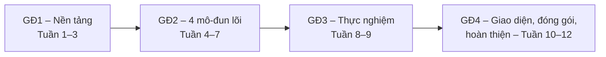
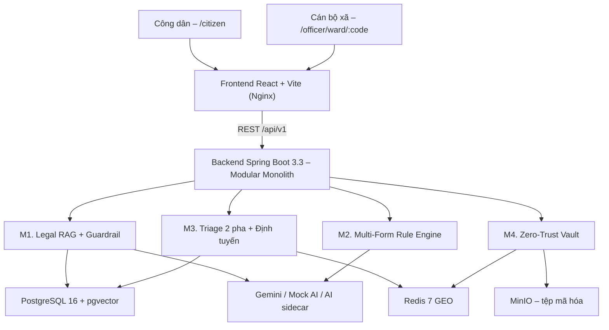

**TRƯỜNG ĐẠI HỌC GIAO THÔNG VẬN TẢI TP. HỒ CHÍ MINH**
**VIỆN ĐÀO TẠO CHẤT LƯỢNG CAO**

 

# BÁO CÁO HỌC KỲ DOANH NGHIỆP

## SmartWard AI – Nền tảng Hỗ trợ Thủ tục Hành chính và Phân luồng Phản ánh Hiện trường Cấp Xã/Phường Tích hợp Trí tuệ Nhân tạo

 

| | |
|:---|:---|
| **Giáo viên hướng dẫn** | TS. Lê Văn Quốc Anh |
| **Sinh viên thực hiện** | Nguyễn Minh Tuấn Khanh |
| **MSSV** | 089205023490 |
| **Lớp** | CN2301CLCB |
| **Ngành** | Công nghệ Thông tin |
| **Đơn vị thực tập** | Viettel An Giang – Chi nhánh Tập đoàn Công nghiệp – Viễn thông Quân đội |
| **Kho mã nguồn** | https://github.com/tuankhanh2306/SmartWardAI |

 

TP. Hồ Chí Minh, tháng 11 năm 2026

---

## MỤC LỤC

- [Chương 1. Giới thiệu doanh nghiệp và vị trí thực hiện](#chương-1-giới-thiệu-doanh-nghiệp-và-vị-trí-thực-hiện)
  - 1.1. Giới thiệu doanh nghiệp · 1.2. Lĩnh vực hoạt động · 1.3. Bộ phận tham gia · 1.4. Vị trí và vai trò của sinh viên · 1.5. Mentor và nhóm làm việc
- [Chương 2. Tổng quan dự án/công việc](#chương-2-tổng-quan-dự áncông-việc)
  - 2.1. Bối cảnh và mục tiêu · 2.2. Vấn đề cần giải quyết · 2.3. Phạm vi công việc · 2.4. Yêu cầu · 2.5. Công nghệ và công cụ sử dụng
- [Chương 3. Nội dung thực hiện](#chương-3-nội-dung-thực-hiện)
  - 3.1. Phân tích công việc · 3.2. Phương pháp và giải pháp · 3.3. Quá trình triển khai · 3.4. Kết quả thực hiện · 3.5. Kiểm thử và đánh giá · 3.6. Vấn đề phát sinh và cách giải quyết
- [Chương 4. Kết quả và kinh nghiệm](#chương-4-kết-quả-và-kinh-nghiệm)
  - 4.1. Kết quả đạt được · 4.2. Kiến thức đã vận dụng · 4.3. Kỹ năng chuyên môn · 4.4. Kỹ năng làm việc nhóm và giao tiếp · 4.5. Khó khăn và bài học kinh nghiệm · 4.6. Những nội dung cần tiếp tục cải thiện
- [Chương 5. Kết luận](#chương-5-kết-luận)
  - 5.1. Kết quả chính · 5.2. Mức độ hoàn thành công việc · 5.3. Kinh nghiệm đạt được · 5.4. Định hướng phát triển chuyên môn

---

## DANH MỤC TỪ VIẾT TẮT

| Viết tắt | Ý nghĩa |
|:---|:---|
| AI / LLM | Trí tuệ nhân tạo / Mô hình ngôn ngữ lớn |
| RAG | Retrieval-Augmented Generation – Sinh văn bản tăng cường truy xuất |
| OCR | Nhận dạng ký tự quang học |
| TTHC | Thủ tục hành chính |
| CCCD | Căn cước công dân |
| HNSW | Hierarchical Navigable Small World – chỉ mục vector xấp xỉ |
| RQ | Research Question – Câu hỏi nghiên cứu |
| RBAC | Phân quyền theo vai trò |
| PWA | Progressive Web App |
| NĐ 13/2023 | Nghị định 13/2023/NĐ-CP về bảo vệ dữ liệu cá nhân |

---

# CHƯƠNG 1. GIỚI THIỆU DOANH NGHIỆP VÀ VỊ TRÍ THỰC HIỆN

## 1.1. Giới thiệu doanh nghiệp

- **Tên đơn vị tiếp nhận:** Viettel An Giang – Chi nhánh Tập đoàn Công nghiệp – Viễn thông Quân đội (Viettel Group).
- **Địa chỉ:** 654 Nguyễn Trung Trực, Phường Rạch Giá, tỉnh An Giang.
- **Mô hình:** Chi nhánh hạch toán phụ thuộc Tổng công ty Mạng lưới Viettel, phạm vi hoạt động toàn tỉnh An Giang và phối hợp triển khai dự án tại các tỉnh Đồng bằng sông Cửu Long.

Viettel An Giang là đơn vị tiên phong trong chuyển đổi số tại địa phương. Giai đoạn 2023–2026, chi nhánh đã chủ trì triển khai nhiều hệ thống phục vụ quản lý nhà nước: một cửa điện tử liên thông đa cấp, giám sát hành trình xe công, quản lý dân cư và Trung tâm Điều hành Đô thị thông minh (IOC). Đây là môi trường phù hợp để sinh viên tiếp cận bài toán hệ thống thông tin ứng dụng trong hành chính công.

## 1.2. Lĩnh vực hoạt động

1. **Hạ tầng viễn thông và kết nối số:** mạng truyền dẫn quang toàn tỉnh, phủ sóng 4G, thử nghiệm 5G – nền tảng cho camera AI, IoT nông nghiệp, hội nghị truyền hình chính phủ.
2. **Nghiên cứu, phát triển và chuyển giao giải pháp phần mềm:** phần mềm một cửa đa cấp (xã – huyện – tỉnh), dịch vụ công trực tuyến mức độ 4, nền tảng phân tích dữ liệu kinh tế – xã hội.
3. **Tư vấn chuyển đổi số và ứng dụng AI:** tư vấn kỹ thuật cho UBND tỉnh và sở ngành theo Nghị quyết 36a/NQ-CP và Chiến lược Chuyển đổi số Quốc gia; thí điểm LLM, thị giác máy tính, NLP trong quản lý nhà nước – bối cảnh ra đời dự án SmartWard AI.

## 1.3. Bộ phận tham gia

- **Phòng ban:** Phòng Giải pháp Kinh doanh Doanh nghiệp – Tổ Phát triển Giải pháp Công nghệ Số.
- **Mô hình làm việc:** nhóm sản phẩm tích hợp dọc – mỗi thành viên nắm toàn bộ vòng đời tính năng (nghiệp vụ → mã nguồn → CSDL → tài liệu → kiểm thử).
- **Môi trường được tiếp cận:** kho mã nguồn Git, quản lý công việc theo Scrum, môi trường thử nghiệm Docker, tài liệu đặc tả nghiệp vụ hành chính công đang vận hành tại địa phương.

## 1.4. Vị trí và vai trò của sinh viên

| Thông tin | Chi tiết |
|:---|:---|
| Họ và tên | Nguyễn Minh Tuấn Khanh |
| MSSV | 089205023490 |
| Lớp / Ngành | CN2301CLCB – Công nghệ Thông tin, Khóa 23 |
| Vị trí thực tập | Full-stack Developer Intern / Kỹ sư Phát triển Phần mềm Thực tập |
| Dự án phụ trách | SmartWard AI |
| Thời gian | 12 tuần |

Sinh viên là **người phát triển toàn phần duy nhất** của dự án, chịu trách nhiệm:

- **Phân tích nghiệp vụ:** khảo sát Bộ phận Một cửa cấp xã/phường, hệ thống hóa 2 điểm nghẽn (sai sót tờ khai; phản ánh hiện trường trùng lặp/phân mảnh).
- **Thiết kế kiến trúc:** đề xuất và bảo vệ kiến trúc **Modular Monolith** (Spring Boot 3.3, Java 21) trong ràng buộc tổng RAM ≤ 2,0 GB.
- **Thiết kế CSDL đa mô hình:** PostgreSQL 16 + pgvector (HNSW 768 chiều), Redis 7 (GEO, token), MinIO (lưu trữ tệp mã hóa).
- **Phát triển 4 mô-đun AI/nghiệp vụ lõi:** Legal RAG, Rule Engine kiểm tra tờ khai, Triage phản ánh 2 pha, Kho tài liệu Zero-Trust.
- **Xây dựng giao diện web:** React + Vite + TailwindCSS + Leaflet (Cổng Công dân và Bàn điều hành Cán bộ).
- **Xây dựng bộ dữ liệu và đánh giá thực nghiệm** cho 3 câu hỏi nghiên cứu.

## 1.5. Mentor và nhóm làm việc

| Vai trò | Người phụ trách | Nhiệm vụ |
|:---|:---|:---|
| Giảng viên hướng dẫn (UTH) | TS. Lê Văn Quốc Anh | Định hướng khung nghiên cứu, phê duyệt RQ1–RQ3, thẩm định phương pháp thực nghiệm, đánh giá kết quả học kỳ |
| Mentor doanh nghiệp | Cán bộ kỹ thuật – Phòng Giải pháp Kinh doanh Doanh nghiệp, Viettel An Giang | Giao nhiệm vụ hàng tuần, thẩm định tính khả thi triển khai thực tế (hạ tầng, bảo mật, nghiệp vụ), review mã nguồn |
| Nhóm làm việc | Sinh viên (phát triển độc lập) | Toàn bộ vai trò: BA, kiến trúc sư, lập trình viên backend/frontend, kỹ sư dữ liệu, kiểm thử, tài liệu |

Quy trình làm việc chuẩn hóa theo Git-Flow + Conventional Commits 1.0.0, lưu trữ công khai trên GitHub để GVHD và Mentor theo dõi liên tục. Công cụ AI Agent (Antigravity/Gemini) được dùng làm trợ lý kỹ thuật (scaffold, review, soát lỗi); ranh giới giữa phần AI hỗ trợ và phần sinh viên tự thiết kế, chịu trách nhiệm (kiến trúc, thuật toán lõi, thực nghiệm) được công khai trong `AGENT_RULES.md`.

---

# CHƯƠNG 2. TỔNG QUAN DỰ ÁN/CÔNG VIỆC

## 2.1. Bối cảnh và mục tiêu

**Bối cảnh.** Sau sắp xếp đơn vị hành chính, tỉnh An Giang có **96 đơn vị cấp xã** (79 xã, 14 phường, 3 đặc khu). Bộ phận Một cửa cấp xã là nơi tiếp xúc trực tiếp với người dân nhưng còn xử lý thủ công nhiều khâu; chính quyền đang đẩy mạnh Chính phủ số, Đề án 06/CP và phải tuân thủ NĐ 13/2023 về bảo vệ dữ liệu cá nhân.

**Mục tiêu tổng quát.** Xây dựng nền tảng SmartWard AI hỗ trợ (i) người dân chuẩn bị hồ sơ TTHC đúng ngay từ đầu và (ii) cán bộ xã/phường tiếp nhận, gom nhóm, điều phối phản ánh hiện trường hiệu quả – vận hành với chi phí hạ tầng 0 đồng trên phần cứng ≤ 2,0 GB RAM.

**Mục tiêu cụ thể.**
1. Tư vấn 40 TTHC cấp xã có trích dẫn căn cứ pháp lý, **từ chối trả lời khi không đủ căn cứ** (chống ảo giác).
2. Tiền kiểm tra tờ khai hành chính sau OCR bằng quy tắc tất định.
3. Tự động gom cụm phản ánh trùng lặp theo vị trí + ngữ nghĩa và định tuyến đúng xã/phường.
4. Bảo vệ tài liệu cá nhân theo NĐ 13/2023.
5. Đánh giá định lượng qua 3 câu hỏi nghiên cứu (RQ1–RQ3).

## 2.2. Vấn đề cần giải quyết

**Bài toán 1 – Sai sót hồ sơ hành chính:**
- Sai cấu trúc CCCD 12 số (3 số mã tỉnh + 1 số thế kỷ/giới tính + 2 số năm sinh + 6 số ngẫu nhiên).
- Mâu thuẫn logic ngày tháng (ngày cấp < ngày sinh; nhầm DD/MM và MM/DD).
- Thiếu thành phần hồ sơ do tra cứu nhầm thủ tục hoặc văn bản hết hiệu lực.
- Hậu quả: hồ sơ bị trả lại 1–3 lần/người, cán bộ quá tải.
- Rủi ro khi dùng LLM thuần: **bịa căn cứ pháp lý** (legal hallucination).

**Bài toán 2 – Phản ánh hiện trường trùng lặp, phân mảnh:**
- Nhiều người mô tả cùng một sự cố bằng các cách diễn đạt khác nhau.
- GPS sai số 40–120 m trong hẻm sâu/nhà cao tầng (multipath).
- Phản ánh phân tán qua nhiều kênh; người dân không biết gửi về xã/phường nào khi gặp sự cố ngoài địa bàn cư trú.

**Ba câu hỏi nghiên cứu:**

| RQ | Nội dung | Biến độc lập | Chỉ số đo |
|:---:|:---|:---|:---|
| RQ1 | RAG phân đoạn theo Chương–Điều–Khoản + ngưỡng từ chối θ cải thiện độ chính xác trích dẫn và giảm ảo giác so với LLM zero-shot/RAG chuẩn thế nào? | Zero-shot / RAG chuẩn / RAG đề xuất | Recall@3, MRR, Citation Precision, False Answer Rate |
| RQ2 | Gom cụm 2 pha (không gian R + ngữ nghĩa τ) có hiệu quả hơn chỉ dùng vị trí hoặc chỉ dùng văn bản? Tham số (R, τ) tối ưu là bao nhiêu? | Spatial-only / Semantic-only / Two-Stage | Precision, Recall, F1 |
| RQ3 | Rule Engine tất định đặt sau OCR phát hiện được bao nhiêu % lỗi logic tờ khai? | Có / không có Rule Engine | Error Detection Rate, False Positive Rate |

## 2.3. Phạm vi công việc

**Trong phạm vi:**
- 40 TTHC cấp xã thuộc 4 lĩnh vực: Hộ tịch, Cư trú, Chứng thực, Bảo trợ xã hội (nguồn: Cổng Dịch vụ công Quốc gia).
- 4 nhóm tờ khai: `CT01` (cư trú), `TK-KS` (khai sinh), `TK-KH` (kết hôn/xác nhận tình trạng hôn nhân), `TK-BTXH` (trợ cấp bảo trợ xã hội).
- 96 đơn vị hành chính cấp xã tỉnh An Giang.
- Hai nhóm người dùng: Công dân (web mobile-first/PWA) và Cán bộ xã (bàn điều hành tập trung).

**Ngoài phạm vi:**
- Không thay thế quyết định pháp lý của cán bộ; hệ thống chỉ **nhắc nhở – cảnh báo**, người dân tự sửa trên tờ khai giấy.
- Không tích hợp thật với CSDL Dân cư Quốc gia/VNeID (chỉ mô phỏng giao diện).
- Không triển khai ứng dụng di động bản địa.

## 2.4. Yêu cầu

**Yêu cầu chức năng:**

| Mã | Yêu cầu |
|:---:|:---|
| FR1 | Hỏi đáp TTHC có trích dẫn; từ chối khi điểm tương đồng cao nhất S_max < θ = 0,78; hậu kiểm loại trích dẫn giả |
| FR2 | Tiền kiểm tra tờ khai: cấu trúc CCCD, logic ngày tháng, tuổi kết hôn, điều kiện trợ cấp, trường bắt buộc; cảnh báo kiểm tra thủ công khi độ tin cậy OCR < 0,70 |
| FR3 | Tiếp nhận phản ánh kèm GPS, số điện thoại bắt buộc; gom cụm 2 pha; định tuyến về đúng UBND xã/phường nơi xảy ra sự cố |
| FR4 | Bản đồ GIS các cụm sự cố cho cán bộ |
| FR5 | Lưu tài liệu: đóng watermark động, mã hóa AES-256-GCM, liên kết xem một lần (HTTP 410 khi xem lại) |
| FR6 | Phân quyền Công dân / Cán bộ (RBAC, xác thực thẻ công chức) |

**Yêu cầu phi chức năng:**

| Mã | Yêu cầu |
|:---:|:---|
| NFR1 | Tổng RAM cụm Docker ≤ 2.048 MiB; chi phí vận hành 0 đồng |
| NFR2 | Vận hành ngoại tuyến được (demo không cần Internet) |
| NFR3 | Tuân thủ NĐ 13/2023 về dữ liệu cá nhân |
| NFR4 | Giới hạn tần suất 5 yêu cầu/phút/IP cho RAG; cache truy vấn 1 giờ |
| NFR5 | Giao diện thân thiện người cao tuổi (cỡ chữ A/A+/A++, đọc giọng nói) |

## 2.5. Công nghệ và công cụ sử dụng

| Nhóm | Công nghệ | Lý do lựa chọn |
|:---|:---|:---|
| Backend | Spring Boot 3.3.5, Java 21, Maven Wrapper | Modular Monolith 1 JVM, tiết kiệm RAM so với Microservices |
| Bất đồng bộ | Spring `@Async` (core=2, max=4, queue=50) | Thay Kafka + ZooKeeper (≥ 1 GB RAM) – dư thừa với tải vài trăm yêu cầu/ngày |
| CSDL | PostgreSQL 16 + pgvector (HNSW), Flyway | Gộp dữ liệu quan hệ và vector trong 1 RDBMS, truy vấn lai trong 1 câu SQL, bảo đảm ACID |
| Bộ nhớ đệm / không gian | Redis 7 (GEOSEARCH, GETDEL) | Truy vấn bán kính mili-giây; thao tác đọc-xóa nguyên tử cho token một lần |
| Lưu trữ tệp | MinIO (S3-compatible) | Tách tệp nhị phân khỏi CSDL, ILM tự hủy sau 7 ngày |
| AI | Gemini 2.5 Flash, gemini-embedding-001 (768 chiều); `DeterministicMockAiClient`; AI sidecar Python (FastAPI) | Chạy thật khi có API key, chạy giả lập tất định khi ngoại tuyến |
| Frontend | React 18, TypeScript, Vite 6, TailwindCSS, Leaflet | SPA nhẹ (~149 KB gzip), hỗ trợ PWA |
| Thiết kế UI | Google Stitch (qua Stitch MCP) | Sinh nguyên mẫu 4 màn hình GovTech |
| Đóng gói | Docker multi-stage, Docker Compose, Nginx 1.27 | Triển khai một lệnh, giới hạn `mem_limit` từng container |
| Thực nghiệm | Python (numpy, pandas, scikit-learn, matplotlib, seaborn) | Grid Search, tính chỉ số, vẽ biểu đồ |
| Quản lý mã nguồn | Git, GitHub, Conventional Commits, Semantic Versioning | Truy vết lịch sử, release theo tuần |

---

# CHƯƠNG 3. NỘI DUNG THỰC HIỆN

## 3.1. Phân tích công việc

Công việc được chia theo lộ trình 12 tuần, 4 giai đoạn:

| Giai đoạn | Đầu việc chính | Đầu ra |
|:---|:---|:---|
| GĐ1 | Khảo sát nghiệp vụ, phát biểu RQ, thiết kế kiến trúc, dựng hạ tầng Docker, pipeline dữ liệu 40 TTHC, schema CSDL | Tài liệu kiến trúc, `docker-compose.yml`, khung Spring Boot, 40 TTHC đã xác minh |
| GĐ2 | Legal RAG, Rule Engine, Triage 2 pha, Vault Zero-Trust | 4 mô-đun + REST API + unit test |
| GĐ3 | Bộ dữ liệu đánh giá, Experiment Runner, Grid Search, biểu đồ | Số liệu RQ1–RQ3, biểu đồ khoa học |
| GĐ4 | Giao diện web/PWA, Docker hóa toàn bộ, kiểm thử ngoại tuyến, gia cố bảo mật, slide bảo vệ | Sản phẩm chạy một lệnh, slide thuyết trình |

**Kiến trúc tổng thể:**

**Mô hình dữ liệu:** 6 bảng chính – `admin_procedures`, `legal_chunks` (vector 768 chiều, chỉ mục HNSW), `issue_clusters`, `civic_reports`, `form_submissions`, `vault_documents` – quản lý migration bằng Flyway.

## 3.2. Phương pháp và giải pháp

### 3.2.1. Mô-đun 1 – Legal RAG và Abstention Guardrail

1. **Phân đoạn theo cấu trúc pháp lý:** văn bản TTHC được cắt theo Chương – Điều – Khoản, gắn metadata ngày hiệu lực, chỉ truy xuất đoạn `ACTIVE` và còn hiệu lực.
2. **Truy xuất:** vector hóa câu hỏi (768 chiều) → Top-K theo cosine trên chỉ mục HNSW.
3. **Chốt chặn từ chối:**

$$\text{Hành động} = \begin{cases} \text{Từ chối, hướng dẫn gặp cán bộ Một cửa} & \text{nếu } S_{max} < \theta = 0.78 \\ \text{Sinh câu trả lời + trích dẫn bắt buộc} & \text{nếu } S_{max} \geq \theta \end{cases}$$

4. **Hậu kiểm trích dẫn:** quét mã `[MÃ_ĐOẠN]` trong câu trả lời, loại mọi mã không thuộc Top-K thực tế.
5. **Bổ sung trải nghiệm hội thoại:** chuẩn hóa tiếng Việt không dấu/lỗi Telex (`VietnameseTextNormalizer`), nhớ ngữ cảnh 3–5 lượt, viết lại câu hỏi phụ thuộc ngữ cảnh ("còn lệ phí bao nhiêu?"), gợi ý nhanh sau mỗi câu trả lời, câu trả lời theo khuôn 5 phần.
6. **Bảo vệ hệ thống:** giới hạn 5 yêu cầu/phút/IP, cache Redis 1 giờ, tuyên bố miễn trừ trách nhiệm.

### 3.2.2. Mô-đun 2 – Multi-Form Deterministic Rule Engine

Bộ quy tắc **thuần Java (và TypeScript phía client)**, không phụ thuộc LLM, đặt sau bước OCR:

| Tờ khai | Quy tắc chính |
|:---|:---|
| `CT01` | CCCD 12 số, 63 mã tỉnh hợp lệ, chữ số thế kỷ/giới tính khớp giới tính khai báo, 2 số năm sinh khớp ngày sinh; sự đồng ý của chủ hộ |
| `TK-KS` | Đối chiếu chéo với Giấy chứng sinh (họ tên mẹ, ngày sinh trẻ); quy tắc khi cha mẹ chưa đăng ký kết hôn |
| `TK-KH` | Tuổi kết hôn tính đến từng ngày (Nam ≥ 20, Nữ ≥ 18 – Điều 8 Luật HN&GĐ 2014); chặn mục đích xác nhận độc thân chung chung |
| `TK-BTXH` | Người cao tuổi ≥ 80 không lương hưu hoặc khuyết tật nặng; tài khoản nhận trợ cấp |
| Chung | Trường bắt buộc; logic ngày tháng; cờ `MANUAL_REVIEW_REQUIRED` khi độ tin cậy OCR < 0,70 (vùng xám – human-in-the-loop) |

Nguyên tắc nghiệp vụ: hệ thống **chỉ cảnh báo**, người dân sửa bằng bút trên bản giấy – bảo đảm tính pháp lý của bản khai gốc.

### 3.2.3. Mô-đun 3 – Two-Stage Spatial-Semantic Triage

1. **Pha 1 – Lọc không gian:** Redis `GEOSEARCH` tìm cụm `OPEN`/`IN_PROGRESS` trong bán kính R mét, cửa sổ 72 giờ.
2. **Pha 2 – Lọc nghiệp vụ và ngữ nghĩa:** loại ứng viên khác danh mục; tính cosine giữa vector mô tả mới và vector tâm cụm.
3. **Quyết định:** nếu Sim ≥ τ → gộp vào cụm, cập nhật tâm GPS và vector tâm theo trung bình động (chuẩn hóa L2); ngược lại → tạo cụm mới `CLUST_YYYYMMDD_XXXX`.
4. **Định tuyến liên xã/phường:** dựa trên địa chỉ trong ô vị trí (reverse geocoding + Haversine) để gửi về đúng 1 trong 96 UBND cấp xã.
5. **Bắt buộc số điện thoại** người phản ánh để cán bộ xác minh.

### 3.2.4. Mô-đun 4 – Zero-Trust Document Vault

| Tầng bảo vệ | Kỹ thuật |
|:---|:---|
| Watermark động | Java2D, `AlphaComposite` (α = 0,38), chữ nghiêng phủ toàn ảnh: "CHỈ DÙNG ĐỂ SƠ DUYỆT HỒ SƠ TẠI UBND – [thời điểm]" |
| Mã hóa | `AES/GCM/NoPadding` 256-bit, IV 12 byte ngẫu nhiên, tag 128-bit; khóa bắt buộc đủ 32 byte, lỗi thì từ chối lưu (fail-closed) |
| Truy cập một lần | Token lưu Redis TTL 24 giờ, tiêu thụ bằng `GETDEL` nguyên tử; lần xem thứ hai trả **HTTP 410 Gone**; header cấm cache |

### 3.2.5. Ràng buộc tài nguyên (Zero-Cost)

| Container | `mem_limit` | Thực tế |
|:---|:---:|:---:|
| PostgreSQL 16 + pgvector | 448 MiB | ~110 MiB |
| Redis 7 | 128 MiB | ~18 MiB |
| MinIO | 256 MiB | ~65 MiB |
| AI sidecar (FastAPI) | 384 MiB | ~210 MiB |
| Backend Spring Boot | 768 MiB | ~380 MiB |
| Frontend Nginx | 64 MiB | ~12 MiB |
| **Tổng** | **2.048 MiB** | **~795 MiB** |

## 3.3. Quá trình triển khai

| Tuần | Nội dung chính | Kết quả bàn giao | Kiểm thử |
|:---:|:---|:---|:---:|
| 1 | Khảo sát nghiệp vụ, phát biểu 3 RQ, thiết kế kiến trúc, Docker Compose 4 container, khung Spring Boot, Git workflow, pipeline 5 TTHC thí điểm | Release `v0.1.0-w01`, bộ tài liệu kiến trúc | 2/2 pass |
| 2 | Thu thập đủ 40 TTHC, Flyway `V1__init_schema.sql` (6 bảng + HNSW), JPA Entity, `LegalChunkingService` | Schema CSDL, 40 TTHC đã xác minh | – |
| 3 | `AiModelClient` (Gemini + Mock tất định), `RedisRateLimiter`, `QueryCacheService` | Tầng tích hợp AI | – |
| 4 | Mô-đun 1 Legal RAG, Guardrail θ = 0,78, hậu kiểm trích dẫn, API `POST /api/v1/rag/ask` | Mô-đun RAG | 21/21 pass |
| 5 | Mô-đun 2 Rule Engine (CCCD, ngày tháng, trường bắt buộc), API `POST /api/v1/forms/precheck` | Mô-đun tiền kiểm | 38/38 pass |
| 6 | Mô-đun 3 Triage 2 pha, API `/issues/report`, `/issues/clusters`; sơ kết giữa kỳ | Mô-đun Triage | 43/43 pass |
| 7 | Mô-đun 4 Vault (watermark, AES-GCM, token một lần), API `/vault/upload`, `/vault/view/{token}` | Mô-đun Vault | 51/51 pass |
| 8 | Bộ dữ liệu đánh giá (80 câu RAG, 40 tờ khai, 150 phản ánh), `ExperimentRunnerService`, API benchmark | Hạ tầng đo lường | 57/57 pass |
| 9 | Grid Search (R, τ), so sánh 3 phương pháp, biểu đồ 300 DPI, phân tích lỗi | Số liệu và biểu đồ | – |
| 10 | Frontend React/PWA từ thiết kế Google Stitch: Cổng Công dân, Tiền kiểm & Báo sự cố, GIS, Bàn sơ duyệt | Build Vite 0 lỗi | Build pass |
| 11 | Dockerfile multi-stage, Compose toàn hệ thống, kiểm thử ngoại tuyến, cập nhật README | Hệ thống chạy 1 lệnh | 57/57 pass |
| 12 | Mở rộng 96 xã/phường An Giang, 4 nhóm tờ khai, RBAC + HMAC, hợp nhất bàn điều hành cán bộ; **khắc phục rò rỉ nhãn trong đánh giá**, kiểm định lại trên tập held-out; gia cố bảo mật; slide bảo vệ | Sản phẩm hoàn thiện, `SmartWardAI_BaoVe.pptx` | ~129 ca test backend |

## 3.4. Kết quả thực hiện

**Sản phẩm phần mềm:**

| Thành phần | Kết quả |
|:---|:---|
| Backend | Modular Monolith với 4 mô-đun nghiệp vụ + mô-đun đánh giá; REST API có tài liệu Swagger; xử lý lỗi tập trung `ApiResponse<T>` / `GlobalExceptionHandler` |
| Frontend | Cổng chọn địa bàn (96 xã/phường), Cổng Công dân (chatbot 40 TTHC, TTS, cỡ chữ A++), Tiền kiểm 4 nhóm tờ khai + Báo sự cố GPS, Bàn điều hành cán bộ tập trung (GIS, duyệt hồ sơ watermark, nhận sự cố liên xã) |
| Dữ liệu | 40 TTHC chuẩn hóa từ Cổng DVCQG; danh mục 96 đơn vị hành chính An Giang; 3 bộ dữ liệu đánh giá |
| Hạ tầng | 6 container thường trực, trần 2.048 MiB, thực tế ~795 MiB; chế độ ngoại tuyến hoạt động đầy đủ |
| Tài liệu | README, đặc tả hệ thống, kiến trúc & luồng xử lý, ràng buộc dự án, Git workflow, lộ trình, 9 báo cáo tuần, slide bảo vệ |

**Các API chính:**

| Phương thức | Endpoint | Chức năng |
|:---:|:---|:---|
| POST | `/api/v1/rag/ask` | Hỏi đáp TTHC |
| POST | `/api/v1/forms/precheck` | Tiền kiểm tờ khai |
| POST | `/api/v1/issues/report` | Gửi phản ánh |
| GET | `/api/v1/issues/clusters` | Danh sách cụm sự cố cho bản đồ |
| POST | `/api/v1/vault/upload` | Tải tài liệu lên kho bảo mật |
| GET | `/api/v1/vault/view/{token}` | Xem tài liệu một lần |
| POST | `/api/v1/evaluation/run-benchmarks` | Chạy bộ đánh giá |
| GET | `/api/v1/health` | Kiểm tra sức khỏe hệ thống |

## 3.5. Kiểm thử và đánh giá

### 3.5.1. Kiểm thử phần mềm

- **Backend:** 24 lớp kiểm thử, ~129 ca (unit test + MockMvc), bao phủ RAG (chặn tần suất, cache, từ chối, hậu kiểm trích dẫn), validator tờ khai, Triage (tạo/gộp cụm, chặn gộp nhầm khác danh mục), Vault (mã hóa–giải mã toàn vẹn, phát hiện sửa ciphertext, HTTP 410). Toàn bộ chạy được **không cần Internet**.
- **Frontend:** `tsc -b` + `vite build` 0 lỗi; script kiểm thử chatbox 4 nhóm ca (sai chính tả, câu mơ hồ, câu nối tiếp, ngoài phạm vi).
- **Kiểm thử đối kháng:** bộ `intent_adversarial_benchmark.json` và kiểm thử bộ nhớ watermark, AES-GCM luồng.

### 3.5.2. Đánh giá thực nghiệm

> [!IMPORTANT]
> Số liệu dưới đây là kết quả **đo lại sau khi loại bỏ rò rỉ nhãn (ground-truth leakage)** trong script đánh giá (commit ngày 08/11/2026), lưu tại `evaluation/results/`. Các con số 100% được ghi trong báo cáo tuần 8–9 **không còn hiệu lực** và đã được thay thế.

**RQ1 – Legal RAG** (80 câu: 65 trong phạm vi, 15 câu bẫy ngoài phạm vi):

| Cấu hình | Recall@3 | MRR | Citation Precision | Tỷ lệ trả lời sai câu bẫy | Tỷ lệ từ chối đúng |
|:---|:---:|:---:|:---:|:---:|:---:|
| LLM Zero-shot (mốc tham chiếu) | – | – | 32,5% | 73,3% | 26,7% |
| RAG chuẩn (θ = 0,42) | 86,2% | 0,79 | 86,2% | 100,0% | 0,0% |
| **RAG đề xuất (Chunking Điều–Khoản + θ = 0,78)** | **86,2%** | **0,79** | **97,6%** | **6,7%** | **93,3%** |

→ Guardrail giữ nguyên khả năng truy xuất nhưng tăng độ chính xác trích dẫn +11,4 điểm % và giảm trả lời sai câu bẫy từ 100% xuống 6,7% (14/15 câu bẫy bị từ chối đúng).

**RQ2 – Triage phản ánh** (150 phản ánh = 30 sự cố gốc × 5 biến thể, có nhiễu GPS và 25 ca biên khó):

| Phương pháp | Precision | Recall | F1 | Độ chính xác ca khó |
|:---|:---:|:---:|:---:|:---:|
| Spatial-only (R = 50 m) | 43,03% | 92,67% | 58,77% | 96,0% |
| Semantic-only (τ = 0,75) | 98,36% | 80,00% | 88,24% | 84,0% |
| **Two-Stage (R = 50 m, τ = 0,75)** | **100,00%** | **80,00%** | **88,89%** | 84,0% |

Kiểm định trên **tập held-out tách theo thời gian** (90 phản ánh dev / 60 phản ánh test, so khớp TF-IDF mù nhãn):

| Cấu hình | Precision | Recall | F1 |
|:---|:---:|:---:|:---:|
| Tối ưu trên dev (R = 50 m, τ = 0,75) | 100,0% | 70,0% | **82,35%** |
| Cấu hình triển khai (R = 25 m, τ = 0,80) | 100,0% | 62,0% | 76,54% |

→ Two-Stage cho Precision tuyệt đối (không gộp nhầm sự cố khác loại) – ưu tiên đúng về nghiệp vụ, vì gộp nhầm nguy hiểm hơn tách thừa. Recall còn hạn chế (70%); F1 sụt mạnh khi τ ≥ 0,82 (ví dụ R = 75 m, τ = 0,82 chỉ đạt F1 39,57%), cho thấy mô hình nhạy với τ.

**RQ3 – Rule Engine tờ khai** (40 tờ khai mẫu, 20 đánh máy + 20 viết tay, lỗi được cài sẵn): phát hiện 100% lỗi cấu trúc CCCD và lỗi logic ngày tháng đã cài, không báo nhầm trên mẫu hợp lệ. Lưu ý: đây là kết quả trên **dữ liệu tổng hợp có lỗi chủ động cài**; quy tắc tất định nên đạt 100% với lỗi nằm trong tập quy tắc – giá trị thực sự cần được kiểm chứng trên tờ khai thực tế.

**Tài nguyên:** tổng RAM thực tế ~795 MiB / trần 2.048 MiB; gói frontend ~149 KB gzip.

## 3.6. Vấn đề phát sinh và cách giải quyết

| # | Vấn đề | Nguyên nhân | Giải pháp |
|:---:|:---|:---|:---|
| 1 | Kiến trúc Microservices + Kafka vượt ngân sách RAM (~2,7–4 GB) | Over-engineering so với tải thực tế | Chuyển sang Modular Monolith, thay Kafka bằng `@Async` + Redis → RAM < 2 GB |
| 2 | LLM bịa căn cứ pháp lý (73,3% trả lời sai câu bẫy) | LLM không có ràng buộc nguồn | Guardrail θ = 0,78 + hậu kiểm trích dẫn |
| 3 | Kết quả đánh giá ban đầu đạt 100% bất thường | Script đánh giá vô tình dùng nhãn ground-truth khi tính tương đồng | Loại rò rỉ nhãn, thêm kiểm định held-out tách theo thời gian, báo cáo lại số liệu trung thực |
| 4 | Ngưỡng θ không thống nhất giữa backend và frontend | Cấu hình rải rác | Hợp nhất θ = 0,78 tại một nguồn cấu hình |
| 5 | Mô hình embedding `text-embedding-004` bị ngừng | Thay đổi từ nhà cung cấp | Nâng lên `gemini-embedding-001` (768 chiều, MRL); tách không gian vector theo `embedding_model` để tránh so sánh chéo mô hình |
| 6 | Lộ khóa Gemini API phía trình duyệt; phân quyền chỉ ở frontend | Thiết kế ban đầu ưu tiên demo nhanh | Chuyển mọi lời gọi AI qua backend; thêm xác thực cán bộ HMAC phía server |
| 7 | Bản đồ Leaflet hiển thị thiếu ô, máy chủ OSM bị chặn | Lỗi resize + chính sách tile server | `ResizeObserver`, chuyển sang CDN tile thay thế |
| 8 | Chatbot trả lời cứng nhắc, cắt cụt, không hiểu tiếng Việt không dấu | Thiếu tiền xử lý và ngữ cảnh | Chuẩn hóa Telex/không dấu, nhớ ngữ cảnh 3–5 lượt, khuôn trả lời 5 phần |
| 9 | Máy không có Maven trong PATH | Môi trường cá nhân | Dùng Maven Wrapper nhúng trong repo |
| 10 | Phòng bảo vệ có thể mất mạng | Rủi ro demo | `DeterministicMockAiClient` sinh embedding tất định từ SHA-256, chạy 100% ngoại tuyến |

---

# CHƯƠNG 4. KẾT QUẢ VÀ KINH NGHIỆM

## 4.1. Kết quả đạt được

- Hoàn thành **4/4 mô-đun lõi** và giao diện cho 2 nhóm người dùng, triển khai được bằng một lệnh `docker compose up`.
- Trả lời định lượng cả **3 câu hỏi nghiên cứu**: RAG đề xuất đạt Citation Precision 97,6%, giảm trả lời sai câu bẫy xuống 6,7%; Triage 2 pha đạt Precision 100%, F1 88,89% (toàn tập) và 82,35% (held-out); Rule Engine phát hiện 100% lỗi cài sẵn.
- Đáp ứng ràng buộc **Zero-Cost**: ~795 MiB RAM thực tế, chạy ngoại tuyến.
- Mở rộng phạm vi từ 1 phường thí điểm lên **96 đơn vị cấp xã An Giang**, từ 1 lên **4 nhóm tờ khai**.
- Lịch sử phát triển minh bạch: ~72 commit theo Conventional Commits; bộ tài liệu kỹ thuật và slide bảo vệ.

## 4.2. Kiến thức đã vận dụng

| Học phần / Lĩnh vực | Vận dụng trong dự án |
|:---|:---|
| Phân tích thiết kế hệ thống | Khảo sát nghiệp vụ, đặc tả yêu cầu, sơ đồ tuần tự, ERD |
| Cơ sở dữ liệu | Thiết kế 6 bảng, migration Flyway, chỉ mục HNSW, truy vấn lai quan hệ – vector |
| Lập trình Java / OOP | Spring Boot, Dependency Injection, xử lý ngoại lệ tập trung |
| Cấu trúc dữ liệu & giải thuật | Tìm kiếm láng giềng gần nhất, cập nhật tâm cụm trung bình động, Haversine |
| Trí tuệ nhân tạo / NLP | Embedding, RAG, ngưỡng từ chối, TF-IDF, chuẩn hóa tiếng Việt |
| An toàn thông tin | AES-GCM, token một lần nguyên tử, RBAC, HMAC, bảo vệ khóa API |
| Xác suất thống kê | Precision/Recall/F1, Recall@k, MRR, Grid Search, chia tập dev/test |
| Công nghệ phần mềm | Git-Flow, kiểm thử tự động, Semantic Versioning |
| Pháp luật CNTT | NĐ 13/2023, Luật Căn cước, Luật HN&GĐ 2014, Thông tư 04/2020/TT-BTP |

## 4.3. Kỹ năng chuyên môn

- **Backend:** thiết kế REST API, Modular Monolith, tích hợp PostgreSQL/Redis/MinIO, xử lý bất đồng bộ.
- **AI ứng dụng:** xây dựng pipeline RAG, thiết kế guardrail, tích hợp LLM có phương án dự phòng ngoại tuyến.
- **Frontend:** React + TypeScript, bản đồ Leaflet, PWA, thiết kế hướng người cao tuổi.
- **DevOps:** Docker multi-stage, giới hạn tài nguyên container, healthcheck, quản lý bí mật qua `.env`.
- **Nghiên cứu thực nghiệm:** phát biểu RQ có thể kiểm chứng, xây dựng bộ dữ liệu, phát hiện và khắc phục rò rỉ nhãn, báo cáo số liệu trung thực.

## 4.4. Kỹ năng làm việc nhóm và giao tiếp

- Báo cáo tiến độ định kỳ theo mẫu cho GVHD và Mentor; release theo tuần để người hướng dẫn kiểm tra snapshot mã nguồn.
- Trình bày và bảo vệ quyết định kỹ thuật (Monolith vs Microservices) bằng số liệu.
- Chuyển đổi ngôn ngữ kỹ thuật sang ngôn ngữ nghiệp vụ hành chính khi làm việc với Mentor; ẩn thuật ngữ kỹ thuật khỏi giao diện người dân.
- Phối hợp có kiểm soát với AI Agent: phân định rõ phần được hỗ trợ và phần tự chịu trách nhiệm.

## 4.5. Khó khăn và bài học kinh nghiệm

| Khó khăn | Bài học |
|:---|:---|
| Muốn dùng kiến trúc "doanh nghiệp lớn" cho bài toán nhỏ | Chọn kiến trúc theo tải thực tế, không theo xu hướng |
| Kết quả thực nghiệm đẹp bất thường (100%) | Kết quả hoàn hảo là tín hiệu cần nghi ngờ; luôn tách tập test độc lập và kiểm tra rò rỉ dữ liệu |
| Số liệu giữa các tài liệu không đồng bộ | Mỗi chỉ số chỉ nên có một nguồn sự thật (file kết quả), tài liệu phải trích từ đó |
| Ưu tiên demo nhanh dẫn đến lỗ hổng (lộ API key, phân quyền phía client) | Bảo mật phải thiết kế từ đầu, không bổ sung sau |
| Phụ thuộc dịch vụ bên thứ ba (mô hình embedding bị ngừng, tile server bị chặn) | Thiết kế lớp trừu tượng và phương án dự phòng cho mọi phụ thuộc ngoài |
| Phát triển một mình, khối lượng lớn | Chia nhỏ theo tuần, mỗi mục tiêu phải có đầu ra kiểm chứng được |

## 4.6. Những nội dung cần tiếp tục cải thiện

1. **Dữ liệu đánh giá:** bộ dữ liệu hiện chủ yếu là tổng hợp; cần thu thập tờ khai và phản ánh **thực tế** (đã có mẫu thu thập held-out trong `ml/data/`).
2. **Recall của Triage (70% trên held-out):** thử nghiệm embedding tiếng Việt chuyên biệt (bi-encoder PhoBERT tinh chỉnh đang thử nghiệm) thay cho TF-IDF.
3. **Mốc so sánh LLM Zero-shot** cần được đo lại trực tiếp thay vì dùng giá trị tham chiếu.
4. **Đo độ trễ và tải thực tế** sau khi sửa pipeline đánh giá.
5. Tích hợp thật với VNeID / CSDL Dân cư Quốc gia khi có cơ chế cấp phép.
6. Kiểm thử end-to-end tự động phía frontend và kiểm thử bảo mật độc lập.

---

# CHƯƠNG 5. KẾT LUẬN

## 5.1. Kết quả chính

Dự án SmartWard AI đã xây dựng thành công một nền tảng hỗ trợ hành chính công cấp xã/phường gồm 4 mô-đun: **(1)** tư vấn 40 TTHC có trích dẫn và cơ chế từ chối chống ảo giác; **(2)** tiền kiểm 4 nhóm tờ khai bằng quy tắc tất định; **(3)** gom cụm phản ánh 2 pha không gian – ngữ nghĩa và định tuyến về đúng 96 xã/phường An Giang; **(4)** kho tài liệu Zero-Trust tuân thủ NĐ 13/2023. Toàn hệ thống vận hành trong ~795 MiB RAM, chi phí 0 đồng, chạy được ngoại tuyến.

Về mặt nghiên cứu: guardrail θ = 0,78 giảm tỷ lệ trả lời sai câu hỏi ngoài phạm vi từ 100% (RAG chuẩn) xuống 6,7% mà không giảm Recall@3; gom cụm 2 pha đạt Precision 100% và F1 82,35% trên tập held-out, vượt phương pháp chỉ dùng vị trí (F1 58,77%).

## 5.2. Mức độ hoàn thành công việc

| Hạng mục | Kế hoạch | Thực tế | Mức độ |
|:---|:---|:---|:---:|
| 4 mô-đun lõi | 4 | 4 | 100% |
| Giao diện Công dân + Cán bộ | 2 | 2 (+ cổng chọn địa bàn) | 100% |
| Dữ liệu TTHC | 40 | 40 | 100% |
| Trả lời RQ1–RQ3 bằng số liệu | 3 | 3 (đã đo lại trung thực) | 100% |
| Ràng buộc RAM ≤ 2 GB | ≤ 2.048 MiB | ~795 MiB | Đạt |
| Đánh giá trên dữ liệu thực tế | – | Chưa có | Chưa đạt |
| Tích hợp hệ thống quốc gia | Ngoài phạm vi | Mô phỏng giao diện | – |

**Tự đánh giá:** hoàn thành đầy đủ mục tiêu kỹ thuật; phần thực nghiệm hoàn thành nhưng còn giới hạn ở dữ liệu tổng hợp.

## 5.3. Kinh nghiệm đạt được

- Làm chủ toàn bộ vòng đời một sản phẩm phần mềm có AI, từ khảo sát nghiệp vụ đến triển khai.
- Hiểu rằng trong lĩnh vực hành chính – pháp lý, **"biết từ chối" quan trọng hơn "trả lời được mọi câu"**.
- Rèn luyện tính trung thực học thuật: chủ động phát hiện, sửa và công bố lại số liệu khi phát hiện lỗi phương pháp.
- Hiểu đặc thù triển khai CNTT cho cơ quan nhà nước: ràng buộc hạ tầng, bảo vệ dữ liệu cá nhân, tính pháp lý của hồ sơ gốc.

## 5.4. Định hướng phát triển chuyên môn

**Đối với sản phẩm:**
1. Ứng dụng di động bản địa (React Native/Expo) với OCR trên thiết bị (ML Kit).
2. Tích hợp định danh VNeID và dữ liệu Đề án 06.
3. Hỗ trợ ngôn ngữ dân tộc thiểu số (Khmer, Chăm) phù hợp địa bàn An Giang.
4. Học chủ động có con người tham gia (human-in-the-loop) từ phản hồi của cán bộ để cải thiện mô hình.

**Đối với bản thân:** định hướng trở thành kỹ sư phần mềm chuyên về **hệ thống AI ứng dụng cho khu vực công (GovTech)**, tập trung vào kiến trúc backend, đánh giá mô hình AI có kiểm soát và an toàn dữ liệu.

---

## TÀI LIỆU THAM KHẢO

1. Chính phủ (2023). *Nghị định 13/2023/NĐ-CP về bảo vệ dữ liệu cá nhân.*
2. Quốc hội (2014). *Luật Hôn nhân và Gia đình số 52/2014/QH13.*
3. Quốc hội (2023). *Luật Căn cước số 26/2023/QH15.*
4. Bộ Tư pháp (2020). *Thông tư 04/2020/TT-BTP hướng dẫn Luật Hộ tịch.*
5. Chính phủ (2021). *Nghị định 20/2021/NĐ-CP về chính sách trợ giúp xã hội.*
6. Lewis, P. et al. (2020). Retrieval-Augmented Generation for Knowledge-Intensive NLP Tasks. *NeurIPS.*
7. Malkov, Y. A., & Yashunin, D. A. (2018). Efficient and robust approximate nearest neighbor search using HNSW graphs. *IEEE TPAMI.*
8. Cổng Dịch vụ công Quốc gia – https://dichvucong.gov.vn

---

## Ý KIẾN ĐÁNH GIÁ VÀ XÁC NHẬN

**Giảng viên hướng dẫn (UTH):**
- Nhận xét: ....................................................................................................
- Đánh giá: ☐ Đạt yêu cầu ☐ Cần bổ sung — Điểm: ....... / 10

*Ngày ..... tháng ..... năm 2026* — **TS. Lê Văn Quốc Anh** *(Ký và ghi rõ họ tên)*

**Người hướng dẫn doanh nghiệp (Viettel An Giang):**
- Nhận xét: ....................................................................................................
- Mức độ hoàn thành: ☐ Đạt ☐ Vượt mức ☐ Cần cải thiện

*Ngày ..... tháng ..... năm 2026* — *(Ký, ghi rõ họ tên, đóng dấu đơn vị)*
